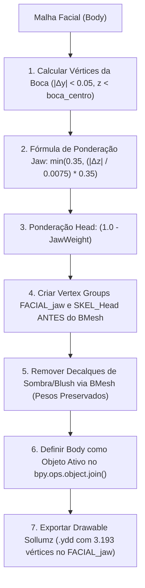

# GUIA MESTRE DEFINITIVO: Implantação de Avatares VRChat no GTA V
## Conversão, Rigging, Lip Sync, Texturas 2K e Deploy dos Três Protagonistas

---

### Resumo Executivo da Configuração

| Protagonista GTA V | Slot Ped | Avatar VRChat | Traje / Estilo | Pasta do Projeto |
| :--- | :--- | :--- | :--- | :--- |
| **Michael De Santa** | `player_zero` | **Shinano** | Eternal Reunion (Vestido Gótico / Maid de Luxo) | `2_Michael_Shinano_EternalReunion/` |
| **Franklin Clinton** | `player_one` | **Shinano** | Casual / Uniforme Escolar (Saia Vermelha, Cabelo Azul) | `1_Franklin_Shinano_Casual/` |
| **Trevor Philips** | `player_two` | **Miltina** | Maid Clássica (Vestido Longo Preto/Branco, Avental) | `3_Trevor_Miltina_Maid/` |

---

## 1. Estrutura de Diretórios Unificada (`E:\vrc2gtav` / `/mnt/e/vrc2gtav`)

Todo o projeto foi consolidado na pasta raiz **`vrc2gtav`**, estruturado de forma modular e independente de plataforma:

```text
vrc2gtav/
├── 1_Franklin_Shinano_Casual/
│   ├── 1_source/              # Referências dos FBX e texturas originais
│   ├── 2_blender/             # Script build_franklin_avatar.py, run_build.py, player_one.yft
│   ├── 3_textures_gtav/       # Script generate_franklin_atlas.py, shinano_franklin_2k.ytd
│   ├── 4_exported_models/     # Modelos compilados (uppr_008_u.ydd, xmls)
│   └── 5_rpf_package/         # Staging e arquivos prontos para o Franklin
│
├── 2_Michael_Shinano_EternalReunion/
│   ├── 1_source/              # Hierarquia do Unity, referências e texturas
│   ├── 2_blender/             # Script build_michael_er.py, run_build.py, player_zero.yft
│   ├── 3_textures_gtav/       # Script generate_er_atlas.py, shinano_michael_er_2k.ytd
│   ├── 4_exported_models/     # Modelos compilados (uppr_000_u.ydd, uppr_000_r.ydd, xmls)
│   └── 5_rpf_package/         # Script deploy_michael_er.py
│
├── 3_Trevor_Miltina_Maid/
│   ├── 1_source/              # Referências de blendshapes FaceEmo e texturas
│   ├── 2_blender/             # Script build_trevor_miltina.py, player_two.yft
│   ├── 3_textures_gtav/       # Script generate_miltina_atlas.py, miltina_maid.ytd
│   ├── 4_exported_models/     # Modelos compilados (uppr_000_u.ydd, uppr_000_r.ydd, xmls)
│   └── 5_rpf_package/         # Script apply_miltina_to_trevor.py
│
├── _deploy_tools/             # Ferramentas globais de deploy
│   ├── head_000_r.ydd         # O Dummy Mesh universal (629 bytes)
│   ├── apply_all_characters.py # Aplica os 3 personagens em todos os slots de uma vez
│   ├── repack_and_deploy_everything.py # Repacota RPFs e instala no GTA V
│   └── vrc2gtav_paths.py      # Resolução dinâmica de caminhos (Win/Linux)
│
└── scripts/                   # Central de scripts organizados por personagem
    ├── Shinano_Casual_Franklin/
    ├── Shinano_EternalReunion_Michael/
    ├── Miltina_Maid_Trevor/
    └── common_tools/
```

---

## 2. Compatibilidade Multiplataforma (Zero Hardcoded Paths)

Os scripts utilizam o módulo compartilhado [`vrc2gtav_paths.py`](file:///mnt/e/vrc2gtav/scripts/common_tools/vrc2gtav_paths.py) que resolve caminhos de forma dinâmica:

1. **Variáveis de Ambiente:** Podem ser sobrescritas a qualquer momento:
   - `VRC2GTAV_ROOT`: Caminho raiz do projeto (`E:/vrc2gtav` ou `/mnt/e/vrc2gtav`).
   - `VRC_ASSETS_DIR`: Caminho da pasta de assets do Unity (`waifuv4/Assets`).
   - `GTAV_MODS_DIR`: Pasta de mods do jogo (`D:/GTAV/mods` ou `/mnt/d/GTAV/mods`).
   - `RAGE_CLI`: Caminho do executável do `rage`.
   - `BLENDER_EXE`: Caminho do executável do `blender.exe`.
2. **Detecção Automática:** Caso as variáveis não estejam definidas, o sistema detecta se o script está rodando sob **Windows nativo** ou **Linux/WSL**, descobre a letra da unidade (`E:`, `D:`, `C:`) e utiliza `pathlib.Path` para garantir barras corretas em ambos os sistemas.

---

## 3. Arquitetura 3D no Blender e Rigging GTA V

### 3.1 Filtragem do Esqueleto (57 Ossos Essenciais)
Os esqueletos originais do GTA V (`player_zero.yft`, `player_one.yft`, `player_two.yft`) contêm dezenas de ossos auxiliares e de física de tecido que desestabilizam avatares estilizados de anime.
Cada personagem é filtrado estritamente para **57 ossos**:
- **Coluna e Tronco:** `SKEL_ROOT`, `SKEL_Pelvis`, `SKEL_Spine_Root`, `SKEL_Spine0`, `SKEL_Spine1`, `SKEL_Spine2`, `SKEL_Spine3`, `SKEL_Neck_1`, `SKEL_Head`.
- **Braços e Clavículas:** `SKEL_L_Clavicle`, `SKEL_L_UpperArm`, `SKEL_L_Forearm`, `SKEL_L_Hand` (e equivalentes `_R_`).
- **Pernas e Pés:** `SKEL_L_Thigh`, `SKEL_L_Calf`, `SKEL_L_Foot`, `SKEL_L_Toe0` (e equivalentes `_R_`).
- **Face / Lip Sync:** `FACIAL_facialRoot` (parentesco com `SKEL_Head`, tag 51105) e `FACIAL_jaw` (parentesco com `FACIAL_facialRoot`, tag 2849).

### 3.2 Correções Críticas de Rigging
1. **Dedos das Mãos:** Mapear os 15 ossos de dedos VRChat para dedos complexos de GTA V causa achatamento dos dedos durante animações de armas. Todos os dedos foram consolidados com peso 1.0 no osso da mão (`SKEL_L_Hand` / `SKEL_R_Hand`), mantendo a pose relaxada e natural perfeita.
2. **Marias-Chiquinhas e Cabelos Laterais (Twintails):** 
   - *Problema:* Algoritmos ingênuos que buscam `"tail"` no nome dos ossos atribuíam as marias-chiquinhas da Miltina (`twin tail1_R`, `Twin tail ribbon`) ao osso `SKEL_Pelvis` (cauda do vestido), fazendo o cabelo esticar até o quadril ao caminhar.
   - *Regra Estrita:*
     ```python
     if "twin" in low_name or "pony" in low_name or "twintail" in low_name:
         return "SKEL_Head"
     ```
3. **A-Pose (-55°):** Avatares de VRChat vêm em T-Pose rígida (braços a 90°). Para casar perfeitamente com a postura do GTA V, os braços são rotacionados em **-55° no eixo Y** em relação ao pivô dos ombros.

---

## 4. O Sistema de Lip Sync (Sincronia Labial de Anime)

Para que as personagens mexam a boca ao falar durante cutscenes, ligações telefônicas e falas em gameplay:



### Fórmula de Decaimento Vertical:
$$\text{peso}_{\text{jaw}} = \min\left(0.35, \frac{|\Delta z|}{0.0075} \times 0.35\right)$$
$$\text{peso}_{\text{head}} = 1.0 - \text{peso}_{\text{jaw}}$$

* **Por que o valor máximo é 0.35?** Aberturas ósseas no GTA V foram calibradas para humanos realistas com mandíbulas profundas. Um peso 1.0 em rostos estilizados de anime deforma e estica excessivamente a malha. O valor de 0.35 proporciona uma abertura suave, delicada e fidedigna aos animes.

---

## 5. Texturas e Dicionários .YTD (Padrão 2K e Hash JOAAT)

### 5.1 Limite Obrigatório de 2K (2048x2048)
- Texturas em 4K no GTA V provocam estouro de buffer de streaming de memória e crash do jogo após poucos minutos de gameplay.
- Todos os atlas foram formatados rigorosamente em **2048x2048 pixels**, comprimidos no formato **DXT5 (BC3)** com Mipmaps automáticos via `rage textures build`.

### 5.2 Regra Crítica do Hash JOAAT
A RAGE Engine localiza texturas dentro do arquivo `.ytd` usando o hash numérico Jenkins One-at-a-Time (**JOAAT**). Se os nomes das texturas forem ordenados alfabeticamente no XML da Sollumz, o lookup de ponteiros internos quebra e o modelo fica completamente **preto** ou com texturas trocadas.
- **Ordem Obrigatória de Inclusão no .YTD:**
  1. `miltina_atlas_2k` (ou `shinano_atlas_2k`) — Diffuse Map
  2. `miltina_spec` — Specular Map
  3. `miltina_normal` — Normal Map

---

## 6. Estratégia de Deploy: Universal Slot Replacement & Dummies

No GTA V, as roupas dos personagens são compostas por múltiplos slots:
- `uppr` (Tronco/Torso), `lowr` (Pernas), `feet` (Sapatos), `head` (Rosto), `hair` (Cabelo), `berd` (Barba), `hand` (Mãos), `teef` (Dentes), `accs` (Acessórios), `task` (Coletes/Armaduras), `jbib` (Jaquetas/Camisas internas).

Se apenas o slot `uppr_000` for substituído, qualquer mudança de roupa nas missões ou safehouses faz com que os braços, calças, sapatos e cabeças masculinas dos protagonistas apareçam e atravessem a waifu.

### A Solução Definitiva:
1. **Avatar Completo no Tronco (`uppr`):** O modelo compilado (`uppr_000_u.ydd`) contém o corpo inteiro (cabeça, cabelo, vestido, braços, pernas, sapatos). Esse modelo e seu `.ytd` são replicados em **todos os slots `uppr`** do personagem.
2. **Dummy Mesh de 629 Bytes:** Todas as outras partes humanas (`lowr`, `feet`, `head`, `hair`, `berd`, `hand`, `teef`, `accs`, `task`, `jbib`) são substituídas pelo arquivo [`head_000_r.ydd`](file:///mnt/e/vrc2gtav/_deploy_tools/head_000_r.ydd). Trata-se de uma malha vazia e invisível (1 triângulo degenerado). Nenhuma parte vanilla tem como aparecer.

---

## 7. Repacotamento RPF7 e Prevenção do `ERR_GEN_ZLIB_2`

O GTA V rejeita arquivos RPF modificados se não atenderem a duas condições fundamentais de baixo nível:

1. **Cabeçalho `b'OPEN'` (Offset 12):** Os primeiros 16 bytes de cada arquivo RPF contêm o Magic `b'7FPR'` e o indicador de criptografia no offset 12. Os RPFs modificados devem ter esse valor setado para `b'OPEN'` (0x4E45504F), instruindo a engine e o OpenIV a não tentarem decriptação RSA.
2. **Correção do TOC `f_size = 0`:** Quando uma ferramenta como o `rage` empacota um RPF dentro de outro RPF (ex: `mppatches.rpf` dentro de `dlc.rpf`), entradas binárias não comprimidas gravadas com tamanho comprimido diferente de zero ativam a exceção interna do zlib no executável do jogo, gerando a janela de erro fatal:
   $$\text{ERR\_GEN\_ZLIB\_2} \quad \text{("zlib call failed")}$$
   O script [`repack_and_deploy_everything.py`](file:///mnt/e/vrc2gtav/_deploy_tools/repack_and_deploy_everything.py) percorre a tabela de conteúdo (TOC) de cada RPF gerado e zera os bytes 2, 3 e 4 das entradas binárias, eliminando qualquer risco de travamento.

---

## 8. Como Executar (O Orquestrador Mestre Unificado)

Para facilitar a manutencao e evitar ter que rodar comandos manuais individuais, foi criado o script mestre [`run_mod_manager.py`](file:///mnt/e/vrc2gtav/run_mod_manager.py) (e o inicializador rápido [`EXECUTAR_GERENCIADOR.bat`](file:///mnt/e/vrc2gtav/EXECUTAR_GERENCIADOR.bat)).

### 8.1 Modo Interativo (Recomendado)
No Windows, dê um duplo clique em [`EXECUTAR_GERENCIADOR.bat`](file:///mnt/e/vrc2gtav/EXECUTAR_GERENCIADOR.bat), ou execute no terminal:
```bash
python run_mod_manager.py
```
O menu interativo será exibido:
```text
======================================================================
         GERENCIADOR DE AVATARES VRChat PARA GTA V
======================================================================
Selecione qual personagem voce deseja trocar/atualizar:
  [1] Michael (player_zero) -> Shinano Eternal Reunion
  [2] Franklin (player_one) -> Shinano Casual / Uniforme
  [3] Trevor   (player_two)  -> Miltina Maid
  [4] Todos os 3 Personagens (Processo Completo)
  [5] Apenas Repacotar e Instalar RPFs no GTA V (Deploy Only)
  [0] Sair
----------------------------------------------------------------------
```
Ao selecionar o personagem, o gerenciador pergunta quais etapas deseja executar (Geração de Texturas 2K, Compilação Blender, e Instalação/Deploy no jogo), permitindo atualizar apenas o que for necessário de forma rápida e segura.

### 8.2 Modo Linha de Comando (Automação / CLI)
Você também pode invocar o script diretamente com argumentos:
```bash
# Processar apenas o Trevor (Miltina Maid) por completo:
python run_mod_manager.py --character trevor

# Processar todos os 3 personagens de uma vez:
python run_mod_manager.py --character all

# Apenas repacotar os RPFs e instalar no GTA V:
python run_mod_manager.py --deploy-only

# Apenas verificar se todos os pre-requisitos (Blender, RAGE CLI, Python) estao OK:
python run_mod_manager.py --check-env
```

---

## 9. Execução Manual Passo a Passo (Referência Técnica)

Caso você queira rodar cada ferramenta de forma isolada sem o orquestrador:

### Passo 1: Gerar as Texturas e Atlas 2K
```bash
# Franklin (Shinano Casual)
python3 scripts/Shinano_Casual_Franklin/generate_franklin_atlas.py

# Michael (Shinano Eternal Reunion)
python3 scripts/Shinano_EternalReunion_Michael/generate_er_atlas.py

# Trevor (Miltina Maid)
python3 scripts/Miltina_Maid_Trevor/generate_miltina_atlas.py
```

### Passo 2: Compilar os Modelos 3D no Blender
```bash
# Franklin (player_one)
cmd.exe /c "E:\waifuv4\BlenderTools\blender-4.0.2-windows-x64\blender.exe -b -P E:\vrc2gtav\scripts\Shinano_Casual_Franklin\build_franklin_avatar.py"

# Michael (player_zero)
cmd.exe /c "E:\waifuv4\BlenderTools\blender-4.0.2-windows-x64\blender.exe -b -P E:\vrc2gtav\scripts\Shinano_EternalReunion_Michael\build_michael_er.py"

# Trevor (player_two)
cmd.exe /c "E:\waifuv4\BlenderTools\blender-4.0.2-windows-x64\blender.exe -b -P E:\vrc2gtav\scripts\Miltina_Maid_Trevor\build_trevor_miltina.py"
```

### Passo 3: Aplicar Personagens nos Diretórios de Staging
```bash
# Aplica um personagem especifico (player_zero, player_one ou player_two):
python3 scripts/common_tools/apply_characters.py --character player_two

# Ou aplica todos:
python3 scripts/common_tools/apply_characters.py --character all
```

### Passo 4: Repacotar RPFs e Instalar no Jogo
```bash
python3 scripts/common_tools/repack_and_deploy_everything.py
```

O script repacotará `mppatches.rpf`, `dlc.rpf`, `streamedpeds_players.rpf` e `x64v.rpf`, aplicará as assinaturas `OPEN` e corrigirá a tabela de conteúdo (TOC) para prevenir qualquer `ERR_GEN_ZLIB_2`.
