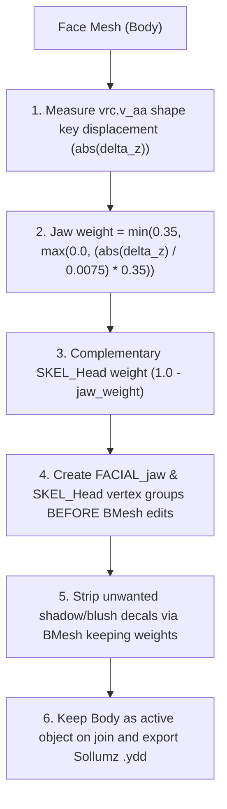

# MASTER DEPLOYMENT GUIDE: VRChat Avatars in GTA V
## 3D Conversion, Rigging, Articulated Hands, Lip Sync, 2K Textures, First-Run & Protagonist Deployment

**Language / Idioma / 言語:** **Master Guide (EN)** | [Guia Mestre (PT-BR)](GUIA_MESTRE_IMPLANTACAO_AVATARES_GTAV.md) | [README (EN)](README.md) | [README (PT-BR)](README.pt-BR.md) | [README (日本語)](README.ja.md)

---

### Executive Configuration Summary

| GTA V Protagonist | In-Game Ped ID | VRChat Avatar | Outfit / Style | Character Folder |
| :--- | :--- | :--- | :--- | :--- |
| **Michael De Santa** | `player_zero` | **Shinano** | Eternal Reunion (Gothic Dress + Pocket Watch) | `2_Michael_Shinano_EternalReunion/` |
| **Franklin Clinton** | `player_one` | **Shinano** | Casual / School Uniform (Red Skirt, Blue Hair) | `1_Franklin_Shinano_Casual/` |
| **Trevor Philips** | `player_two` | **Miltina** | Classic Maid (Black/White Long Dress, Apron) | `3_Trevor_Miltina_Maid/` |

---

## 1. Unified Directory Layout & Copyright Policy (First-Run)

The repository uses a modular structure separating version-controlled automation scripts from Rockstar Games base game files and locally generated build artifacts:

```text
vrc2gtav/
├── RUN_MANAGER.bat                                  # Windows launcher with system locale detection
├── EXECUTAR_GERENCIADOR.bat                         # Portuguese-named launcher mirror
├── run_mod_manager.py                               # Master orchestrator (interactive menu + CLI)
├── vrc2gtav.cfg.example                             # Versioned INI configuration template
├── README.md / README.pt-BR.md / README.ja.md       # Trilingual project documentation
├── MASTER_DEPLOYMENT_GUIDE.md                       # This technical guide in English
├── GUIA_MESTRE_IMPLANTACAO_AVATARES_GTAV.md         # Matching technical guide in Portuguese
│
├── _deploy_tools/                                   # Runtime mirror & empty dummy drawables
│   ├── head_000_r.ydd                               # 629-byte invisible dummy body mesh
│   ├── p_eyes_dummy.ydd                             # Invisible rigid prop dummy (p_eyes_* slots)
│   ├── setup_first_run.py                           # First-Run wizard (config + RPF extraction)
│   ├── repack_and_deploy_everything.py              # RPF7 repacker + TOC patcher + installer
│   └── ...                                          # Mirrors of unity_scene_helper, texture_calibration_helper, hand_skeleton_helper, i18n, paths, apply_*
│
├── scripts/                                         # Canonical Python source tree (English + i18n)
│   ├── common_tools/                                # Shared helpers, manager, and test suite
│   ├── Shinano_Casual_Franklin/                     # Franklin texture & Blender build pipeline
│   ├── Shinano_EternalReunion_Michael/              # Michael texture, Blender build & deploy pipeline
│   └── Miltina_Maid_Trevor/                         # Trevor texture, Blender build & staging pipeline
│
├── 1_Franklin_Shinano_Casual/                       # Execution mirrors & local outputs (gitignored)
├── 2_Michael_Shinano_EternalReunion/                # Execution mirrors & local outputs (gitignored)
└── 3_Trevor_Miltina_Maid/                           # Execution mirrors & local outputs (gitignored)
```

### Copyright Separation & `.gitignore` Policy
No copyrighted GTA V game files or local render screenshots are tracked in Git. Folders such as `staging/`, `renders/`, `backups/`, `vrc2gtav.cfg`, as well as `.yft`, `.ytd`, `.dds`, `.ydd.xml`, `.backup_*`, and compiled `.ydd` files are gitignored and built locally from the user's own legal installation during **First-Run**.

The only `.ydd` files stored under `_deploy_tools/` are the two minimal scratch-built dummy meshes:
- [`_deploy_tools/head_000_r.ydd`](_deploy_tools/head_000_r.ydd) — 629-byte empty invisible body dummy.
- [`_deploy_tools/p_eyes_dummy.ydd`](_deploy_tools/p_eyes_dummy.ydd) — empty rigid prop dummy used to suppress vanilla sunglasses/glasses (`p_eyes_*`).

---

## 2. Cross-Platform `.cfg` Configuration & Trilingual Support (`en` / `ja` / `pt`)

### 2.1 `vrc2gtav.cfg` and Path Resolution
Paths are never hardcoded in scripts. [`scripts/common_tools/vrc2gtav_paths.py`](scripts/common_tools/vrc2gtav_paths.py) resolves locations in the following precedence order:

1. **CLI flags (`--gtav-root`, `--unity-assets`, `--blender`, `--rage`).**
2. **Environment variables:** `VRC2GTAV_ROOT`, `VRC_ASSETS_DIR`, `GTAV_MODS_DIR`, `RAGE_CLI`, `BLENDER_EXE`, `VRC2GTAV_LANG`.
3. **Local `vrc2gtav.cfg` file:** initialized from [`vrc2gtav.cfg.example`](vrc2gtav.cfg.example) during First-Run (`setup_first_run.py`).
4. **Cross-platform auto-detection:** detects native **Windows** vs. **Linux / WSL** execution and converts drive-letter paths (e.g., `D:/GTAV` ↔ `/mnt/d/GTAV`) via `pathlib.Path`.
5. **Unit `1.0` default scales & `.unity` extraction (`unity_scene_helper.py`):** Clean repository defaults (`unity_scene =` blank) keep all avatar body, head, bone, and prop scales at `1.0`. Setting `unity_scene` (and optional `unity_avatar_name`) under `[franklin]`, `[michael]`, or `[trevor]` extracts customized `Transform` / `PrefabInstance` scales (canceling `PhysBone`/Marshmallow scale wrappers) and height-normalizes bones before arm/hand retargeting.
6. **Default hair & texture fallback (`texture_calibration_helper.py`):** Blank or missing `fbx_hair` (*Neko Tied Bob hair*) or optional eye/makeup packs automatically fall back to the base avatar's built-in hair (`Hair_*` / `Shinano_hair.png` for Shinano, `Milltina_hair_*` / calibrated `Milltina_Hair.png` for Miltina) and base face texture (`Shinano_face.png`, `Milltina_Face.png`). Custom `fbx_hair` is also supported on Miltina.

### 2.2 Trilingual Localization (`en` / `ja` / `pt`)
[`scripts/common_tools/vrc2gtav_i18n.py`](scripts/common_tools/vrc2gtav_i18n.py) provides full runtime translations in **English (`en`)**, **Japanese (`ja`)**, and **Portuguese (`pt`)**:
- **Auto-detection order:** `--lang` flag → `VRC2GTAV_LANG` environment variable → `[general] language` in `vrc2gtav.cfg` → OS locale (falling back to `en`).
- **Windows launchers:** [`RUN_MANAGER.bat`](RUN_MANAGER.bat) and [`EXECUTAR_GERENCIADOR.bat`](EXECUTAR_GERENCIADOR.bat) inspect `VRC2GTAV_LANG` or `HKCU\Control Panel\International\LocaleName` with `chcp 65001`, printing localized prompts before launching Python.
- **Blender invocations:** custom arguments must follow Blender's `--` delimiter: `blender -b -P <script.py> -- --lang ja`.

---

## 3. Blender 3D Architecture & GTA V Rigging

### 3.1 Core Skeleton, Arms & Full Articulated Finger Bones
Vanilla protagonist `.yft` skeletons contain dozens of helper/cloth bones that destabilize stylized anime meshes. Each build retains the canonical humanoid core (`SKEL_ROOT`, `SKEL_Pelvis`, `SKEL_Spine_Root`, `SKEL_Spine0`..`SKEL_Spine3`, `SKEL_Neck_1`, `SKEL_Head`, legs, feet, `FACIAL_facialRoot`, `FACIAL_jaw`) combined with the articulated hand/arm system implemented in [`scripts/common_tools/hand_skeleton_helper.py`](scripts/common_tools/hand_skeleton_helper.py):

- **30 1:1 finger bones:** `SKEL_L_Finger00` through `SKEL_L_Finger42` and `SKEL_R_Finger00` through `SKEL_R_Finger42` (`GTAV_FINGER_BONE_NAMES`).
- **8 arm & wrist helper bones:** `RB_L_ArmRoll`, `RB_R_ArmRoll`, `RB_L_ForeArmRoll`, `RB_R_ForeArmRoll`, `PH_L_Hand`, `PH_R_Hand`, `IK_L_Hand`, `IK_R_Hand` (`EXTRA_ARM_HELPER_BONES`).
- **Rest-pose relocation & `.yft` bind-pose patching:**
  1. `extract_avatar_arm_hand_targets` reads exact shoulder, elbow, wrist, and all 30 finger joint positions from the VRChat avatar.
  2. `relocate_blender_armature_bones` moves the GTA V armature bones in Blender to match the anime proportions so fingers open and close naturally in cutscenes, driving, and weapon-grip animations.
  3. `patch_yft_skeleton` updates the `.yft` bind matrices (`player_zero.yft`, `player_one.yft`, `player_two.yft`) exported alongside the `.ydd`.

### 3.2 Critical Rigging & Geometry Fixes
1. **Twintail & sidelock bone rule:** bones containing `twin`, `pony`, or `twintail` map strictly to `SKEL_Head` so naive `"tail"` matching does not bind hair to `SKEL_Pelvis`.
2. **T-Pose to A-Pose (-55°):** VRChat arms are rotated downward into GTA V's native A-Pose before weight transfer and bone relocation.
3. **RAGE `uint16` vertex split (`split_oversized_material_geometries`):** meshes exceeding `30000` vertices per chunk are split to stay within RAGE index limits, and `lod_dist_high` is set to `9998.0`.
4. **Michael Eternal Reunion — Hip Heart, Skirt Weights & Pocket Watch ([`build_michael_er.py`](scripts/Shinano_EternalReunion_Michael/build_michael_er.py)):**
   - Waist/hip skirt and heart ornament weights (which previously detached or drifted during leg movement) are balanced across `SKEL_Pelvis`, `SKEL_L_Thigh`, and `SKEL_R_Thigh`, clamped to GTA V's 4-bone influence limit per vertex.
   - `Pocket Watch` aligns precisely to `Pocket Watch_Root`, applies its corrective blendshape, and maps UVs into its dedicated tile of the 4×2 atlas ([`generate_er_atlas.py`](scripts/Shinano_EternalReunion_Michael/generate_er_atlas.py)) so it renders fully textured.

---

## 4. Anime Lip Sync System (`FACIAL_jaw`)

To animate mouths cleanly during cutscenes, dialogue, and phone calls, all three character builders compute `FACIAL_jaw` weights from the `vrc.v_aa` facial shape key displacement on `Body`:



### Vertical Decay Formula
$$\text{weight}_{\text{jaw}} = \min\left(0.35, \max\left(0.0, \frac{|\Delta z|}{0.0075} \times 0.35\right)\right)$$
$$\text{weight}_{\text{head}} = 1.0 - \text{weight}_{\text{jaw}}$$

- **Why clamp at `0.35`?** GTA V jaw rotations assume realistic human jaw depth; a full `1.0` weight overstretches compact anime faces. Capping at `0.35` produces clean, anime-accurate mouth articulation.

---

## 5. Textures & `.ytd` Dictionaries (2K Standard & JOAAT Order)

### 5.1 2K (2048×2048) Atlas & DXT5 Compression
- All atlas generators ([`generate_franklin_atlas.py`](scripts/Shinano_Casual_Franklin/generate_franklin_atlas.py), [`generate_er_atlas.py`](scripts/Shinano_EternalReunion_Michael/generate_er_atlas.py), [`generate_miltina_atlas.py`](scripts/Miltina_Maid_Trevor/generate_miltina_atlas.py)) output **2048×2048** textures compressed as **DXT5 (BC3)** with mipmaps via `rage`.
- Michael (*Eternal Reunion*) packs all outfit variations UN1–UN3 plus the Pocket Watch tile UN4, metallic golds, buckles, and lenses into a **4×2 texture atlas**.
- Compiled meshes bind `ped_default.sps` with `DiffuseSampler`, `BumpSampler`, and `SpecSampler`.

### 5.2 JOAAT Texture Order Stability
The RAGE Engine looks up `.ytd` textures using Jenkins One-at-a-Time (**JOAAT**) hashes. Reordering textures or mismatching shader/dictionary names causes pitch-black rendering or swapped maps. Each atlas script and Blender builder keeps diffuse, specular, and normal maps synchronized in deterministic order.

---

## 6. Deployment Strategy: Universal Slot Replacement & Dummies

GTA V protagonist outfits span multiple component slots (`uppr`, `lowr`, `feet`, `head`, `hair`, `berd`, `hand`, `teef`, `accs`, `task`, `jbib`) plus facial props (`p_eyes_*`). Replacing only `uppr_000` allows original male limbs, clothing, or glasses to clip back in during missions or cutscenes.

### How Universal Replacement Solves This:
1. **Full Avatar in `uppr`:** [`scripts/common_tools/apply_characters.py`](scripts/common_tools/apply_characters.py) replicates the compiled full-body `.ydd`, `.ytd`, and `.yft` across all target `uppr` slots in staging.
2. **Body Dummy ([`_deploy_tools/head_000_r.ydd`](_deploy_tools/head_000_r.ydd)):** every remaining humanoid slot (`lowr`, `feet`, `head`, `hair`, `berd`, `hand`, `teef`, `accs`, `task`, `jbib`) is replaced with the 629-byte invisible dummy drawable.
3. **Glasses / Eye Prop Dummy ([`_deploy_tools/p_eyes_dummy.ydd`](_deploy_tools/p_eyes_dummy.ydd)):** all 35 `p_eyes_*.ydd` prop entries in `streamedpedprops.rpf` / `x64v_modded.rpf` are replaced with the empty rigid prop dummy so vanilla sunglasses never poke through character eyes.

---

## 7. RPF7 Repacking & Preventing `ERR_GEN_ZLIB_2`

[`scripts/common_tools/repack_and_deploy_everything.py`](scripts/common_tools/repack_and_deploy_everything.py) repacks `mppatches.rpf`, `mppatchesng_dlc.rpf`, `streamedpeds_players.rpf`, `streamedpedprops.rpf`, and `x64v_modded.rpf` with live terminal progress bars and two mandatory low-level binary fixes:

1. **`b'OPEN'` Header Flag (Offset 12):** after verifying `b'7FPR'` magic, sets offset 12 to `b'OPEN'` so the RAGE Engine loads unencrypted custom RPFs.
2. **TOC `f_size` Zeroing (16 bytes per TOC entry):** uncompressed nested binary entries written by CLI tools with non-zero compressed-size fields trigger **`ERR_GEN_ZLIB_2`** at game runtime. The repacker walks the TOC and zeroes the compressed-size bytes for uncompressed binary entries.

---

## 8. Running the Pipeline (First-Run, Manager & Tests)

### 8.1 First-Run Setup (Required on a Fresh Clone)
Before building textures or repacking RPFs:

```bash
python scripts/common_tools/setup_first_run.py
# Or through the master orchestrator:
python run_mod_manager.py --setup
```

This wizard initializes `vrc2gtav.cfg` from [`vrc2gtav.cfg.example`](vrc2gtav.cfg.example), validates `GTA5.exe`, Unity `Assets`, `blender`, and `rage`, and extracts the user's vanilla GTA V RPFs into local `staging/`. Add `--check-only` to inspect prerequisites without writing files, or `--lang en|ja|pt` to override language.

### 8.2 Interactive Manager & CLI Modes
On Windows, double-click [`RUN_MANAGER.bat`](RUN_MANAGER.bat) (or [`EXECUTAR_GERENCIADOR.bat`](EXECUTAR_GERENCIADOR.bat)), or run via terminal:

```bash
# Launch interactive menu:
python run_mod_manager.py

# Build and deploy all three characters into GTA V mods/:
python run_mod_manager.py --character all

# Build a single character (michael, franklin, or trevor) in English:
python run_mod_manager.py --character michael --lang en

# Skip texture & Blender stages and run deployment + RPF repack only:
python run_mod_manager.py --deploy-only

# Verify system prerequisites only:
python run_mod_manager.py --check-env
```

### 8.3 Automated Validation Suite
[`scripts/common_tools/test_mod_suite.py`](scripts/common_tools/test_mod_suite.py) validates both source invariants and compiled game outputs:

```bash
# Full suite (8 checks; requires First-Run, build, and deploy):
python scripts/common_tools/test_mod_suite.py --lang en

# Source-only suite (5 checks; runs on a fresh clone prior to First-Run):
python scripts/common_tools/test_mod_suite.py --source-only --lang en
```

---

## 9. Manual Step-by-Step Reference

```bash
# Step 1: Generate 2K texture atlases (.dds and .ytd)
python scripts/Shinano_Casual_Franklin/generate_franklin_atlas.py
python scripts/Shinano_EternalReunion_Michael/generate_er_atlas.py
python scripts/Miltina_Maid_Trevor/generate_miltina_atlas.py

# Step 2: Compile 3D models in Blender + Sollumz
python scripts/Shinano_Casual_Franklin/run_build_franklin.py
python scripts/Shinano_EternalReunion_Michael/run_build_er.py
python scripts/Miltina_Maid_Trevor/run_pipeline.py

# Step 3: Populate staging slots (single protagonist or all three)
python scripts/common_tools/apply_characters.py --character player_zero
python scripts/common_tools/apply_all_characters.py

# Step 4: Repack RPFs (OPEN header + TOC fix) and install into mods/
python scripts/common_tools/repack_and_deploy_everything.py
```

---

## 10. Assets & Tools Credits

This repository contains **only Python automation scripts, launchers, documentation, and minimal empty dummy meshes**. All 3D character models, outfits, hair, eye textures, and expression presets belong to their respective creators and **are not bundled here**; obtain each asset from its official storefront below:

### 10.1 Avatars, Outfits, Hair & Eye Textures

| Category | Asset Name | Creator / Shop | Used On | Official Link |
| :--- | :--- | :--- | :--- | :--- |
| **Base Avatar & Casual Outfit** | オリジナル3Dモデル「しなの」 (*Shinano*) | ポンデロニウム研究所 (`ponderogen`) | Michael, Franklin | [BOOTH](https://ponderogen.booth.pm/items/6106863) / [Shop](https://ponderogen.booth.pm/) |
| **Base Avatar & Maid Outfit** | オリジナル3Dモデル『ミルティナ』 (*Milltina*) | DOLOS art (`dolosart`) | Trevor | [BOOTH](https://dolosart.booth.pm/items/6538026) / [Shop](https://dolosart.booth.pm/) |
| **Dress, Shoes & Accessories** | 【15アバター対応】エターナル・リユニオン【MA対応】 (*Eternal Reunion* + *Pocket Watch*) | VAGRANT (`Vagrant Brand`) | Michael | [BOOTH](https://vagrant.booth.pm/items/5634313) / [Shop](https://vagrant.booth.pm/) |
| **Hair, Cat Ears, Clips & Halo** | ねこタイドボブヘア (*Neko Tied Bob hair*) | Li-ne (`Li-ne_Shop`) | Michael | [BOOTH](https://li-ne.booth.pm/items/7977491) / [Shop](https://li-ne.booth.pm/) |
| **Eye Texture (Shinano)** | `[eye17アバター対応]MoonButterfly eye & Rurune Make` | ha-oa | Michael, Franklin | [BOOTH](https://ha-oa.booth.pm/items/8483652) / [Shop](https://ha-oa.booth.pm/) |
| **Eye Texture (Milltina)** | お魚が泳ぐ あわあわ水光 Eye Texture【10Color】【23Avatar】 (`Milltina_AWEyes`) | NAGIMA (`nagikawamart`) | Trevor | [BOOTH](https://nagikawamart.booth.pm/items/6837271) / [Shop](https://nagikawamart.booth.pm/) |

### 10.2 Tools, Shaders & Open-Source Utilities

| Tool / Project | Author / Maintainer | Pipeline Role | Official Link |
| :--- | :--- | :--- | :--- |
| **lilToon** (v2.4.1) | `lilxyzw` | Layer/mask reference for 2K atlas baking | [GitHub](https://github.com/lilxyzw/lilToon) / [Docs](https://lilxyzw.github.io/lilToon/) |
| **FaceEmo** (v1.7.0) | `suzuryg` | Facial `.anim` authoring (`ShinanoDefAdultNewv5.anim`, `Miltina_close eyes_Base_adult.anim`) | [GitHub](https://github.com/suzuryg/face-emo) / [Docs](https://suzuryg.github.io/face-emo/) |
| **Modular Avatar** (v1.18.7) | `bd_` (Nadena) | Non-destructive Unity outfit/hair assembly (`waifuv4`) | [GitHub](https://github.com/bdunderscore/modular-avatar) / [Site](https://modular-avatar.nadena.dev/) |
| **Blender** (4.0.2) | Blender Foundation | Rigging, weight transfer, blendshapes, and verification renders | [Official Site](https://www.blender.org/) |
| **Sollumz** (v2.9.0) | `Skylumz`, `Colton`, `alexguirre` | Blender add-on for GTA V `.ydd` / `.yft` / XML import & export | [GitHub](https://github.com/Sollumz/Sollumz) / [Docs](https://docs.sollumz.org/) |
| **rage-cli** (`rage` 0.28.1) | `VIRUXE` | `.rpf` extraction/repacking, `.ytd` builds, and RAGE renders | [GitHub](https://github.com/VIRUXE/rage-cli) |
| **RageOpenV** | `Chiheb-Bacha` | `.asi` plugin loading RPF archives from `mods/` in GTA V | [GitHub](https://github.com/Chiheb-Bacha/RageOpenV) |
| **Ultimate ASI Loader** | `ThirteenAG` | Proxy DLL (`dinput8.dll`) for loading `.asi` mods | [GitHub](https://github.com/ThirteenAG/Ultimate-ASI-Loader) |
