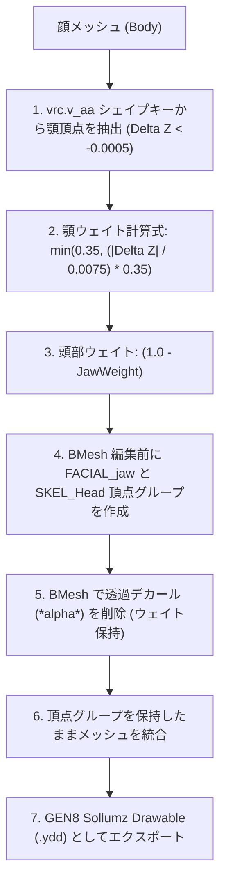

**言語 / Language / Idioma:** [English](README.md) | [Português (BR)](README.pt-BR.md) | **日本語**

# 完全マスターガイド: VRChat アバターを GTA V Legacy に導入する方法

## 3人の主人公 (Michael / Franklin / Trevor) の 3D 変換・リギング・リップシンク・2K テクスチャ・多言語対応・展開

> 関連ドキュメント: [Master Deployment Guide (English)](MASTER_DEPLOYMENT_GUIDE.md) | [Guia Mestre Técnico (Português)](GUIA_MESTRE_IMPLANTACAO_AVATARES_GTAV.md)

---

### 構成概要

| GTA V 主人公 | Ped スロット | VRChat アバター | 衣装・スタイル | プロジェクトフォルダ |
| :--- | :--- | :--- | :--- | :--- |
| **Michael De Santa** | `player_zero` | **Shinano** | Eternal Reunion (ゴシックドレス / 懐中時計 + 猫耳ボブヘア) | `2_Michael_Shinano_EternalReunion/` |
| **Franklin Clinton** | `player_one` | **Shinano** | カジュアル / 制服風 (赤スカート、青染めヘア) | `1_Franklin_Shinano_Casual/` |
| **Trevor Philips** | `player_two` | **Miltina** | クラシックメイド (黒白ロングドレス、エプロン、ツインテール) | `3_Trevor_Miltina_Maid/` |

> **クレジット:** クリエイター名・公式 BOOTH リンク・ベースアバター・衣装・ヘアー・アイテクスチャ・使用ツールの一覧は [第10章 — 使用アセット・ツールクレジット](#10-使用アセットツールクレジット) をご覧ください。

---

## 1. 統合ディレクトリ構成 (`vrc2gtav`)

プロジェクト全体はプラットフォーム非依存のモジュール構造で管理されています:

```text
vrc2gtav/
├── 1_Franklin_Shinano_Casual/
│   ├── 1_source/              # FBX・テクスチャ参照ドキュメント
│   ├── 2_blender/             # build_franklin_avatar.py, run_build.py, player_one.yft (セットアップ後)
│   ├── 3_textures_gtav/       # generate_franklin_atlas.py, shinano_franklin_2k.ytd (ビルド後)
│   ├── 4_exported_models/     # コンパイル済みモデル (.ydd/.xml ビルド後)
│   └── 5_rpf_package/         # Franklin 用ステージング
│
├── 2_Michael_Shinano_EternalReunion/
│   ├── 1_source/              # Unity シーン階層・参照情報
│   ├── 2_blender/             # build_michael_er.py, run_build.py, player_zero.yft (セットアップ後)
│   ├── 3_textures_gtav/       # generate_er_atlas.py, test_er.ytd (ビルド後)
│   ├── 4_exported_models/     # コンパイル済みモデル (.ydd/.xml ビルド後)
│   └── 5_rpf_package/         # deploy_michael_er.py
│
├── 3_Trevor_Miltina_Maid/
│   ├── 1_source/              # FaceEmo ブレンドシェイプ・テクスチャ参照情報
│   ├── 2_blender/             # build_trevor_miltina.py, run_pipeline.py, player_two.yft (セットアップ後)
│   ├── 3_textures_gtav/       # generate_miltina_atlas.py, miltina_maid.ytd (ビルド後)
│   ├── 4_exported_models/     # コンパイル済みモデル (.ydd/.xml ビルド後)
│   └── 5_rpf_package/         # apply_miltina_to_trevor.py
│
├── _deploy_tools/             # 共通デプロイツール (scripts/common_tools とミラー同期)
│   ├── head_000_r.ydd         # ボディ用ユニバーサルダミーメッシュ (629 バイト)
│   ├── p_eyes_dummy.ydd       # 眼鏡非表示用スケルトンなしダミーメッシュ (515 バイト)
│   ├── apply_characters.py    # キャラクターモデルをステージングへ適用
│   ├── apply_all_characters.py# 3キャラクター一括適用ラッパー
│   ├── hand_skeleton_helper.py# 腕・手・30本の指ボーン 1:1 再配置ヘルパー
│   ├── repack_and_deploy_everything.py # 進捗バー付き RPF 再パック & GTA V 導入
│   ├── run_mod_manager.py     # マスターマネージャーのミラーコピー
│   ├── setup_first_run.py     # 初回セットアップウィザード (vrc2gtav.cfg 作成 & バニラ展開)
│   ├── texture_calibration_helper.py # シェーダー補正済みデフォルト髪・瞳フォールバック合成ヘルパー
│   ├── unity_scene_helper.py  # .unity シーンスケール抽出 & デフォルト/カスタムヘアー解決ヘルパー
│   ├── vrc2gtav_i18n.py       # システムロケール対応 3か国語エンジン (en / ja / pt)
│   └── vrc2gtav_paths.py      # vrc2gtav.cfg リーダー + Windows/WSL パス自動変換
│
├── RUN_MANAGER.bat            # Windows 用マルチリンガル起動バッチ
├── EXECUTAR_GERENCIADOR.bat   # Windows 用起動バッチ (ポルトガル語エイリアス)
├── run_mod_manager.py         # ルートのマスターオーケストレーター
├── vrc2gtav.cfg.example       # ポータブルパス・言語設定テンプレート (初回実行時にコピー)
│
└── scripts/                   # キャラクター別ソーススクリプト群
    ├── Shinano_Casual_Franklin/
    ├── Shinano_EternalReunion_Michael/
    ├── Miltina_Maid_Trevor/
    └── common_tools/          # 共通ツール + 自動検証スイート test_mod_suite.py
```

> **著作権および初回セットアップに関する注意:** このリポジトリにはツールのソースコード、ドキュメント、テンプレート [`vrc2gtav.cfg.example`](vrc2gtav.cfg.example)、および技術用の空ダミーメッシュ 2点 (`head_000_r.ydd` と `p_eyes_dummy.ydd`) のみが含まれています。**GTA V のゲーム本体ファイル** (`.rpf`, `.yft`, Rockstar 製モデル/テクスチャ) **および有料の VRChat/BOOTH アセット** (`.fbx`, `.anim`, 元テクスチャ, コンパイル済み `.ydd`/`.ytd`) **は一切配布していません**。初回実行時に正規購入した GTA V とアバター素材のパスを指定すると、ウィザードが `staging/` と `*/2_blender/` へベース RPF とバニラスケルトンを自動展開します。

---

## 2. 一元設定 (`vrc2gtav.cfg`)・多言語自動切替・First-Run セットアップ

すべてのローカルパスは Git 除外設定の `vrc2gtav.cfg` に一元管理されます（初回実行時に [`vrc2gtav.cfg.example`](vrc2gtav.cfg.example) から自動生成）。

[`vrc2gtav_paths.py`](scripts/common_tools/vrc2gtav_paths.py) は `vrc2gtav.cfg` (または環境変数 `VRC2GTAV_CFG`) を読み込み、Windows 形式 (`E:/...`, `D:/...`) と Linux/WSL 形式 (`/mnt/e/...`, `/mnt/d/...`) を自動変換します。

### 3か国語自動対応 (`en` / `ja` / `pt`)

すべての Python スクリプトと Windows `.bat` ランチャーは OS のシステムロケールを検出し、英語 (`en`)・日本語 (`ja`)・ポルトガル語 (`pt`) の表示を自動で切り替えます:

- **優先順位:** コマンドライン引数 `--lang {en,ja,pt,auto}` -> 環境変数 `VRC2GTAV_LANG` -> `vrc2gtav.cfg` の `[general] language` -> OS ロケール (Windows UI 言語 / POSIX `LC_ALL`, `LANG`) -> 英語 (`en`) フォールバック。
- **WSL -> Windows Blender 連携:** WSL 上から `build_blender_command()` で Windows 版 `blender.exe` を起動する際、`VRC2GTAV_LANG` と `VRC2GTAV_CFG` が `WSLENV` 経由で自動引き継ぎされます。

### 初回セットアップ (First-Run)

1. **自動セットアップ:** `RUN_MANAGER.bat`、`python run_mod_manager.py`、または `python run_mod_manager.py --setup` を実行すると、`vrc2gtav.cfg` や `staging/` の未展開を自動検出します:
   - `vrc2gtav.cfg.example` を `vrc2gtav.cfg` にコピーし、`gtav_root` (`GTA5.exe` を含むフォルダ)、購入済みアバターを含む Unity `Assets` フォルダ、`blender` (Sollumz 導入済み)、`rage` ([VIRUXE/rage](https://github.com/VIRUXE/rage)) のパスを検出または対話入力で設定します。
   - NG 暗号化キーの抽出 (`rage extract-keys`) と、`x64v.rpf`、`streamedpeds_players.rpf`、`streamedpedprops.rpf`、`mppatchesng/dlc.rpf` (`mppatches.rpf`)、`patchday4ng/dlc.rpf` の展開を `staging/` へ自動実行します。
   - ベーススケルトン (`player_zero.yft`, `player_one.yft`, `player_two.yft`) を `*/2_blender/` と `staging/backup_vanilla_skeletons/` に配置します。
2. **ドライブ・フォルダ移動時:** `vrc2gtav.cfg` の `[directories]`、`[executables]`、`[rpf_paths]`、`[franklin]`、`[michael]`、`[trevor]` セクションのみを編集すればよく、`.py` スクリプトの書き換えは不要です。
3. **オプションの環境変数:** `VRC2GTAV_LANG`、`VRC2GTAV_CFG`、`VRC2GTAV_ROOT`、`VRC_ASSETS_DIR`、`GTAV_MODS_DIR`、`RAGE_CLI`、`BLENDER_EXE`。

### デフォルト等倍スケール (`1.0`) と `.unity` シーンからの体型スケール自動抽出

- **初期状態の標準比率 (`1.0`):** GitHub のクリーン構成（`vrc2gtav.cfg.example` で `unity_scene =` 空欄）では、身体・頭部・ボーン・小物のスケールはすべてハードコードなしの標準 `1.0` に保たれます。
- **`.unity` シーン解析によるカスタマイズ反映:** `vrc2gtav.cfg` の `[franklin]`、`[michael]`、`[trevor]` に `unity_scene`（および必要に応じて `unity_avatar_name`）を指定すると、[`unity_scene_helper.py`](scripts/common_tools/unity_scene_helper.py) が `.unity` YAML 内の `GameObject`、`Transform`、`PrefabInstance` 上書き値、および `PhysBone` / Marshmallow スケール打ち消しを自動解析して GTA V モデルへ正確に反映します。

### デフォルトヘアー & 瞳/メイクテクスチャの自動フォールバック

- **Shinano (Franklin / Michael) および Miltina (Trevor):** カスタムヘアー (`fbx_hair`、例: *ねこタイドボブヘア*) やオプションの瞳・メイクパック (*MoonButterfly eye*, *AWEyes*) が未設定またはディスク上に存在しない場合でも、[`unity_scene_helper.py`](scripts/common_tools/unity_scene_helper.py) と [`texture_calibration_helper.py`](scripts/common_tools/texture_calibration_helper.py) がエラーを出さずにベースアバター標準のデフォルトヘアー (`Hair_base` / `Hair_bang` / `Hair_back` / `Hair_side` / `Other_ear` + `Shinano_hair.png`、`Milltina_hair_*` + 補正済み `Milltina_Hair.png`) と基本顔テクスチャへ自動フォールバックします。
- **両アバターでのカスタムヘアー対応:** `vrc2gtav.cfg` で `fbx_hair`（および任意のテクスチャ）を指定すれば、**Shinano**・**Miltina** の両方でカスタムヘアーへシームレスに切り替えられます。

---

## 3. Blender 3D 変換パイプライン & GTA V リギング設計

### 3.1 スケルトンフィルタリング (必須ボーン + 指30本)

GTA V の純正スケルトン (`player_zero.yft`, `player_one.yft`, `player_two.yft`) にはアニメ調アバターの姿勢を崩す補助・揺れ物ボーンが多数含まれています。各ビルドでは必須の体幹・四肢ボーンと [`hand_skeleton_helper.py`](scripts/common_tools/hand_skeleton_helper.py) が管理する指ボーンのみに整理します:

- **脊椎・胴体:** `SKEL_ROOT`, `SKEL_Pelvis`, `SKEL_Spine_Root`, `SKEL_Spine0`, `SKEL_Spine1`, `SKEL_Spine2`, `SKEL_Spine3`, `SKEL_Neck_1`, `SKEL_Head`
- **腕・鎖骨・手・指:** `SKEL_L_Clavicle`, `SKEL_L_UpperArm`, `SKEL_L_Forearm`, `SKEL_L_Hand`, 左手15本 `SKEL_L_Finger00`..`SKEL_L_Finger42` (および右側 `_R_`)
- **脚・足:** `SKEL_L_Thigh`, `SKEL_L_Calf`, `SKEL_L_Foot`, `SKEL_L_Toe0` (および右側 `_R_`)
- **表情・リップシンク:** `FACIAL_facialRoot` (`SKEL_Head` の子) および `FACIAL_jaw` (`FACIAL_facialRoot` の子)

### 3.2 重要なリギング補正

1. **手と指の 1:1 再配置 (`hand_skeleton_helper.py`):** VRChat の30本の指ボーン (`Thumb`, `Index`, `Middle`, `Ring`, `Little` 左右) を GTA V の `SKEL_L/R_Finger00..42` へ 1:1 対応させ、`.yft` スケルトンの関節座標もアバター実寸に合わせて再配置することで、RAGE アニメーション内で指の開閉が自然に行えます。
2. **ツインテール・サイドヘアー:**
   - *課題:* `"tail"` の単純部分一致では Miltina のツインテール (`twin tail1_R`, `Twin tail ribbon`) が `SKEL_Pelvis` に割り当てられ、歩行時に髪が腰へ引き伸ばされていました。
   - *厳密ルール:*
     ```python
     if "twin" in lower_bone_name or "pony" in lower_bone_name or "twintail" in lower_bone_name:
         return "SKEL_Head"
     ```
3. **Eternal Reunion ドレス・懐中時計 (Michael):**
   - スカート (`UN1_Skirt`) には上下・前後のエルミート補間ウェイト (`compute_skirt_vertex_weights`) を適用し、腰ハートやウエストチェーン (`UN3_WaistChain`) の位置ズレと貫通を防ぎます。
   - 懐中時計 (`Pocket Watch`) は不透明なガラス蓋 (`Glass_Lenz`) を除去して文字盤を見やすくし、Unity シーン座標で腰リングに高精度で位置合わせしています。
4. **A-Pose (-55°):** VRChat の 90° T-Pose から肩ピボット基準で **-55°** 回転し、GTA V Ped の基準姿勢と一致させます。

---

## 4. アニメ調リップシンクシステム

カットシーン、通話、ゲーム内の会話に合わせて口が自然に開閉する仕組みです:



### 垂直減衰計算式

$$\text{weight}_{\text{jaw}} = \min\left(0.35,\ \frac{|\Delta z|}{0.0075} \times 0.35\right), \qquad \text{weight}_{\text{head}} = 1.0 - \text{weight}_{\text{jaw}}$$

- **上限を 0.35 にする理由:** GTA V の顎ボーン可動域はリアルな人間体型を前提としており、ウェイト 1.0 ではアニメ顔が過度に伸びてしまいます。0.35 に制限することで上品でアニメらしい口パクになります。

---

## 5. テクスチャ & `.YTD` 辞書 (2K 上限と JOAAT 順)

### 5.1 2K 解像度上限 (最大 2048px)

- 4K テクスチャは GTA V のストリーミングメモリを圧迫し、クラッシュの原因になります。
- 全アトラス (Franklin/Trevor 用 `2048x2048` 2x2、Michael 用 `2048x1024` 4x2) は `rage textures build` によりミップマップ付き `.ytd` へ変換されます。

### 5.2 JOAAT ハッシュ登録順

RAGE Engine は `.ytd` 内のテクスチャを **JOAAT** ハッシュで参照するため、`ped_default.sps` が期待する順序で格納します:

1. Diffuse Atlas (`shinano_franklin_atlas_2k` / `shinano_er_atlas` / `miltina_atlas_2k`)
2. Specular Map
3. Normal Map

---

## 6. 展開方式: 全スロット置換 & ダミーメッシュ

GTA V の主人公服装は複数パーツ (`uppr`, `lowr`, `feet`, `head`, `hair`, `berd`, `hand`, `teef`, `accs`, `task`, `jbib`) で構成されます。`uppr_000` だけを差し替えると、ミッションや自宅での着替え時に元の男性主人公の手足や頭部が貫通してしまいます。

### 恒久対策

1. **全身モデルを上半身スロット (`uppr`) へ統合:** 各コンパイル済み `.ydd` にアバター全身を含め、対象キャラクターの **すべての `uppr` モデルおよび `uppr_diff_*` テクスチャ辞書** へ展開します。
2. **ボディ用ダミーメッシュ (`head_000_r.ydd`, 629 バイト):** 残りの身体スロット (`lowr`, `feet`, `head`, `hair`, `berd`, `hand`, `teef`, `accs`, `task`, `jbib`) はすべて空の `head_000_r.ydd` で置き換えます。
3. **眼鏡プロップ用ダミー (`p_eyes_*.ydd` in `streamedpedprops.rpf`):** 3人の主人公の眼鏡プロップ計35ファイル (`player_zero_p`: 11, `player_one_p`: 12, `player_two_p`: 12) をスケルトン・埋め込みテクスチャなしの `p_eyes_dummy.ydd` (515 バイト) へ置換し、`.ytd` を維持したままシーン中の不要なサングラス表示を防ぎます。

---

## 7. RPF7 再パック & `ERR_GEN_ZLIB_2` 回避策

1. **`b'OPEN'` ヘッダ (オフセット 12):** 編集済み RPF は `-e open` (`0x4E45504F`) で生成し、RSA 復号を試行させません。
2. **TOC `file_size = 0` パッチ:** 外側の `.rpf` (`dlc.rpf` や `x64v.rpf`) 内にネストされた `.rpf` (`mppatches.rpf` や `streamedpeds_players.rpf`) を格納する際、TOC の圧縮サイズ欄が 0 以外だと GTA V が `ERR_GEN_ZLIB_2` で強制終了します。[`repack_and_deploy_everything.py`](scripts/common_tools/repack_and_deploy_everything.py) がネスト RPF エントリのサイズを `0` にバイナリパッチし、進捗バー付きでパックして `rage verify` による検証を行います。

---

## 8. 実行方法 (マスターオーケストレーター)

メインエントリーポイントは [`run_mod_manager.py`](run_mod_manager.py)（およびバッチファイル [`RUN_MANAGER.bat`](RUN_MANAGER.bat) / [`EXECUTAR_GERENCIADOR.bat`](EXECUTAR_GERENCIADOR.bat)）です。

### 8.1 対話モード (推奨)

Windows では `RUN_MANAGER.bat` をダブルクリック、またはターミナルで実行します:

```bash
python run_mod_manager.py
```

### 8.2 CLI コマンドラインモード

```bash
# 対話式の初回セットアップ (vrc2gtav.cfg 作成 & バニラ RPF 展開):
python run_mod_manager.py --setup

# 非対話式の初回セットアップ:
python run_mod_manager.py --setup --non-interactive --gtav-root D:/GTAV --unity-assets E:/waifuv4/Assets

# 言語を指定して Trevor (Miltina Maid) をビルド・適用・導入:
python run_mod_manager.py --character trevor --lang ja
python run_mod_manager.py --character trevor --lang en
python run_mod_manager.py --character trevor --lang pt

# 3キャラクターすべてを一括処理:
python run_mod_manager.py --character all

# RPF 再パックと GTA V mods/ への配置のみ実行:
python run_mod_manager.py --deploy-only

# 前提ツール (Blender, RAGE CLI, Python, パス) の確認:
python run_mod_manager.py --check-env

# 自動テストスイートの実行:
python scripts/common_tools/test_mod_suite.py --source-only
python scripts/common_tools/test_mod_suite.py
```

---

## 9. 手動ステップ実行 (技術リファレンス)

### ステップ 1: 2K テクスチャと `.ytd` 辞書の生成

```bash
# Franklin (Shinano Casual)
python3 scripts/Shinano_Casual_Franklin/generate_franklin_atlas.py

# Michael (Shinano Eternal Reunion)
python3 scripts/Shinano_EternalReunion_Michael/generate_er_atlas.py

# Trevor (Miltina Maid)
python3 scripts/Miltina_Maid_Trevor/generate_miltina_atlas.py
```

### ステップ 2: Blender で 3D モデルをコンパイル

以下のラッパーは `vrc2gtav.cfg` から Blender パスを読み込み、`VRC2GTAV_LANG` を自動引き継ぎします:

```bash
# Franklin (player_one)
python3 scripts/Shinano_Casual_Franklin/run_build_franklin.py

# Michael (player_zero)
python3 scripts/Shinano_EternalReunion_Michael/run_build_er.py

# Trevor (player_two)
python3 scripts/Miltina_Maid_Trevor/run_pipeline.py
```

### ステップ 3: 展開済みステージングフォルダへモデルを適用

```bash
# 指定キャラクターのみ適用 (player_zero, player_one, または player_two):
python3 scripts/common_tools/apply_characters.py --character player_two

# 全キャラクター一括適用:
python3 scripts/common_tools/apply_characters.py --character all
```

### ステップ 4: RPF 再パックとゲームへのインストール

```bash
python3 scripts/common_tools/repack_and_deploy_everything.py
```

---

## 10. 使用アセット・ツールクレジット

本 Mod で使用しているすべてのアバター、衣装、ヘアー、アクセサリー、アイテクスチャ、表情プリセットおよびツールの権利は各制作者に帰属します。ご利用・改変の際は BOOTH 各商品ページおよび各リポジトリの利用規約・ライセンスに従ってください。

### 全体一覧 (アバター・衣装・ヘアー・瞳・アクセサリー)

| カテゴリ | アセット名 | 制作者 / ショップ | 適用キャラクター | 公式リンク |
| :--- | :--- | :--- | :--- | :--- |
| **ベースアバター & カジュアル衣装** | オリジナル3Dモデル「しなの」 (*Shinano*) | ポンデロニウム研究所 (`ponderogen`) | Michael, Franklin | [BOOTH](https://ponderogen.booth.pm/items/6106863) / [ショップ](https://ponderogen.booth.pm/) |
| **ベースアバター & メイド服** | オリジナル3Dモデル『ミルティナ』 (*Milltina*) | DOLOS art (`dolosart`) | Trevor | [BOOTH](https://dolosart.booth.pm/items/6538026) / [ショップ](https://dolosart.booth.pm/) |
| **ドレス・靴・小物一式** | 【15アバター対応】エターナル・リユニオン【MA対応】 (*Eternal Reunion* + *Pocket Watch*) | VAGRANT (`Vagrant Brand`) | Michael | [BOOTH](https://vagrant.booth.pm/items/5634313) / [ショップ](https://vagrant.booth.pm/) |
| **ヘアー・猫耳・ヘアピン・ヘイロー (任意)** | ねこタイドボブヘア (*Neko Tied Bob hair*) | Li-ne (`Li-ne_Shop`) | Michael *(未導入時は標準 Shinano ヘアーへ自動切替)* | [BOOTH](https://li-ne.booth.pm/items/7977491) / [ショップ](https://li-ne.booth.pm/) |
| **アイテクスチャ (Shinano 用・任意)** | `[eye17アバター対応]MoonButterfly eye & Rurune Make` | ha-oa | Michael, Franklin *(未導入時は `Shinano_face.png`)* | [BOOTH](https://ha-oa.booth.pm/items/8483652) / [ショップ](https://ha-oa.booth.pm/) |
| **アイテクスチャ (Milltina 用・任意)** | お魚が泳ぐ あわあわ水光 Eye Texture【10Color】【23Avatar】 (`Milltina_AWEyes`) | NAGIMA (`nagikawamart`) | Trevor *(未導入時は `Milltina_Face.png`)* | [BOOTH](https://nagikawamart.booth.pm/items/6837271) / [ショップ](https://nagikawamart.booth.pm/) |

---

### 10.1 Michael De Santa (`player_zero`) — Shinano Eternal Reunion

- **ベースアバター (ボディ・顔・肌・メイク):** [オリジナル3Dモデル「しなの」 (Shinano)](https://ponderogen.booth.pm/items/6106863) — [ポンデロニウム研究所](https://ponderogen.booth.pm/)
  - *参照元:* `Shinano/FBX/Shinano.fbx` および `Shinano/Texture/` (`Shinano_body.png`, `Shinano_face_blue.png`, `Shinano_face_makeup1.png`, `Shinano_face_emission_mask.png`)。
  - *使用メッシュ:* `Body` (頭部・顔・瞳) および `Body_base` (素体)。
- **ドレス・靴・タイツ・アクセサリー (懐中時計含む):** [【15アバター対応】エターナル・リユニオン【MA対応】 (Eternal Reunion)](https://vagrant.booth.pm/items/5634313) — [VAGRANT](https://vagrant.booth.pm/)
  - *参照元:* `Vagrant Brand/Eternal Reunion/Avatars/Shinano/FBX/ER_Shi.fbx`、`Pocket Watch/FBX/ER_PW.fbx`、`TEX/` 配下のテクスチャ (`V3_UN1.png`, `V3_UN2.png`, `V3_UN3.png`, `UN4.png`, `Masks/`, `Normal/`)。
  - *衣装・靴:* `UN1_Shirt`, `UN1_Skirt`, `UN2_Corset`, `UN2_Stocking`, `UN2_Shoes`。
  - *小物・懐中時計:* `UN1_ChestRibbon`, `UN1_Choker`, `UN3_Bag`, `UN3_Glasses`, `UN3_WaistChain`, `Pocket Watch`。(※ ベレー帽 `UN2_Beret` は最終版では無効化しています)
- **ヘアー・猫耳・リボン・ヘアピン・ヘイロー:** [ねこタイドボブヘア (Neko Tied Bob hair)](https://li-ne.booth.pm/items/7977491) — [Li-ne (`Li-ne_Shop`)](https://li-ne.booth.pm/)
  - *参照元:* `Li-ne/Neko Tied Bob hair/_Fbx/Neko Tied Bob hair.fbx` および `_Mat/`・`Accessories/` 内のテクスチャ (`Blue.png`, `Light Mask.png`, `Normal map.png`, `Pin Mat.png`, `Accessories Mat.png`)。
  - *ヘアー:* `Bangs`, `Top Back`, `Under Side`, `Back`, `Side Bangs`, `Side`, `In Hair`。
  - *耳・小物:* `Ears`, `Ribbon`, `_Pin.Back`, `_Pin.R`, `_Pin.L2`, `_Halo`。
- **アイテクスチャ:** [[eye17アバター対応]MoonButterfly eye & Rurune Make](https://ha-oa.booth.pm/items/8483652) — [ha-oa](https://ha-oa.booth.pm/)
  - *参照元:* `MoonButterfly eye/Sinano/Texture/` (`sky.png`, `Cloud.jpg`, `Eye-highlight.png`, `無題157_20260711214118.png`)。
- **表情プリセット (ブレンドシェイプ):** [FaceEmo](https://suzuryg.github.io/face-emo/) で作成した `ShinanoDefAdultNewv5.anim`。

---

### 10.2 Franklin Clinton (`player_one`) — Shinano Casual

- **ベースアバター・カジュアル衣装・デフォルトヘア・獣耳・尻尾:** [オリジナル3Dモデル「しなの」 (Shinano)](https://ponderogen.booth.pm/items/6106863) — [ポンデロニウム研究所](https://ponderogen.booth.pm/)
  - *参照元:* `Shinano/FBX/Shinano.fbx` および `Shinano/Texture/` (`Shinano_body.png`, `Shinano_costume.png`, アトラス上で青色調に再着色した `Shinano_hair.png`, `Shinano_face_blue.png`, `Shinano_face_makeup1.png`)。
  - *体・顔:* `Body`, `Body_base`。
  - *衣装・靴:* `Cloth_sweater`, `Cloth_skirt`, `Cloth_tights`, `Cloth_boots`。
  - *ヘアー・耳・尻尾:* `Hair_back`, `Hair_bang`, `Hair_base`, `Hair_side`, `Other_ear`, `Other_tail`。
- **アイテクスチャ:** [[eye17アバター対応]MoonButterfly eye & Rurune Make](https://ha-oa.booth.pm/items/8483652) — [ha-oa](https://ha-oa.booth.pm/)
  - *参照元:* `MoonButterfly eye/Sinano/Texture/` (`sky.png`, `Cloud.jpg`, `Eye-highlight.png`, `無題157_20260711214118.png`)。
- **表情プリセット (ブレンドシェイプ):** [FaceEmo](https://suzuryg.github.io/face-emo/) で作成した `ShinanoDefAdultNewv5.anim`。

---

### 10.3 Trevor Philips (`player_two`) — Miltina Maid

- **ベースアバター・メイド服・ツインテール・牛耳/角/尻尾:** [オリジナル3Dモデル『ミルティナ』 (Milltina)](https://dolosart.booth.pm/items/6538026) — [DOLOS art](https://dolosart.booth.pm/)
  - *参照元:* `DOLOSart/1.Milltina/FBX/Milltina.fbx` および `Material/` (`Milltina_Face.png`, `Milltina_Body.png`, `Milltina_Costume.png`, `Milltina_Hair.png`, `Milltina_Costume_Normal.png`)。
  - *体・顔:* `Body`, `Milltina_body`。
  - *メイド服本体:* `Milltina_cloth_dress`, `Milltina_cloth_apron`, `Milltina_cloth_skirt`, `Milltina_cloth_panties`。
  - *小物・靴:* `Milltina_cloth_collar`, `Milltina_cloth_hat`, `Milltina_cloth_neck_ribbon`, `Milltina_cloth_wrist_cuffs`, `Milltina_cloth_garterbelt`, `Milltina_cloth_hair_ribbon`, `Milltina_cloth_tail_ribbon`, `Milltina_cloth_tail_slit`, `Milltina_cloth_shoes`。
  - *ヘアー・獣耳/角/尻尾:* `Milltina_hair_base`, `Milltina_hair_side`, `Milltina_hair_front`, `Milltina_hair_front_side`, `Milltina_hair_twintail`, `Milltina_cow_ears`, `Milltina_cow_horns`, `Milltina_cow_tail`。
- **アイテクスチャ:** [お魚が泳ぐ あわあわ水光 Eye Texture【10Color】【23Avatar】](https://nagikawamart.booth.pm/items/6837271) — [NAGIMA (`nagikawamart`)](https://nagikawamart.booth.pm/)
  - *参照元:* `NAGIMA/AWEyes_Texture/Milltina_AWEyes/Material/` (`Texture/Milltina_AWEyes_Blue Sea.png` および `Osakana/Milltina_AWEyes_Osakana.png`)。
- **表情プリセット (ブレンドシェイプ):** [FaceEmo](https://suzuryg.github.io/face-emo/) で作成した `Miltina_close eyes_Base_adult.anim`。

---

### 10.4 シェーダー・Unity/VRChat パッケージ & パイプラインツール

| ツール / パッケージ | 制作者 / 保守者 | 役割 | リンク |
| :--- | :--- | :--- | :--- |
| **lilToon** (v2.4.1) | `lilxyzw` | 2K アトラスベイクおよび質再現のリファレンスシェーダー | [GitHub](https://github.com/lilxyzw/lilToon) / [Docs](https://lilxyzw.github.io/lilToon/) |
| **FaceEmo** (v1.7.0) | `suzuryg` | `.anim` 表情プリセットの作成・書き出し | [GitHub](https://github.com/suzuryg/face-emo) / [Docs](https://suzuryg.github.io/face-emo/) |
| **Modular Avatar** (v1.18.7) | `bd_` (Nadena) | Unity シーン (`waifuv4`) 上での衣装・ヘアー非破壊セットアップ | [GitHub](https://github.com/bdunderscore/modular-avatar) / [公式サイト](https://modular-avatar.nadena.dev/) |
| **Blender** (4.0.2) | Blender Foundation | リギング・ウェイト転送・ブレンドシェイプ焼き込み・確認レンダリング | [公式サイト](https://www.blender.org/) |
| **Sollumz** (v2.9.0) | `Skylumz`, `Colton`, `alexguirre` | GTA V `.ydd` / `.yft` / XML の入出力用 Blender アドオン | [GitHub](https://github.com/Sollumz/Sollumz) / [Docs](https://docs.sollumz.org/) |
| **rage-cli** (`rage` 0.28.1) | `VIRUXE` | `.rpf` 展開/再パック・`.ytd` 構築・整合性検証・RAGE プレビュー描画 | [GitHub](https://github.com/VIRUXE/rage-cli) |
| **RageOpenV** | `Chiheb-Bacha` | GTA V の `mods/` フォルダから RPF を読み込む ASI プラグイン | [GitHub](https://github.com/Chiheb-Bacha/RageOpenV) |
| **Ultimate ASI Loader** | `ThirteenAG` | `.asi` プラグイン読み込み用プロキシ DLL (`dinput8.dll`) | [GitHub](https://github.com/ThirteenAG/Ultimate-ASI-Loader) |
