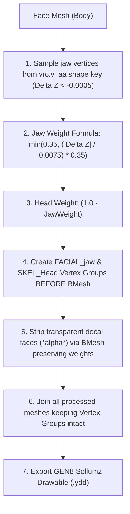

**Language / Idioma / 言語:** **English** | [Português (BR)](README.pt-BR.md) | [日本語](README.ja.md)

# DEFINITIVE MASTER GUIDE: Deploying VRChat Avatars in GTA V Legacy

## 3D Conversion, Rigging, Lip Sync, 2K Textures, Multi-Language Support, and Deployment for All Three Protagonists

> See also: [Master Deployment Guide (English)](MASTER_DEPLOYMENT_GUIDE.md) | [Guia Mestre Técnico (Português)](GUIA_MESTRE_IMPLANTACAO_AVATARES_GTAV.md)

---

### Executive Setup Summary

| GTA V Protagonist | Ped Slot | VRChat Avatar | Outfit / Style | Project Directory |
| :--- | :--- | :--- | :--- | :--- |
| **Michael De Santa** | `player_zero` | **Shinano** | Eternal Reunion (Gothic Dress / Pocket Watch + Neko Tied Bob Hair) | `2_Michael_Shinano_EternalReunion/` |
| **Franklin Clinton** | `player_one` | **Shinano** | Casual / Uniform (Red Skirt, Recolored Blue Hair) | `1_Franklin_Shinano_Casual/` |
| **Trevor Philips** | `player_two` | **Miltina** | Classic Maid (Black & White Dress, Apron, Twintails) | `3_Trevor_Miltina_Maid/` |

> **Credits:** See [Section 10 — Asset & Tool Credits](#10-asset--tool-credits) for the complete list of creators, official BOOTH store links, base avatars, outfits, hair packs, eye textures, and pipeline tools.

---

## 1. Unified Directory Structure (`vrc2gtav`)

The entire project is organized in a modular, platform-agnostic workspace:

```text
vrc2gtav/
├── 1_Franklin_Shinano_Casual/
│   ├── 1_source/              # Reference hierarchy & texture notes
│   ├── 2_blender/             # build_franklin_avatar.py, run_build.py, player_one.yft (after setup)
│   ├── 3_textures_gtav/       # generate_franklin_atlas.py, shinano_franklin_2k.ytd (after build)
│   ├── 4_exported_models/     # Compiled models (.ydd/.xml after build)
│   └── 5_rpf_package/         # Franklin-specific staging data
│
├── 2_Michael_Shinano_EternalReunion/
│   ├── 1_source/              # Unity scene hierarchy notes
│   ├── 2_blender/             # build_michael_er.py, run_build.py, player_zero.yft (after setup)
│   ├── 3_textures_gtav/       # generate_er_atlas.py, test_er.ytd (after build)
│   ├── 4_exported_models/     # Compiled models (.ydd/.xml after build)
│   └── 5_rpf_package/         # deploy_michael_er.py
│
├── 3_Trevor_Miltina_Maid/
│   ├── 1_source/              # FaceEmo blendshape & texture references
│   ├── 2_blender/             # build_trevor_miltina.py, run_pipeline.py, player_two.yft (after setup)
│   ├── 3_textures_gtav/       # generate_miltina_atlas.py, miltina_maid.ytd (after build)
│   ├── 4_exported_models/     # Compiled models (.ydd/.xml after build)
│   └── 5_rpf_package/         # apply_miltina_to_trevor.py
│
├── _deploy_tools/             # Global deployment tools (mirrored from scripts/common_tools)
│   ├── head_000_r.ydd         # Universal body Dummy Mesh (629 bytes)
│   ├── p_eyes_dummy.ydd       # Skeletonless glasses Prop Dummy Mesh (515 bytes)
│   ├── apply_characters.py    # Apply one or all characters to extracted staging dirs
│   ├── apply_all_characters.py# Convenience wrapper for applying all 3 protagonists
│   ├── hand_skeleton_helper.py# 1:1 arm, hand, and 30-finger bone relocation helper
│   ├── repack_and_deploy_everything.py # Repack RPFs with progress bars and install to GTA V
│   ├── run_mod_manager.py     # Mirrored copy of the master orchestrator
│   ├── setup_first_run.py     # First-Run Setup Wizard (writes vrc2gtav.cfg & extracts base RPFs)
│   ├── texture_calibration_helper.py # Shader-calibrated default hair & eye/face fallback compositing
│   ├── unity_scene_helper.py  # .unity scene scale extractor & custom-vs-default hair resolver
│   ├── vrc2gtav_i18n.py       # Trilingual engine (en / ja / pt) using OS system locale
│   └── vrc2gtav_paths.py      # Central vrc2gtav.cfg reader + Windows/WSL path converter
│
├── RUN_MANAGER.bat            # Multilingual Windows double-click launcher
├── EXECUTAR_GERENCIADOR.bat   # Multilingual Windows launcher (Portuguese filename alias)
├── run_mod_manager.py         # Root master orchestrator entry point
├── vrc2gtav.cfg.example       # Portable path & language template (generates local vrc2gtav.cfg)
│
└── scripts/                   # Primary source scripts grouped by character
    ├── Shinano_Casual_Franklin/
    ├── Shinano_EternalReunion_Michael/
    ├── Miltina_Maid_Trevor/
    └── common_tools/          # Shared modules + automated test_mod_suite.py
```

> **Copyright & First-Run Notice:** This repository tracks only source scripts, documentation, [`vrc2gtav.cfg.example`](vrc2gtav.cfg.example), and the two empty technical dummy meshes (`head_000_r.ydd` and `p_eyes_dummy.ydd`). **No GTA V game files** (`.rpf`, `.yft`, Rockstar models/textures) **and no paid VRChat/BOOTH assets** (`.fbx`, `.anim`, source textures, compiled `.ydd`/`.ytd` files) are distributed on GitHub. On first run, provide paths to your own legal GTA V copy and purchased avatar assets; the First-Run wizard extracts base RPFs and vanilla skeletons into `staging/` and `*/2_blender/`.

---

## 2. Centralized Configuration (`vrc2gtav.cfg`), Multi-Language Support, and First-Run Setup

All configurable paths are stored in a local gitignored `vrc2gtav.cfg` file (automatically created from [`vrc2gtav.cfg.example`](vrc2gtav.cfg.example) on first run).

[`vrc2gtav_paths.py`](scripts/common_tools/vrc2gtav_paths.py) parses `vrc2gtav.cfg` (or `VRC2GTAV_CFG`) and automatically converts paths between Windows (`E:/...`, `D:/...`) and Linux/WSL (`/mnt/e/...`, `/mnt/d/...`).

### Automatic Trilingual Support (`en` / `ja` / `pt`)

Every Python script and Windows `.bat` launcher automatically adapts its output, menus, progress bars, and errors to English (`en`), Japanese (`ja`), or Portuguese (`pt`) based on your system locale:

- **Priority order:** `--lang {en,ja,pt,auto}` CLI flag -> `VRC2GTAV_LANG` environment variable -> `[general] language` in `vrc2gtav.cfg` -> OS system locale (Win32 / Windows UI Language / POSIX `LC_ALL`, `LANG`) -> `en` fallback.
- **WSL -> Windows Blender propagation:** When `build_blender_command()` launches Windows `blender.exe` from WSL, `VRC2GTAV_LANG` and `VRC2GTAV_CFG` are forwarded via `WSLENV`.

### Automatic First-Run Setup

1. **First-Run Wizard:** Running `RUN_MANAGER.bat`, `python run_mod_manager.py`, or `python run_mod_manager.py --setup` detects whether `vrc2gtav.cfg` or extracted `staging/` archives are missing:
   - Copies `vrc2gtav.cfg.example` to `vrc2gtav.cfg` and detects or prompts for your `gtav_root` (containing `GTA5.exe`), Unity `Assets` directory with purchased VRChat assets, `blender` (with Sollumz), and `rage` ([VIRUXE/rage](https://github.com/VIRUXE/rage)).
   - Runs `rage extract-keys` and unpacks `x64v.rpf`, `streamedpeds_players.rpf`, `streamedpedprops.rpf`, `mppatchesng/dlc.rpf` (`mppatches.rpf`), and `patchday4ng/dlc.rpf` (if present) into `staging/`.
   - Populates base skeletons (`player_zero.yft`, `player_one.yft`, `player_two.yft`) into `*/2_blender/` and `staging/backup_vanilla_skeletons/`.
2. **Relocating drives or folders:** Edit `[directories]`, `[executables]`, `[rpf_paths]`, `[franklin]`, `[michael]`, or `[trevor]` in `vrc2gtav.cfg` — no Python edits are required.
3. **Optional Environment Variables:** `VRC2GTAV_LANG`, `VRC2GTAV_CFG`, `VRC2GTAV_ROOT`, `VRC_ASSETS_DIR`, `GTAV_MODS_DIR`, `RAGE_CLI`, `BLENDER_EXE`.

### Unit `1.0` Default Scales & `.unity` Scene Scale Extraction

- **Out-of-the-box `1.0` proportions:** Clean repository defaults (`unity_scene =` blank in `vrc2gtav.cfg.example`) keep every character's body, head, bone, and prop scale at `1.0` with no hardcoded scaling overrides.
- **Automatic `.unity` extraction:** Point `unity_scene` (and optional `unity_avatar_name`) under `[franklin]`, `[michael]`, or `[trevor]` to your Unity scene file. [`unity_scene_helper.py`](scripts/common_tools/unity_scene_helper.py) streams the YAML hierarchy (`GameObject`, `Transform`, `PrefabInstance` overrides, and `PhysBone`/Marshmallow scale cancellation) to reproduce your customized Unity proportions accurately in GTA V.

### Default Hair & Texture Fallback (Zero Missing-Asset Failures)

- **Shinano (Franklin & Michael) & Miltina (Trevor):** If an optional custom hair pack (`fbx_hair`, such as *Neko Tied Bob hair*) or third-party eye/makeup pack (*MoonButterfly eye*, *AWEyes*) is blank or missing on disk, both [`unity_scene_helper.py`](scripts/common_tools/unity_scene_helper.py) and [`texture_calibration_helper.py`](scripts/common_tools/texture_calibration_helper.py) automatically fall back to the base avatar's built-in default hair (`Hair_base`, `Hair_bang`, `Hair_back`, `Hair_side`, `Other_ear` with `Shinano_hair.png`; `Milltina_hair_*` with calibrated `Milltina_Hair.png`) and base face texture.
- **Custom hair support for all avatars:** Setting `fbx_hair` (and optional texture overrides) in `vrc2gtav.cfg` swaps in custom hair seamlessly for both **Shinano** and **Miltina**.

---

## 3. Blender 3D Pipeline & GTA V Rigging Architecture

### 3.1 Skeleton Filtering (Core Bones + 30 Finger Bones)

Vanilla GTA V skeletons (`player_zero.yft`, `player_one.yft`, `player_two.yft`) contain dozens of helper and cloth physics bones that destabilize stylized anime rigs. Each build filters the armature down to essential structural bones plus finger/arm bones managed by [`hand_skeleton_helper.py`](scripts/common_tools/hand_skeleton_helper.py):

- **Spine & Torso:** `SKEL_ROOT`, `SKEL_Pelvis`, `SKEL_Spine_Root`, `SKEL_Spine0`, `SKEL_Spine1`, `SKEL_Spine2`, `SKEL_Spine3`, `SKEL_Neck_1`, `SKEL_Head`.
- **Arms, Clavicles & Fingers:** `SKEL_L_Clavicle`, `SKEL_L_UpperArm`, `SKEL_L_Forearm`, `SKEL_L_Hand`, 15 left finger bones `SKEL_L_Finger00`..`SKEL_L_Finger42` (and `_R_` equivalents).
- **Legs & Feet:** `SKEL_L_Thigh`, `SKEL_L_Calf`, `SKEL_L_Foot`, `SKEL_L_Toe0` (and `_R_` equivalents).
- **Face / Lip Sync:** `FACIAL_facialRoot` (child of `SKEL_Head`) and `FACIAL_jaw` (child of `FACIAL_facialRoot`).

### 3.2 Critical Rigging Fixes

1. **1:1 Hands & Fingers (`hand_skeleton_helper.py`):** All 30 VRChat finger bones (`Thumb`, `Index`, `Middle`, `Ring`, `Little` L/R) map 1:1 to GTA V `SKEL_L/R_Finger00..42`, and their `.yft` rest positions are relocated to match the avatar's exact proportions so hands open and close naturally across RAGE animations.
2. **Twintails & Side Hair:**
   - *Issue:* Naive substring checks matching `"tail"` mapped Miltina's twintails (`twin tail1_R`, `Twin tail ribbon`) onto `SKEL_Pelvis`, pulling her hair down to her hips when walking.
   - *Strict Rule:*
     ```python
     if "twin" in lower_bone_name or "pony" in lower_bone_name or "twintail" in lower_bone_name:
         return "SKEL_Head"
     ```
3. **Eternal Reunion Dress & Pocket Watch (Michael):**
   - `UN1_Skirt` uses anatomical vertical and front-to-back Hermite ramps (`compute_skirt_vertex_weights`) so the skirt follows leg stride without distorting hip hearts or waist chains (`UN3_WaistChain`).
   - `Pocket Watch` strips its opaque glass cover (`Glass_Lenz`), aligns via 4x4 transform to the Unity watch ring, and receives dedicated gold specular mapping in the 4x2 atlas.
4. **A-Pose (-55°):** VRChat models use a 90° T-pose; upper arms are rotated **-55°** at the shoulder pivots to match GTA V ped bind pose.

---

## 4. Anime Lip Sync System

To animate mouth opening smoothly during cutscenes, phone calls, and gameplay dialogue:



### Vertical Decay Formula

$$\text{weight}_{\text{jaw}} = \min\left(0.35,\ \frac{|\Delta z|}{0.0075} \times 0.35\right), \qquad \text{weight}_{\text{head}} = 1.0 - \text{weight}_{\text{jaw}}$$

- **Why cap at 0.35?** GTA V jaw bone animations are authored for realistic human jaws; a 1.0 weight overstretches anime chins. Capping at 0.35 yields clean, subtle anime speech motion.

---

## 5. Textures & `.YTD` Dictionaries (2K Limit & JOAAT Order)

### 5.1 Mandatory 2K Resolution Ceiling (Max 2048px)

- 4K textures in GTA V exhaust streaming memory pools quickly during gameplay.
- All atlases (`2048x2048` 2x2 for Franklin/Trevor and `2048x1024` 4x2 for Michael) are compiled into `.ytd` dictionaries with mipmaps via `rage textures build`.

### 5.2 Critical JOAAT Texture Order

RAGE Engine resolves texture samplers inside `.ytd` dictionaries via **JOAAT** hashes. Textures must be appended in strict shader order for `ped_default.sps`:

1. Diffuse Atlas (`shinano_franklin_atlas_2k` / `shinano_er_atlas` / `miltina_atlas_2k`)
2. Specular Map
3. Normal Map

---

## 6. Deployment Strategy: Universal Slot Replacement & Dummies

GTA V protagonist outfits span multiple component slots (`uppr`, `lowr`, `feet`, `head`, `hair`, `berd`, `hand`, `teef`, `accs`, `task`, `jbib`). Replacing only `uppr_000` causes vanilla human limbs or heads to clip in during missions, cutscenes, or safehouse wardrobe switches.

### The Permanent Fix

1. **Full-Body Avatar in Torso (`uppr`):** Each compiled `.ydd` contains the entire avatar mesh and is replicated across **all `uppr` drawable and `uppr_diff_*` `.ytd` slots** for that character.
2. **Body Dummy Mesh (`head_000_r.ydd`, 629 bytes):** All remaining human component slots (`lowr`, `feet`, `head`, `hair`, `berd`, `hand`, `teef`, `accs`, `task`, `jbib`) are replaced with `head_000_r.ydd`.
3. **Glasses Prop Dummies (`p_eyes_*.ydd` in `streamedpedprops.rpf`):** All 35 glasses prop drawables across the three protagonists (`player_zero_p`: 11, `player_one_p`: 12, `player_two_p`: 12) are replaced with `p_eyes_dummy.ydd` (515 bytes — rigid skeletonless dummy without embedded textures), keeping `.ytd` dictionaries intact so RAGE prop lookups never crash.

---

## 7. RPF7 Repacking & Preventing `ERR_GEN_ZLIB_2`

GTA V requires two low-level conditions on modified `.rpf` archives:

1. **`b'OPEN'` Header (Offset 12):** Modified archives are built with `-e open` (`0x4E45504F`), disabling RSA decryption attempts.
2. **TOC `file_size = 0` Fix:** When nested `.rpf` archives (e.g., `mppatches.rpf` inside `dlc.rpf` or `streamedpeds_players.rpf` inside `x64v.rpf`) have non-zero compressed sizes in the outer TOC, GTA V throws a fatal `ERR_GEN_ZLIB_2` crash. [`repack_and_deploy_everything.py`](scripts/common_tools/repack_and_deploy_everything.py) patches binary TOC entries on nested archives (`file_size = 0`), renders live progress bars, and verifies every output with `rage verify`.

---

## 8. Quick Start (Unified Master Orchestrator)

The main entry point is [`run_mod_manager.py`](run_mod_manager.py) (alongside [`RUN_MANAGER.bat`](RUN_MANAGER.bat) / [`EXECUTAR_GERENCIADOR.bat`](EXECUTAR_GERENCIADOR.bat)).

### 8.1 Interactive Mode (Recommended)

Double-click `RUN_MANAGER.bat` on Windows or run in a terminal:

```bash
python run_mod_manager.py
```

### 8.2 Command-Line Mode (Automation / CLI)

```bash
# Interactive First-Run Setup (creates vrc2gtav.cfg and extracts vanilla RPFs):
python run_mod_manager.py --setup

# Non-interactive First-Run Setup:
python run_mod_manager.py --setup --non-interactive --gtav-root D:/GTAV --unity-assets E:/waifuv4/Assets

# Build, apply, and deploy Trevor (Miltina Maid) with explicit language:
python run_mod_manager.py --character trevor --lang en
python run_mod_manager.py --character trevor --lang ja
python run_mod_manager.py --character trevor --lang pt

# Process all 3 characters:
python run_mod_manager.py --character all

# Repack and install RPFs into GTA V mods/ without rebuilding models:
python run_mod_manager.py --deploy-only

# Verify prerequisites (Blender, RAGE CLI, Python, paths):
python run_mod_manager.py --check-env

# Run the automated validation test suite:
python scripts/common_tools/test_mod_suite.py --source-only
python scripts/common_tools/test_mod_suite.py
```

---

## 9. Manual Step-by-Step Execution (Technical Reference)

### Step 1: Generate 2K Textures and `.ytd` Dictionaries

```bash
# Franklin (Shinano Casual)
python3 scripts/Shinano_Casual_Franklin/generate_franklin_atlas.py

# Michael (Shinano Eternal Reunion)
python3 scripts/Shinano_EternalReunion_Michael/generate_er_atlas.py

# Trevor (Miltina Maid)
python3 scripts/Miltina_Maid_Trevor/generate_miltina_atlas.py
```

### Step 2: Compile 3D Avatars in Blender

The wrapper scripts read Blender paths from `vrc2gtav.cfg` and forward `VRC2GTAV_LANG`:

```bash
# Franklin (player_one)
python3 scripts/Shinano_Casual_Franklin/run_build_franklin.py

# Michael (player_zero)
python3 scripts/Shinano_EternalReunion_Michael/run_build_er.py

# Trevor (player_two)
python3 scripts/Miltina_Maid_Trevor/run_pipeline.py
```

### Step 3: Apply Characters into Extracted Staging Directories

```bash
# Apply one character (player_zero, player_one, or player_two):
python3 scripts/common_tools/apply_characters.py --character player_two

# Or apply all three:
python3 scripts/common_tools/apply_characters.py --character all
```

### Step 4: Repack RPFs and Deploy to GTA V

```bash
python3 scripts/common_tools/repack_and_deploy_everything.py
```

---

## 10. Asset & Tool Credits

All avatars, outfits, hairstyles, accessories, eye textures, and presets belong to their respective authors. Respect each creator's BOOTH terms of service and license conditions.

### Overview (Avatars, Outfits, Hair, Eyes, and Accessories)

| Category | Asset / Item | Creator / Shop | GTA V Character(s) | Official Link |
| :--- | :--- | :--- | :--- | :--- |
| **Base Avatar & Casual Outfit** | オリジナル3Dモデル「しなの」 (*Shinano*) | ポンデロニウム研究所 (`ponderogen`) | Michael, Franklin | [BOOTH](https://ponderogen.booth.pm/items/6106863) / [Shop](https://ponderogen.booth.pm/) |
| **Base Avatar & Maid Outfit** | オリジナル3Dモデル『ミルティナ』 (*Milltina*) | DOLOS art (`dolosart`) | Trevor | [BOOTH](https://dolosart.booth.pm/items/6538026) / [Shop](https://dolosart.booth.pm/) |
| **Dress, Shoes & Accessories** | 【15アバター対応】エターナル・リユニオン【MA対応】 (*Eternal Reunion* + *Pocket Watch*) | VAGRANT (`Vagrant Brand`) | Michael | [BOOTH](https://vagrant.booth.pm/items/5634313) / [Shop](https://vagrant.booth.pm/) |
| **Hair, Cat Ears, Clips & Halo (Optional)** | ねこタイドボブヘア (*Neko Tied Bob hair*) | Li-ne (`Li-ne_Shop`) | Michael *(falls back to default Shinano hair if absent)* | [BOOTH](https://li-ne.booth.pm/items/7977491) / [Shop](https://li-ne.booth.pm/) |
| **Eye Texture (Shinano, Optional)** | `[eye17アバター対応]MoonButterfly eye & Rurune Make` | ha-oa | Michael, Franklin *(falls back to `Shinano_face.png`)* | [BOOTH](https://ha-oa.booth.pm/items/8483652) / [Shop](https://ha-oa.booth.pm/) |
| **Eye Texture (Milltina, Optional)** | お魚が泳ぐ あわあわ水光 Eye Texture【10Color】【23Avatar】 (`Milltina_AWEyes`) | NAGIMA (`nagikawamart`) | Trevor *(falls back to `Milltina_Face.png`)* | [BOOTH](https://nagikawamart.booth.pm/items/6837271) / [Shop](https://nagikawamart.booth.pm/) |

---

### 10.1 Michael De Santa (`player_zero`) — Shinano Eternal Reunion

- **Base Avatar (Body, Face, Skin & Makeup):** [オリジナル3Dモデル「しなの」 (Shinano)](https://ponderogen.booth.pm/items/6106863) — [ポンデロニウム研究所](https://ponderogen.booth.pm/)
  - *Source:* `Shinano/FBX/Shinano.fbx` and `Shinano/Texture/` (`Shinano_body.png`, `Shinano_face_blue.png`, `Shinano_face_makeup1.png`, `Shinano_face_emission_mask.png`).
  - *Meshes used:* `Body` (head/face/eyes) and `Body_base` (body).
- **Dress, Shoes, Stockings & Accessories (including Pocket Watch):** [【15アバター対応】エターナル・リユニオン【MA対応】 (Eternal Reunion)](https://vagrant.booth.pm/items/5634313) — [VAGRANT](https://vagrant.booth.pm/)
  - *Source:* `Vagrant Brand/Eternal Reunion/Avatars/Shinano/FBX/ER_Shi.fbx`, `Pocket Watch/FBX/ER_PW.fbx`, and textures in `TEX/` (`V3_UN1.png`, `V3_UN2.png`, `V3_UN3.png`, `UN4.png`, `Masks/`, `Normal/`).
  - *Dress & Footwear:* `UN1_Shirt`, `UN1_Skirt`, `UN2_Corset`, `UN2_Stocking`, `UN2_Shoes`.
  - *Accessories & Watch:* `UN1_ChestRibbon`, `UN1_Choker`, `UN3_Bag`, `UN3_Glasses`, `UN3_WaistChain`, and `Pocket Watch`. *(Note: `UN2_Beret` is disabled in the final build).*
- **Hair, Cat Ears, Ribbon, Clips & Halo:** [ねこタイドボブヘア (Neko Tied Bob hair)](https://li-ne.booth.pm/items/7977491) — [Li-ne (`Li-ne_Shop`)](https://li-ne.booth.pm/)
  - *Source:* `Li-ne/Neko Tied Bob hair/_Fbx/Neko Tied Bob hair.fbx` and textures in `_Mat/` and `Accessories/` (`Blue.png`, `Light Mask.png`, `Normal map.png`, `Pin Mat.png`, `Accessories Mat.png`).
  - *Hair:* `Bangs`, `Top Back`, `Under Side`, `Back`, `Side Bangs`, `Side`, `In Hair`.
  - *Ears & Accessories:* `Ears`, `Ribbon`, `_Pin.Back`, `_Pin.R`, `_Pin.L2`, and `_Halo`.
- **Eye Texture:** [[eye17アバター対応]MoonButterfly eye & Rurune Make](https://ha-oa.booth.pm/items/8483652) — [ha-oa](https://ha-oa.booth.pm/)
  - *Source:* `MoonButterfly eye/Sinano/Texture/` (`sky.png`, `Cloud.jpg`, `Eye-highlight.png`, `無題157_20260711214118.png`).
- **Facial Expression (Blendshapes):** `ShinanoDefAdultNewv5.anim` preset authored with [FaceEmo](https://suzuryg.github.io/face-emo/).

---

### 10.2 Franklin Clinton (`player_one`) — Shinano Casual

- **Base Avatar, Casual Outfit, Default Hair, Ears & Tail:** [オリジナル3Dモデル「しなの」 (Shinano)](https://ponderogen.booth.pm/items/6106863) — [ポンデロニウム研究所](https://ponderogen.booth.pm/)
  - *Source:* `Shinano/FBX/Shinano.fbx` and `Shinano/Texture/` (`Shinano_body.png`, `Shinano_costume.png`, `Shinano_hair.png` recolored to electric blue in the atlas, `Shinano_face_blue.png`, `Shinano_face_makeup1.png`).
  - *Body & Face:* `Body`, `Body_base`.
  - *Clothing & Footwear:* `Cloth_sweater`, `Cloth_skirt`, `Cloth_tights`, `Cloth_boots`.
  - *Hair, Ears & Tail:* `Hair_back`, `Hair_bang`, `Hair_base`, `Hair_side`, `Other_ear`, `Other_tail`.
- **Eye Texture:** [[eye17アバター対応]MoonButterfly eye & Rurune Make](https://ha-oa.booth.pm/items/8483652) — [ha-oa](https://ha-oa.booth.pm/)
  - *Source:* `MoonButterfly eye/Sinano/Texture/` (`sky.png`, `Cloud.jpg`, `Eye-highlight.png`, `無題157_20260711214118.png`).
- **Facial Expression (Blendshapes):** `ShinanoDefAdultNewv5.anim` preset authored with [FaceEmo](https://suzuryg.github.io/face-emo/).

---

### 10.3 Trevor Philips (`player_two`) — Miltina Maid

- **Base Avatar, Maid Dress, Twintail Hair & Cow Features:** [オリジナル3Dモデル『ミルティナ』 (Milltina)](https://dolosart.booth.pm/items/6538026) — [DOLOS art](https://dolosart.booth.pm/)
  - *Source:* `DOLOSart/1.Milltina/FBX/Milltina.fbx` and `Material/` (`Milltina_Face.png`, `Milltina_Body.png`, `Milltina_Costume.png`, `Milltina_Hair.png`, `Milltina_Costume_Normal.png`).
  - *Body & Face:* `Body`, `Milltina_body`.
  - *Maid Dress & Outfits:* `Milltina_cloth_dress`, `Milltina_cloth_apron`, `Milltina_cloth_skirt`, `Milltina_cloth_panties`.
  - *Maid Accessories & Shoes:* `Milltina_cloth_collar`, `Milltina_cloth_hat`, `Milltina_cloth_neck_ribbon`, `Milltina_cloth_wrist_cuffs`, `Milltina_cloth_garterbelt`, `Milltina_cloth_hair_ribbon`, `Milltina_cloth_tail_ribbon`, `Milltina_cloth_tail_slit`, `Milltina_cloth_shoes`.
  - *Hair & Ears/Horns/Tail:* `Milltina_hair_base`, `Milltina_hair_side`, `Milltina_hair_front`, `Milltina_hair_front_side`, `Milltina_hair_twintail`, `Milltina_cow_ears`, `Milltina_cow_horns`, `Milltina_cow_tail`.
- **Eye Texture:** [お魚が泳ぐ あわあわ水光 Eye Texture【10Color】【23Avatar】](https://nagikawamart.booth.pm/items/6837271) — [NAGIMA (`nagikawamart`)](https://nagikawamart.booth.pm/)
  - *Source:* `NAGIMA/AWEyes_Texture/Milltina_AWEyes/Material/` (`Texture/Milltina_AWEyes_Blue Sea.png` and `Osakana/Milltina_AWEyes_Osakana.png`).
- **Facial Expression (Blendshapes):** `Miltina_close eyes_Base_adult.anim` preset authored with [FaceEmo](https://suzuryg.github.io/face-emo/).

---

### 10.4 Shaders, Unity/VRChat Packages & Pipeline Tools

| Tool / Package | Author / Maintainer | Role in Pipeline | Link |
| :--- | :--- | :--- | :--- |
| **lilToon** (v2.4.1) | `lilxyzw` | Layer/mask reference for 2K atlas baking and avatar shader calibration | [GitHub](https://github.com/lilxyzw/lilToon) / [Docs](https://lilxyzw.github.io/lilToon/) |
| **FaceEmo** (v1.7.0) | `suzuryg` | Authoring and exporting `.anim` facial expression presets | [GitHub](https://github.com/suzuryg/face-emo) / [Docs](https://suzuryg.github.io/face-emo/) |
| **Modular Avatar** (v1.18.7) | `bd_` (Nadena) | Non-destructive outfit/hair assembly in Unity (`waifuv4`) | [GitHub](https://github.com/bdunderscore/modular-avatar) / [Site](https://modular-avatar.nadena.dev/) |
| **Blender** (4.0.2) | Blender Foundation | Rigging, bone weight transfer, blendshapes, and verification renders | [Official Site](https://www.blender.org/) |
| **Sollumz** (v2.9.0) | `Skylumz`, `Colton`, `alexguirre` | Blender add-on for GTA V `.ydd` / `.yft` / XML import and export | [GitHub](https://github.com/Sollumz/Sollumz) / [Docs](https://docs.sollumz.org/) |
| **rage-cli** (`rage` 0.28.1) | `VIRUXE` | `.rpf` extraction/repacking, `.ytd` texture builds, verification & RAGE renders | [GitHub](https://github.com/VIRUXE/rage-cli) |
| **RageOpenV** | `Chiheb-Bacha` | ASI plugin to load RPF archives from `mods/` in GTA V | [GitHub](https://github.com/Chiheb-Bacha/RageOpenV) |
| **Ultimate ASI Loader** | `ThirteenAG` | Proxy DLL (`dinput8.dll`) for loading `.asi` mods | [GitHub](https://github.com/ThirteenAG/Ultimate-ASI-Loader) |
