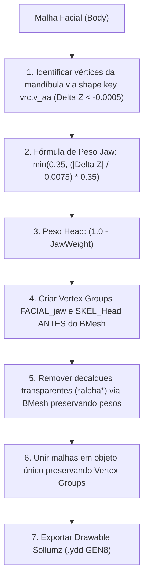

**Idioma / Language / 言語:** [English](README.md) | **Português (BR)** | [日本語](README.ja.md)

# GUIA MESTRE DEFINITIVO: Implantação de Avatares VRChat no GTA V

## Conversão, Rigging, Lip Sync, Texturas 2K, Multilíngue e Deploy dos Três Protagonistas

> Veja também: [Guia Técnico Completo (Português)](GUIA_MESTRE_IMPLANTACAO_AVATARES_GTAV.md) | [Master Deployment Guide (English)](MASTER_DEPLOYMENT_GUIDE.md)

---

### Resumo Executivo da Configuração

| Protagonista GTA V | Slot Ped | Avatar VRChat | Traje / Estilo | Pasta do Projeto |
| :--- | :--- | :--- | :--- | :--- |
| **Michael De Santa** | `player_zero` | **Shinano** | Eternal Reunion (Vestido Gótico / Maid de Luxo) | `2_Michael_Shinano_EternalReunion/` |
| **Franklin Clinton** | `player_one` | **Shinano** | Casual / Uniforme Escolar (Saia Vermelha, Cabelo Azul) | `1_Franklin_Shinano_Casual/` |
| **Trevor Philips** | `player_two` | **Miltina** | Maid Clássica (Vestido Longo Preto/Branco, Avental) | `3_Trevor_Miltina_Maid/` |

> **Créditos:** Consulte a [Seção 10 — Créditos dos Assets Utilizados](#10-créditos-dos-assets-utilizados) para a lista completa de criadores, links oficiais no BOOTH, avatares base, vestidos, cabelos, acessórios, texturas de olhos e ferramentas.

---

## 1. Estrutura de Diretórios Unificada (`vrc2gtav`)

Todo o projeto está consolidado em uma estrutura modular e independente de plataforma:

```text
vrc2gtav/
├── 1_Franklin_Shinano_Casual/
│   ├── 1_source/              # Referências dos FBX e texturas originais
│   ├── 2_blender/             # build_franklin_avatar.py, run_build.py, player_one.yft (após setup)
│   ├── 3_textures_gtav/       # generate_franklin_atlas.py, shinano_franklin_2k.ytd (após build)
│   ├── 4_exported_models/     # Modelos compilados (.ydd/.xml após build)
│   └── 5_rpf_package/         # Staging específico do Franklin
│
├── 2_Michael_Shinano_EternalReunion/
│   ├── 1_source/              # Hierarquia do Unity, referências e texturas
│   ├── 2_blender/             # build_michael_er.py, run_build.py, player_zero.yft (após setup)
│   ├── 3_textures_gtav/       # generate_er_atlas.py, test_er.ytd (após build)
│   ├── 4_exported_models/     # Modelos compilados (.ydd/.xml após build)
│   └── 5_rpf_package/         # deploy_michael_er.py
│
├── 3_Trevor_Miltina_Maid/
│   ├── 1_source/              # Referências de blendshapes FaceEmo e texturas
│   ├── 2_blender/             # build_trevor_miltina.py, run_pipeline.py, player_two.yft (após setup)
│   ├── 3_textures_gtav/       # generate_miltina_atlas.py, miltina_maid.ytd (após build)
│   ├── 4_exported_models/     # Modelos compilados (.ydd/.xml após build)
│   └── 5_rpf_package/         # apply_miltina_to_trevor.py
│
├── _deploy_tools/             # Ferramentas globais de deploy (espelhadas de scripts/common_tools)
│   ├── head_000_r.ydd         # Dummy Mesh universal para corpo (629 bytes)
│   ├── p_eyes_dummy.ydd       # Prop Dummy Mesh sem esqueleto para óculos (515 bytes)
│   ├── apply_characters.py    # Aplica um ou mais personagens nos diretórios de staging
│   ├── apply_all_characters.py# Atalho para aplicar todos os 3 personagens
│   ├── hand_skeleton_helper.py# Mapeamento 1:1 de braços, mãos e 30 ossos de dedos
│   ├── repack_and_deploy_everything.py # Repacota RPFs com barra de progresso e instala no GTA V
│   ├── run_mod_manager.py     # Cópia espelhada do orquestrador mestre
│   ├── setup_first_run.py     # Assistente First-Run (cria vrc2gtav.cfg e extrai RPFs base)
│   ├── vrc2gtav_i18n.py       # Motor trilíngue (en / ja / pt) baseado no idioma do sistema
│   └── vrc2gtav_paths.py      # Leitor do vrc2gtav.cfg + conversor Windows/WSL
│
├── EXECUTAR_GERENCIADOR.bat   # Inicializador Windows multilíngue (duplo clique)
├── RUN_MANAGER.bat            # Inicializador Windows multilíngue (alias em inglês)
├── run_mod_manager.py         # Orquestrador mestre na raiz do projeto
├── vrc2gtav.cfg.example       # Template portátil de caminhos e idioma (gera vrc2gtav.cfg)
│
└── scripts/                   # Central de scripts-fonte organizados por personagem
    ├── Shinano_Casual_Franklin/
    ├── Shinano_EternalReunion_Michael/
    ├── Miltina_Maid_Trevor/
    └── common_tools/          # Scripts comuns + suíte test_mod_suite.py
```

> **Aviso de Copyright e Primeira Execução (First-Run):** Este repositório versiona apenas o código-fonte das ferramentas, documentação, template [`vrc2gtav.cfg.example`](vrc2gtav.cfg.example) e as duas dummy meshes técnicas vazias (`head_000_r.ydd` e `p_eyes_dummy.ydd`). **Nenhum arquivo do GTA V** (`.rpf`, `.yft`, modelos ou texturas da Rockstar) **nem assets pagos do VRChat/BOOTH** (`.fbx`, `.anim`, texturas, `.ydd` ou `.ytd` compilados) são distribuídos no GitHub. No primeiro uso, você aponta a sua própria cópia legal do GTA V e dos seus avatares, e o assistente extrai os RPFs e esqueletos base automaticamente para `staging/` e `*/2_blender/`.

---

## 2. Configuração Centralizada (`vrc2gtav.cfg`), Multilíngue e First-Run

Todos os caminhos configuráveis ficam centralizados no arquivo local `vrc2gtav.cfg` (ignorado pelo Git e criado automaticamente a partir de [`vrc2gtav.cfg.example`](vrc2gtav.cfg.example) na primeira execução).

O módulo [`vrc2gtav_paths.py`](scripts/common_tools/vrc2gtav_paths.py) lê `vrc2gtav.cfg` (ou `VRC2GTAV_CFG`) e converte caminhos automaticamente entre Windows (`E:/...`, `D:/...`) e Linux/WSL (`/mnt/e/...`, `/mnt/d/...`).

### Suporte Trilíngue Automático (`en` / `ja` / `pt`)

Todos os scripts Python e inicializadores `.bat` detectam automaticamente o idioma do sistema (Windows UI Language via Win32 / Registro e locale POSIX `LC_ALL`/`LANG`, com fallback para inglês `en`):

- **Ordem de prioridade:** argumento CLI `--lang {en,ja,pt,auto}` -> variável de ambiente `VRC2GTAV_LANG` -> chave `[general] language` em `vrc2gtav.cfg` -> idioma do sistema operacional -> `en`.
- **Propagação WSL -> Blender Windows:** quando `build_blender_command()` invoca o `blender.exe` no Windows a partir do WSL, `VRC2GTAV_LANG` e `VRC2GTAV_CFG` são propagados automaticamente via `WSLENV`.

### First-Run Automático

1. **Setup Automático no Primeiro Uso:** Ao executar `RUN_MANAGER.bat`, `EXECUTAR_GERENCIADOR.bat`, `python run_mod_manager.py` ou `python run_mod_manager.py --setup`, o script verifica se falta `vrc2gtav.cfg` ou a extração base em `staging/`:
   - Copia `vrc2gtav.cfg.example` para `vrc2gtav.cfg` e detecta ou solicita os caminhos locais de `gtav_root` (contendo `GTA5.exe`), diretório `Assets` do Unity com os avatares adquiridos, `blender` (com Sollumz) e `rage` ([VIRUXE/rage](https://github.com/VIRUXE/rage)).
   - Extrai automaticamente as chaves NG (`rage extract-keys`), `x64v.rpf`, `streamedpeds_players.rpf`, `streamedpedprops.rpf`, `mppatchesng/dlc.rpf` (`mppatches.rpf`) e `patchday4ng/dlc.rpf` (quando presente) para `staging/`.
   - Popula os esqueletos base (`player_zero.yft`, `player_one.yft`, `player_two.yft`) em `*/2_blender/` e em `staging/backup_vanilla_skeletons/`.
2. **Para mover o projeto, o GTA V ou o Blender de unidade/pasta:** edite apenas `[directories]`, `[executables]`, `[rpf_paths]`, `[franklin]`, `[michael]` e `[trevor]` em `vrc2gtav.cfg` — nenhum script `.py` precisa ser alterado.
3. **Variáveis de Ambiente Opcionais:** `VRC2GTAV_LANG`, `VRC2GTAV_CFG`, `VRC2GTAV_ROOT`, `VRC_ASSETS_DIR`, `GTAV_MODS_DIR`, `RAGE_CLI`, `BLENDER_EXE`.

---

## 3. Arquitetura 3D no Blender e Rigging GTA V

### 3.1 Filtragem do Esqueleto (Ossos Essenciais + Dedos)

Os esqueletos originais do GTA V (`player_zero.yft`, `player_one.yft`, `player_two.yft`) contêm dezenas de ossos auxiliares e de física que desestabilizam avatares estilizados de anime. Cada personagem mantém estritamente a estrutura principal + os 30 ossos dos dedos + ossos auxiliares de braço gerenciados por [`hand_skeleton_helper.py`](scripts/common_tools/hand_skeleton_helper.py):

- **Coluna e Tronco:** `SKEL_ROOT`, `SKEL_Pelvis`, `SKEL_Spine_Root`, `SKEL_Spine0`, `SKEL_Spine1`, `SKEL_Spine2`, `SKEL_Spine3`, `SKEL_Neck_1`, `SKEL_Head`.
- **Braços, Clavículas e Mãos:** `SKEL_L_Clavicle`, `SKEL_L_UpperArm`, `SKEL_L_Forearm`, `SKEL_L_Hand`, os 15 ossos `SKEL_L_Finger00`..`SKEL_L_Finger42` (e equivalentes `_R_`).
- **Pernas e Pés:** `SKEL_L_Thigh`, `SKEL_L_Calf`, `SKEL_L_Foot`, `SKEL_L_Toe0` (e equivalentes `_R_`).
- **Face / Lip Sync:** `FACIAL_facialRoot` (filho de `SKEL_Head`) e `FACIAL_jaw` (filho de `FACIAL_facialRoot`).

### 3.2 Correções Críticas de Rigging

1. **Mãos e Dedos 1:1 (`hand_skeleton_helper.py`):** Em vez de deixar todas as falanges presas apenas em `SKEL_Hand`, os 30 ossos de dedos VRChat (`Thumb`, `Index`, `Middle`, `Ring`, `Little`) são mapeados 1:1 para `SKEL_L/R_Finger00..42` e suas juntas no `.yft` são realocadas exatamente para as coordenadas do avatar no `player_zero.yft`, `player_one.yft` e `player_two.yft`, permitindo abrir e fechar as mãos corretamente nas animações da RAGE Engine.
2. **Marias-Chiquinhas e Cabelos Laterais (Twintails):**
   - *Problema:* Buscas genéricas pela substring `"tail"` atribuíam as marias-chiquinhas da Miltina (`twin tail1_R`, `Twin tail ribbon`) ao osso `SKEL_Pelvis`, fazendo o cabelo esticar até o quadril ao caminhar.
   - *Regra Estrita:*
     ```python
     if "twin" in lower_bone_name or "pony" in lower_bone_name or "twintail" in lower_bone_name:
         return "SKEL_Head"
     ```
3. **Vestido Eternal Reunion e Relógio de Bolso (Michael):**
   - A saia (`UN1_Skirt`) utiliza ponderação anatômica com rampa vertical e anteroposterior (`compute_skirt_vertex_weights`) para acompanhar o movimento das pernas sem deformar o quadril nem deslocar os acessórios da cintura (`UN3_WaistChain`, `Pocket Watch`).
   - O relógio de bolso (`Pocket Watch`) tem a lente opaca removida e o mostrador alinhado em coordenadas exatas da cena Unity ao anel da cintura, com mapa specular dourado dedicado no atlas 4x2.
4. **A-Pose (-55°):** Avatares de VRChat chegam em T-Pose (braços a 90°). Os braços são rotacionados em **-55°** em torno dos ombros para alinhar com a postura dos peds do GTA V.

---

## 4. O Sistema de Lip Sync (Sincronia Labial de Anime)

Para que as personagens abram a boca suavemente ao falar em cutscenes, chamadas e diálogos no jogo:



### Fórmula de Decaimento Vertical

$$\text{peso}_{\text{jaw}} = \min\left(0.35,\ \frac{|\Delta z|}{0.0075} \times 0.35\right), \qquad \text{peso}_{\text{head}} = 1.0 - \text{peso}_{\text{jaw}}$$

- **Por que o teto é 0.35?** O esqueleto do GTA V foi calibrado para mandíbulas humanas realistas; peso 1.0 em rostos estilizados de anime estica demais o queixo. O limite em 0.35 mantém a movimentação natural e fiel ao estilo anime.

---

## 5. Texturas e Dicionários .YTD (Padrão 2K e Ordem JOAAT)

### 5.1 Limite de Resolução 2K (Máx. 2048px)

- Texturas 4K no GTA V saturam o pool de streaming de memória rapidamente e causam instabilidade.
- Todos os atlas (`2048x2048` 2x2 para Franklin/Trevor e `2048x1024` 4x2 para Michael) são compilados em `.ytd` com mipmaps automáticos via `rage textures build`.

### 5.2 Regra Crítica da Ordem JOAAT

A RAGE Engine localiza texturas dentro do `.ytd` usando hashes **JOAAT**. Construir o `.ytd` na ordem exata esperada pelo material garante ponteiros corretos no shader `ped_default.sps`:

1. Diffuse Atlas (`shinano_franklin_atlas_2k` / `shinano_er_atlas` / `miltina_atlas_2k`)
2. Specular Map
3. Normal Map

---

## 6. Estratégia de Deploy: Universal Slot Replacement e Dummies

No GTA V, roupas e cabeça são divididas em vários componentes (`uppr`, `lowr`, `feet`, `head`, `hair`, `berd`, `hand`, `teef`, `accs`, `task`, `jbib`). Se apenas `uppr_000` for trocado, trocas de roupa em missões ou casas seguras fazem partes humanas do ped original aparecerem atravessando o avatar.

### A Solução Definitiva

1. **Avatar Completo no Tronco (`uppr`):** O modelo compilado (`uppr_008_u.ydd` ou `uppr_000_u.ydd`/`_r.ydd`) contém o avatar completo e é replicado em **todos os slots `uppr`** e dicionários `uppr_diff_*` do personagem.
2. **Dummy Mesh Corporal (`head_000_r.ydd`, 629 bytes):** Todos os demais slots humanos (`lowr`, `feet`, `head`, `hair`, `berd`, `hand`, `teef`, `accs`, `task`, `jbib`) recebem `head_000_r.ydd`, mantendo o avatar invisível nos slots originais sem risco de colisão.
3. **Dummies de Óculos (`p_eyes_*.ydd` em `streamedpedprops.rpf`):** Todos os 35 drawables de óculos dos três protagonistas (`player_zero_p`: 11, `player_one_p`: 12, `player_two_p`: 12) são substituídos por `p_eyes_dummy.ydd` (515 bytes — drawable rígido sem `<Skeleton>` e sem texturas embutidas), mantendo os `.ytd` intactos para não quebrar lookups da engine em cutscenes ou missões.

---

## 7. Repacotamento RPF7 e Prevenção do `ERR_GEN_ZLIB_2`

Para que o GTA V aceite os arquivos `.rpf` modificados:

1. **Cabeçalho `b'OPEN'` (Offset 12):** Todos os arquivos RPF repacotados são gerados com `-e open` (`0x4E45504F`), instruindo a RAGE Engine a carregá-los sem decriptação RSA.
2. **Correção de TOC `file_size = 0`:** Quando um `.rpf` contém outro `.rpf` aninhado (por exemplo `mppatches.rpf` ou `streamedpeds_players.rpf` dentro de `dlc.rpf`/`x64v.rpf`), entradas aninhadas gravadas com `file_size != 0` na tabela de conteúdo (TOC) disparam erro fatal `ERR_GEN_ZLIB_2`. O script [`repack_and_deploy_everything.py`](scripts/common_tools/repack_and_deploy_everything.py) percorre a TOC binária, zera os 3 bytes de tamanho comprimido nos arquivos `.rpf` aninhados, exibe barra de progresso em cada etapa e valida com `rage verify`.

---

## 8. Como Executar (Orquestrador Mestre Unificado)

O ponto de entrada principal é [`run_mod_manager.py`](run_mod_manager.py) (e os inicializadores [`RUN_MANAGER.bat`](RUN_MANAGER.bat) / [`EXECUTAR_GERENCIADOR.bat`](EXECUTAR_GERENCIADOR.bat)).

### 8.1 Modo Interativo (Recomendado)

No Windows, dê um duplo clique em `RUN_MANAGER.bat` ou `EXECUTAR_GERENCIADOR.bat`, ou execute no terminal:

```bash
python run_mod_manager.py
```

O menu é exibido no idioma do sistema (`en`, `ja` ou `pt`, ou forçado via `--lang`):

```text
======================================================================
         GERENCIADOR DE AVATARES VRChat PARA GTA V
======================================================================
Idioma: Português (PT) | Base: vrc2gtav
Selecione qual personagem você deseja trocar/atualizar:
  [1] Michael (player_zero) -> Shinano Eternal Reunion
  [2] Franklin (player_one) -> Shinano Casual / Uniforme
  [3] Trevor   (player_two)  -> Miltina Maid
  [4] Todos os 3 Personagens (Processo Completo)
  [5] Apenas Repacotar e Instalar RPFs no GTA V (Deploy Only)
  [6] Configuração Inicial e Extração GTA V (First-Run Setup)
  [0] Sair
----------------------------------------------------------------------
```

### 8.2 Modo Linha de Comando (Automação / CLI)

```bash
# Configuração inicial interativa (cria vrc2gtav.cfg e extrai RPFs vanilla):
python run_mod_manager.py --setup

# Configuração inicial não interativa informando os caminhos:
python run_mod_manager.py --setup --non-interactive --gtav-root D:/GTAV --unity-assets E:/waifuv4/Assets

# Processar apenas o Trevor (Miltina Maid) em inglês, japonês ou português:
python run_mod_manager.py --character trevor --lang pt
python run_mod_manager.py --character trevor --lang ja
python run_mod_manager.py --character trevor --lang en

# Processar todos os 3 personagens de uma vez:
python run_mod_manager.py --character all

# Apenas repacotar os RPFs e instalar no GTA V:
python run_mod_manager.py --deploy-only

# Verificar se todos os pré-requisitos (Blender, RAGE CLI, Python) estão prontos:
python run_mod_manager.py --check-env

# Rodar a suíte de testes automatizados (sem necessidade de assets no modo --source-only):
python scripts/common_tools/test_mod_suite.py --source-only
python scripts/common_tools/test_mod_suite.py
```

---

## 9. Execução Manual Passo a Passo (Referência Técnica)

Caso deseje executar cada etapa manualmente:

### Passo 1: Gerar as Texturas e Atlas 2K

```bash
# Franklin (Shinano Casual)
python3 scripts/Shinano_Casual_Franklin/generate_franklin_atlas.py

# Michael (Shinano Eternal Reunion)
python3 scripts/Shinano_EternalReunion_Michael/generate_er_atlas.py

# Trevor (Miltina Maid)
python3 scripts/Miltina_Maid_Trevor/generate_miltina_atlas.py
```

### Passo 2: Compilar os Modelos 3D no Blender

Os scripts wrapper abaixo leem o executável do Blender, `vrc2gtav.cfg` e propagam `VRC2GTAV_LANG`:

```bash
# Franklin (player_one)
python3 scripts/Shinano_Casual_Franklin/run_build_franklin.py

# Michael (player_zero)
python3 scripts/Shinano_EternalReunion_Michael/run_build_er.py

# Trevor (player_two)
python3 scripts/Miltina_Maid_Trevor/run_pipeline.py
```

### Passo 3: Aplicar Personagens nos Diretórios de Staging

```bash
# Aplica um personagem específico (player_zero, player_one ou player_two):
python3 scripts/common_tools/apply_characters.py --character player_two

# Ou aplica todos:
python3 scripts/common_tools/apply_characters.py --character all
```

### Passo 4: Repacotar RPFs e Instalar no Jogo

```bash
python3 scripts/common_tools/repack_and_deploy_everything.py
```

---

## 10. Créditos dos Assets Utilizados

Todos os avatares, vestidos, cabelos, acessórios, texturas e presets abaixo pertencem aos seus respectivos autores. Caso utilize ou adapte este projeto, respeite os termos de licença de cada criador no BOOTH e nos repositórios oficiais.

### Resumo Geral (Avatares, Roupas, Cabelos, Olhos e Acessórios)

| Categoria | Asset / Item | Criador / Loja | Personagens no Mod | Link Oficial |
| :--- | :--- | :--- | :--- | :--- |
| **Avatar Base & Traje Casual** | オリジナル3Dモデル「しなの」 (*Shinano*) | ポンデロニウム研究所 (`ponderogen`) | Michael, Franklin | [BOOTH](https://ponderogen.booth.pm/items/6106863) / [Loja](https://ponderogen.booth.pm/) |
| **Avatar Base & Traje Maid** | オリジナル3Dモデル『ミルティナ』 (*Milltina*) | DOLOS art (`dolosart`) | Trevor | [BOOTH](https://dolosart.booth.pm/items/6538026) / [Loja](https://dolosart.booth.pm/) |
| **Vestido, Sapatos & Acessórios** | 【15アバター対応】エターナル・リユニオン【MA対応】 (*Eternal Reunion* + *Pocket Watch*) | VAGRANT (`Vagrant Brand`) | Michael | [BOOTH](https://vagrant.booth.pm/items/5634313) / [Loja](https://vagrant.booth.pm/) |
| **Cabelo, Orelhas, Presilhas & Auréola** | ねこタイドボブヘア (*Neko Tied Bob hair*) | Li-ne (`Li-ne_Shop`) | Michael | [BOOTH](https://li-ne.booth.pm/items/7977491) / [Loja](https://li-ne.booth.pm/) |
| **Textura de Olhos (Shinano)** | `[eye17アバター対応]MoonButterfly eye & Rurune Make` | ha-oa | Michael, Franklin | [BOOTH](https://ha-oa.booth.pm/items/8483652) / [Loja](https://ha-oa.booth.pm/) |
| **Textura de Olhos (Milltina)** | お魚が泳ぐ あわあわ水光 Eye Texture【10Color】【23Avatar】 (`Milltina_AWEyes`) | NAGIMA (`nagikawamart`) | Trevor | [BOOTH](https://nagikawamart.booth.pm/items/6837271) / [Loja](https://nagikawamart.booth.pm/) |

---

### 10.1 Michael De Santa (`player_zero`) — Shinano Eternal Reunion

- **Avatar Base (Corpo, Rosto, Pele e Maquiagem):** [オリジナル3Dモデル「しなの」 (Shinano)](https://ponderogen.booth.pm/items/6106863) — [ポンデロニウム研究所](https://ponderogen.booth.pm/)
  - *Origem:* `Shinano/FBX/Shinano.fbx` e `Shinano/Texture/` (`Shinano_body.png`, `Shinano_face_blue.png`, `Shinano_face_makeup1.png`, `Shinano_face_emission_mask.png`).
  - *Malhas utilizadas:* `Body` (cabeça/rosto/olhos) e `Body_base` (corpo).
- **Vestido, Sapatos, Meia-Calça e Acessórios (incluindo Relógio de Bolso):** [【15アバター対応】エターナル・リユニオン【MA対応】 (Eternal Reunion)](https://vagrant.booth.pm/items/5634313) — [VAGRANT](https://vagrant.booth.pm/)
  - *Origem:* `Vagrant Brand/Eternal Reunion/Avatars/Shinano/FBX/ER_Shi.fbx`, `Pocket Watch/FBX/ER_PW.fbx` e texturas em `TEX/` (`V3_UN1.png`, `V3_UN2.png`, `V3_UN3.png`, `UN4.png`, `Masks/`, `Normal/`).
  - *Vestido e Calçados:* `UN1_Shirt` (blusa), `UN1_Skirt` (saia), `UN2_Corset` (espartilho), `UN2_Stocking` (meia-calça), `UN2_Shoes` (sapatos).
  - *Acessórios e Relógio:* `UN1_ChestRibbon` (laço do peito), `UN1_Choker` (gargantilha), `UN3_Bag` (bolsa tiracolo), `UN3_Glasses` (óculos), `UN3_WaistChain` (corrente de cintura) e `Pocket Watch` (relógio de bolso integrado ao pacote). *(Nota: a boina `UN2_Beret` não é incluída na versão final).*
- **Cabelo, Orelhas de Gato, Laço, Presilhas e Auréola:** [ねこタイドボブヘア (Neko Tied Bob hair)](https://li-ne.booth.pm/items/7977491) — [Li-ne (`Li-ne_Shop`)](https://li-ne.booth.pm/)
  - *Origem:* `Li-ne/Neko Tied Bob hair/_Fbx/Neko Tied Bob hair.fbx` e texturas em `_Mat/` e `Accessories/` (`Blue.png`, `Light Mask.png`, `Normal map.png`, `Pin Mat.png`, `Accessories Mat.png`).
  - *Cabelo:* `Bangs`, `Top Back`, `Under Side`, `Back`, `Side Bangs`, `Side`, `In Hair`.
  - *Orelhas e Acessórios:* `Ears` (orelhas de gato), `Ribbon` (laço lateral), `_Pin.Back`, `_Pin.R`, `_Pin.L2` (presilhas/grampos) e `_Halo` (auréola metálica flutuante).
- **Textura de Olhos:** [[eye17アバター対応]MoonButterfly eye & Rurune Make](https://ha-oa.booth.pm/items/8483652) — [ha-oa](https://ha-oa.booth.pm/)
  - *Origem:* `MoonButterfly eye/Sinano/Texture/` (`sky.png`, `Cloud.jpg`, `Eye-highlight.png`, `無題157_20260711214118.png`).
- **Expressão Facial (Blendshapes):** Preset `ShinanoDefAdultNewv5.anim` criado com [FaceEmo](https://suzuryg.github.io/face-emo/) sobre as blendshapes do avatar Shinano.

---

### 10.2 Franklin Clinton (`player_one`) — Shinano Casual

- **Avatar Base, Traje Casual, Cabelo Padrão, Orelhas e Cauda:** [オリジナル3Dモデル「しなの」 (Shinano)](https://ponderogen.booth.pm/items/6106863) — [ポンデロニウム研究所](https://ponderogen.booth.pm/)
  - *Origem:* `Shinano/FBX/Shinano.fbx` e `Shinano/Texture/` (`Shinano_body.png`, `Shinano_costume.png`, `Shinano_hair.png` recolorida para azul-anil no atlas, `Shinano_face_blue.png`, `Shinano_face_makeup1.png`).
  - *Corpo e Rosto:* `Body`, `Body_base`.
  - *Roupas e Calçados:* `Cloth_sweater` (suéter), `Cloth_skirt` (saia), `Cloth_tights` (meia-calça), `Cloth_boots` (botas).
  - *Cabelo e Orelhas/Cauda:* `Hair_back`, `Hair_bang`, `Hair_base`, `Hair_side`, `Other_ear` (orelhas), `Other_tail` (cauda).
- **Textura de Olhos:** [[eye17アバター対応]MoonButterfly eye & Rurune Make](https://ha-oa.booth.pm/items/8483652) — [ha-oa](https://ha-oa.booth.pm/)
  - *Origem:* `MoonButterfly eye/Sinano/Texture/` (`sky.png`, `Cloud.jpg`, `Eye-highlight.png`, `無題157_20260711214118.png`).
- **Expressão Facial (Blendshapes):** Preset `ShinanoDefAdultNewv5.anim` criado com [FaceEmo](https://suzuryg.github.io/face-emo/) sobre as blendshapes do avatar Shinano.

---

### 10.3 Trevor Philips (`player_two`) — Miltina Maid

- **Avatar Base, Traje de Maid, Cabelo (Twintails) e Traços de Vaquinha:** [オリジナル3Dモデル『ミルティナ』 (Milltina)](https://dolosart.booth.pm/items/6538026) — [DOLOS art](https://dolosart.booth.pm/)
  - *Origem:* `DOLOSart/1.Milltina/FBX/Milltina.fbx` e `Material/` (`Milltina_Face.png`, `Milltina_Body.png`, `Milltina_Costume.png`, `Milltina_Hair.png`, `Milltina_Costume_Normal.png`).
  - *Corpo e Rosto:* `Body`, `Milltina_body`.
  - *Vestido e Roupas de Maid:* `Milltina_cloth_dress`, `Milltina_cloth_apron` (avental), `Milltina_cloth_skirt`, `Milltina_cloth_panties`.
  - *Acessórios e Calçados de Maid:* `Milltina_cloth_collar` (gola), `Milltina_cloth_hat` (touca/headdress), `Milltina_cloth_neck_ribbon` (laço do pescoço), `Milltina_cloth_wrist_cuffs` (punhos), `Milltina_cloth_garterbelt` (cinta-liga), `Milltina_cloth_hair_ribbon` (laços das marias-chiquinhas), `Milltina_cloth_tail_ribbon` (laço da cauda), `Milltina_cloth_tail_slit`, `Milltina_cloth_shoes` (sapatos).
  - *Cabelo e Orelhas/Chifres/Cauda:* `Milltina_hair_base`, `Milltina_hair_side`, `Milltina_hair_front`, `Milltina_hair_front_side`, `Milltina_hair_twintail`, `Milltina_cow_ears`, `Milltina_cow_horns`, `Milltina_cow_tail`.
- **Textura de Olhos:** [お魚が泳ぐ あわあわ水光 Eye Texture【10Color】【23Avatar】](https://nagikawamart.booth.pm/items/6837271) — [NAGIMA (`nagikawamart`)](https://nagikawamart.booth.pm/)
  - *Origem:* `NAGIMA/AWEyes_Texture/Milltina_AWEyes/Material/` (`Texture/Milltina_AWEyes_Blue Sea.png` e `Osakana/Milltina_AWEyes_Osakana.png`).
- **Expressão Facial (Blendshapes):** Preset `Miltina_close eyes_Base_adult.anim` via [FaceEmo](https://suzuryg.github.io/face-emo/) sobre as blendshapes do avatar Milltina.

---

### 10.4 Shaders, Pacotes Unity/VRChat e Ferramentas do Pipeline

| Ferramenta / Pacote | Autor / Mantenedor | Uso no Projeto | Link |
| :--- | :--- | :--- | :--- |
| **lilToon** (v2.4.1) | `lilxyzw` | Referência de camadas/máscaras para o baking dos atlas 2K e materiais dos avatares | [GitHub](https://github.com/lilxyzw/lilToon) / [Docs](https://lilxyzw.github.io/lilToon/) |
| **FaceEmo** (v1.7.0) | `suzuryg` | Configuração e exportação dos presets de expressão facial (`.anim`) | [GitHub](https://github.com/suzuryg/face-emo) / [Docs](https://suzuryg.github.io/face-emo/) |
| **Modular Avatar** (v1.18.7) | `bd_` (Nadena) | Montagem não destrutiva das roupas e cabelos na cena Unity (`waifuv4`) | [GitHub](https://github.com/bdunderscore/modular-avatar) / [Site](https://modular-avatar.nadena.dev/) |
| **Blender** (4.0.2) | Blender Foundation | Rigging, transferência de pesos, blendshapes e renderização de verificação | [Site Oficial](https://www.blender.org/) |
| **Sollumz** (v2.9.0) | `Skylumz`, `Colton`, `alexguirre` | Add-on do Blender para importação/exportação `.ydd` / `.yft` / XML do GTA V | [GitHub](https://github.com/Sollumz/Sollumz) / [Docs](https://docs.sollumz.org/) |
| **rage-cli** (`rage` 0.28.1) | `VIRUXE` | Extração/repacotamento `.rpf`, compilação `.ytd`, verificação e renders RAGE | [GitHub](https://github.com/VIRUXE/rage-cli) |
| **RageOpenV** | `Chiheb-Bacha` | ASI para carregamento de RPFs da pasta `mods/` no GTA V | [GitHub](https://github.com/Chiheb-Bacha/RageOpenV) |
| **Ultimate ASI Loader** | `ThirteenAG` | Proxy DLL (`dinput8.dll`) para carregamento de plugins `.asi` | [GitHub](https://github.com/ThirteenAG/Ultimate-ASI-Loader) |
