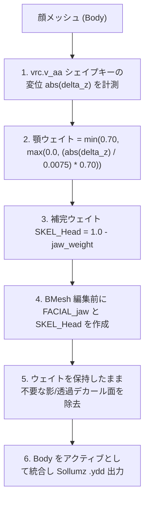

# 導入・技術ガイド: GTA V Legacy 用 VRChat アバター変換
## Unity Editor プラグイン・3D 変換・リギング・`GTAVVToon.asi`・指 30 本・リップシンク・単一ミップ 2K `.ytd`・バニラ復元・RPF7 容量保護

**言語 / Language / Idioma:** [Technical Guide (EN)](DEPLOYMENT_GUIDE.md) | [Guia Técnico (PT-BR)](DEPLOYMENT_GUIDE.pt-BR.md) | **技術ガイド (日本語)** | [README (EN)](../README.md) | [README (PT-BR)](../README.pt-BR.md) | [README (日本語)](../README.ja.md)

---

### 構成サマリー

| GTA V 主人公 | Ped ID | VRChat アバター | 衣装・スタイル | フォルダ |
| :--- | :--- | :--- | :--- | :--- |
| **Michael De Santa** | `player_zero` | `player_zero_michael` | 任意の BOOTH / VRChat アバター (例: *Shinano – Eternal Reunion*) | `player_zero/` |
| **Franklin Clinton** | `player_one` | `player_one_franklin` | 任意の BOOTH / VRChat アバター (例: *Shinano – Casual*) | `player_one/` |
| **Trevor Philips** | `player_two` | `player_two_trevor` | 任意の BOOTH / VRChat アバター (例: *Miltina – Classic Maid*) | `player_two/` |

---

## 1. ディレクトリ構成と著作権ポリシー (First-Run)

本リポジトリはバージョン管理された自動化スクリプト、Unity Editor プラグイン、リアルタイム ASI プラグインと、Rockstar Games 本体データやローカル生成物を明確に分離しています:

```text
vrc2gtav/
├── VRCAvatar2GTAV.unitypackage                      # 完結型 Unity Editor プラグイン + Toolchain (.gitignore / build_unitypackage.py で生成)
├── RUN_MANAGER.bat                                  # OS ロケール対応 Windows ランチャー
├── EXECUTAR_GERENCIADOR.bat                         # ポルトガル語名のランチャーエイリアス
├── run_mod_manager.py                               # マスターオーケストレーター (対話メニュー + CLI)
├── setup_first_run.py                               # First-Run セットアップエントリポイント
├── vrc2gtav.cfg.example                             # バージョン管理された INI 設定テンプレート
├── configs/                                         # ブレンドシェイプ設定 (*_blendshapes.cfg)・PhysBones (*_physbones.cfg)・npc_registry.json・active_multi_slots.json (.gitignore)
├── npcs/                                            # 汎用 NPC / 街中歩行者のローカル作業フォルダ・出力 (.gitignore)
├── unity_plugin/
│   ├── Assets/VRCAvatar2GTAV/
│   │   ├── Editor/                                  # Unity Editor UI 用 C# スクリプト 9 本 (VRCAvatar2GTAV.Editor.asmdef)
│   │   └── Toolchain/                               # Unity 同梱用クリーン自動化スクリプト＆ガイドのステージングミラー
│   ├── build_unitypackage.py                        # 著作権除外済み VRCAvatar2GTAV.unitypackage 生成スクリプト
│   └── install_unity_plugin.py                      # 既存 Unity プロジェクトへの非破壊インストーラー
├── README.md / README.pt-BR.md / README.ja.md       # GitHub トップページ用 README (3か国語)
├── docs/                                            # 詳細な技術・導入ドキュメント
│   ├── DEPLOYMENT_GUIDE.md                          # 英語技術ガイド
│   ├── DEPLOYMENT_GUIDE.pt-BR.md                    # ポルトガル語技術ガイド
│   └── DEPLOYMENT_GUIDE.ja.md                       # 本技術ガイド (日本語)
│
├── _deploy_tools/                                   # 実行時ミラー & 軽量ダミーメッシュ
│   ├── head_000_r.ydd                               # 非表示ボディ用ダミーメッシュ (629 バイト)
│   ├── p_eyes_dummy.ydd                             # プロップ抑制用リジッドダミー (p_*.ydd スロット)
│   ├── setup_first_run.py                           # 初回セットアップウィザード (.cfg 生成 + RPF 展開)
│   ├── restore_vanilla_helper.py                    # 選択的 Rockstar バニラ復元 & マルチスロット実行ヘルパー
│   ├── repack_and_deploy_everything.py              # RPF7 再パック + TOC 修正 + ASI/プロファイル配置
│   └── ...                                          # VToon, PhysBones, eye-blink, hair, MA, NPC, i18n, paths ミラー
│
├── scripts/                                         # ソースコード本体 (Python/C++ + i18n)
│   ├── common_tools/                                # 共通ヘルパー・マネージャー・ビルダー・VToon/Restore ヘルパー・検証スイート
│   ├── physbones_asi/                               # リアルタイム VRChat PhysBones ASI (GTAVPhysBones.asi / .ini)
│   ├── vtoon_asi/                                   # リアルタイム D3D11 lilToon シェーダー ASI (GTAVVToon.asi / .ini / vtoon_profiles)
│   └── common_tools/                                # 汎用ビルダー・マネージャー・VToon/Restore/NPC ヘルパー・i18n・検証スイート
│
├── player_zero/                                     # Michael (player_zero) 出力・ステージング (.gitignore)
├── player_one/                                      # Franklin (player_one) 出力・ステージング (.gitignore)
└── player_two/                                      # Trevor (player_two) 出力・ステージング (.gitignore)
```

### 著作権分離と `.gitignore` ルール
著作権保護された GTA V のゲーム本体ファイル、BOOTH アセット、ローカルレンダー画像は Git および [`VRCAvatar2GTAV.unitypackage`](../VRCAvatar2GTAV.unitypackage) に一切含まれません。`staging/`、`renders/`、`backups/`、`imported_unity_projects/`、`npcs/`、`vtoon_profiles/`、`VRCAvatar2GTAV_Work/`、`vrc2gtav.cfg`、`configs/npc_registry.json`、`configs/active_multi_slots.json`、`player_*/3_textures_gtav/custom_hair_manifest.json`、`player_zero/5_rpf_package/`、`player_one/5_rpf_package/`、`player_two/5_rpf_package/`、および `.zip`・`.unitypackage`・`.yft`・`.ytd`・`.dds`・`.ydd.xml`・`.backup_*`・`.ydd` は除外され、**First-Run**・**Unity エクスポート**・**NPC 変換** 時にローカルで生成されます。

`_deploy_tools/` に同梱されている `.ydd` は技術用の空ダミー 2 点のみです:
- [`_deploy_tools/head_000_r.ydd`](../_deploy_tools/head_000_r.ydd) — 629 バイトの非表示ボディダミー。
- [`_deploy_tools/p_eyes_dummy.ydd`](../_deploy_tools/p_eyes_dummy.ydd) — バニラの帽子・サングラス・耳プロップ (`p_*.ydd`) を非表示にするリジッドダミー。

---

## 2. `.cfg` マルチプラットフォーム設定・多言語対応 (`en` / `ja` / `pt`)

### 2.1 `vrc2gtav.cfg` とパス解決
スクリプト内に環境依存の絶対パスは埋め込まれていません。[`scripts/common_tools/vrc2gtav_paths.py`](../scripts/common_tools/vrc2gtav_paths.py) が以下の優先順でパスを解決します:

1. **CLI フラグ (`--gtav-root`, `--unity-assets`, `--blender`, `--rage`)**
2. **環境変数:** `VRC2GTAV_ROOT`、`VRC_ASSETS_DIR`、`GTAV_MODS_DIR`、`RAGE_CLI`、`BLENDER_EXE`、`VRC2GTAV_LANG`
3. **ローカル `vrc2gtav.cfg`:** First-Run (`setup_first_run.py`) または Unity エクスポーター (`Vrc2GtavConfigDiscovery.SaveToConfig`) により [`vrc2gtav.cfg.example`](../vrc2gtav.cfg.example) から生成
4. **Windows / Linux (WSL) 自動変換:** ネイティブ Windows と WSL を判別し、`D:/GTAV` ↔ `/mnt/d/GTAV` を自動変換
5. **等倍スケール `1.0` デフォルトと `.unity` 解析 (`unity_scene_helper.py`):** 初期構成 (`unity_scene =` 空欄) では体・頭・ボーン・小物のスケールを `1.0` に保ち、`unity_scene` 指定時は `Transform` / `PrefabInstance` 上書きや `PhysBone`/Marshmallow スケール打ち消しを自動抽出します
6. **デフォルトヘアー & 基本顔テクスチャの自動フォールバック (`texture_calibration_helper.py`):** `custom_hair` / `fbx_hair` や瞳・メイクパックが未指定でもベースアバター標準の髪と顔へ自動フォールバックします
7. **Unity 抽出・MA `ShapeChanger`/`BlendshapeSync`・`.cfg`・`.anim` 保持 (`blendshape_helper.py`, `modular_avatar_helper.py`, `universal_gtav_rigging_layer.py`):** `blendshapes_source = auto | unity | cfg`、`--blendshapes-cfg`、`--face-anim` 等で制御し、各スロットプリセット (`configs/player_zero_michael_blendshapes.cfg`, `configs/player_one_franklin_blendshapes.cfg`, `configs/player_two_trevor_blendshapes.cfg`) または自動出力 `.cfg` を読み込みます。任意の BOOTH アバター出力時は **`.unity` シーン名**（CLI では `.zip`/`.unitypackage` 名）で `.cfg` を保存し、先頭に `# Generated`・`# Project`・`# Scene`・`# FBX` コメントを記載します。`--face-anim` が空または全ゼロ値の場合は Unity シーンや `.cfg` 側の顔ブレンドシェイプを保持します。[`universal_gtav_builder.py`](../scripts/common_tools/universal_gtav_builder.py) では `MA ShapeChanger` (`Delete` > `m_threshold` 面削除と `Set` ウェイト `Toe_highheels=1.0`/`Shrink_Foot=0.03` の分離) と `BlendshapeSync` (`RemapCurve`) を基本リセット後に再適用してネストプレハブを維持し、`Body_base`/`Body` の手動 `Shrink_* > 0.5`（全頂点移動面）も RPF7 ポリゴン予算前にカリングします
8. **汎用 Unity カスタムヘアー自動移植 (`unity_hair_helper.py` + `blender_hair_helper.py`):** `.prefab`・`PrefabVariant`・Modular Avatar (`MergeArmature`/`BoneProxy`)・`m_Materials` 上書き・`.fbx` + `.mat` を任意のプロフィール (`player_zero_michael`, `player_one_franklin`, `player_two_trevor`) や任意の BOOTH アバターで `--hair` (`auto | default | none | <パス>`) 等により指定でき、`preserve_alpha` で眼鏡レンズ透過を維持し、`_partition_component_by_z_bands` により下髪・頭頂帯を安定化しつつ `SKEL_Head` ウェイトと元ケモ耳を保持します
9. **マルチ Ped 対応 VRChat PhysBones・下髪/リボン展開・優先度パッカー ([`physbone_helper.py`](../scripts/common_tools/physbone_helper.py) + [`scripts/physbones_asi/`](../scripts/physbones_asi/gtav_physbones.cpp)):** 標準 `79` チェーン・`182` カスタムボーン（Ped ごとに `<= 63` カスタム / `<= 128` 合計上限内・ELF 衝突 `0`）を `GTAVPhysBones.asi` で最大 **32 Ped 同時追跡 (`kMaxTrackedPeds = 32`)**・`model` / `modelHash` 分離・`Advanced` (`integrationType == 1`) 親基準 `stiffness` 付きで演算します（マイケル `30`/`62`、フランクリン `24`/`62`、トレバー `25`/`58` — **破棄 0**；`--physbones-marshmallow` で `81`/`186` 任意有効化）。`physbone_scene_extractor_layer.py` の `_unwrap_container_spokes` が下髪やリボンのコンテナー分岐を展開し、Unity 抽出時 (`prune_orphaned_physbone_chains`) と Blender 形状削除後 (`active_pb_vgrps_ci`) の二段階で孤立・無ウェイトチェーンを除外、`PHYSBONE_PRIORITY_TIERS` で**髪/耳 (`97–100`)・胸 (`94`)・スカート (`90`)**を尻尾 (`82`) や上着 (`68`)・装飾より最優先保持します

### 2.2 3か国語ローカライズ (`en` / `ja` / `pt`)
[`scripts/common_tools/vrc2gtav_i18n.py`](../scripts/common_tools/vrc2gtav_i18n.py) および [`Vrc2GtavLocalization.cs`](../unity_plugin/Assets/VRCAvatar2GTAV/Editor/Vrc2GtavLocalization.cs) により **英語 (`en`)**・**日本語 (`ja`)**・**ポルトガル語 (`pt`)** に完全対応（`--lang` → `VRC2GTAV_LANG` → `vrc2gtav.cfg` → OS ロケール）。Blender 手動実行時は `--` 以降へ引数を渡します (`blender -b -P <script.py> -- --lang ja`)。

---

## 3. Blender 3D アーキテクチャ & GTA V リギング

### 3.1 コアスケルトン・腕・完全関節指ボーン (30 本)
[`scripts/common_tools/hand_skeleton_helper.py`](../scripts/common_tools/hand_skeleton_helper.py) が必須骨格に加え **指ボーン 30 本** (`SKEL_L_Finger00`〜`42`, `SKEL_R_Finger00`〜`42`) と **腕・手首補助ボーン 8 本** (`RB_*_ArmRoll`, `RB_*_ForeArmRoll`, `PH_*_Hand`, `IK_*_Hand`) を `extract_avatar_arm_hand_targets` / `relocate_blender_armature_bones` / `patch_yft_skeleton` で再配置・`.yft` パッチ適用します。

### 3.2 リギング & ジオメトリの重要修正
1. **ツインテール・横髪ルール:** `twin`・`pony`・`twintail` を含むボーンは必ず `SKEL_Head` に固定し腰 (`SKEL_Pelvis`) への誤結合を防止します。
2. **T ポーズから A ポーズへの変換 (-55°):** ウェイト転送前に腕を GTA V 基準の A ポーズへ回転させます。
3. **Unity サブメッシュ順整合 (`map_blender_slots_to_unity_submeshes`):** Blender FBX のマテリアルスロットを Unity `Mesh` サブメッシュ初出順にマッピングし、`m_Materials` 上書きとの 1:1 整合を保証します（[`universal_gtav_builder.py`](../scripts/common_tools/universal_gtav_builder.py)）。
4. **RAGE `uint16` 頂点上限分割 (`split_oversized_material_geometries`):** チャンクあたり `30000` 頂点超を自動分割し、`lod_dist_high = 9998.0` を設定します。
5. **腰・スカート & 小物ウェイト最適化 ([`universal_gtav_builder.py`](../scripts/common_tools/universal_gtav_builder.py) + [`universal_atlas_builder.py`](../scripts/common_tools/universal_atlas_builder.py)):** 腰ウェイトを `SKEL_Pelvis`・`SKEL_L_Thigh`・`SKEL_R_Thigh` に最適化し (`<= 4` 影響ボーン/頂点)、付属ルートボーンと単一外部アトラスを整合させます。

---

## 4. アニメリップシンクシステム (`FACIAL_jaw`)

カットシーン・会話・通話で口元を動かすため、`Body` の `vrc.v_aa` 変位から `--mouth-open-strength`（[`eye_blink_helper.py`](../scripts/common_tools/eye_blink_helper.py) の `DEFAULT_MOUTH_OPEN_STRENGTH = 0.70` および Unity UI スライダー既定値）を用いて `FACIAL_jaw` ウェイトを算出します:



### 垂直減衰式
$$\text{weight}_{\text{jaw}} = \min\left(0.70, \max\left(0.0, \frac{|\Delta z|}{0.0075} \times 0.70\right)\right)$$
$$\text{weight}_{\text{head}} = 1.0 - \text{weight}_{\text{jaw}}$$

- **なぜ既定値を `0.70` にするのか？** GTA V の顎ボーン回転量は実写の人間骨格を前提としているため、`1.0` のままだとアニメ調の小さな顔が過度に伸びることがあります。既定値 `0.70`（Unity で `0.00`〜`1.00` 調整可能）により表情豊かな自然な発話アニメになります。

---

## 5. テクスチャ・単一ミップ `.ytd`・出血デカール & `GTAVVToon.asi`

### 5.1 単一ミップ (`--mips 1`) 2K `.ytd`・内蔵マップ・出血デカール
- [`universal_atlas_builder.py`](../scripts/common_tools/universal_atlas_builder.py) は、既定 **2048×2048** (`--atlas-size` `512/1024/2048/4096`) の **DXT5 (BC3)** テクスチャを **`--mips 1`** 固定の**単一テクスチャ外部 `.ytd`** (`rage textures build --mips 1`) として書き出します。これにより、複数キャラクター同時登場シーンでも GTA V のテクスチャストリーマーによる解像度低下（ぼやけ）を防ぎます。
- 法線・スペキュラマップは内蔵マテリアル用に保持され（非バンプ時等は `blender_hair_helper.py` により有効な非圧縮 `A8R8G8B8` DX9 DDS として生成）、眼鏡/レンズ等の透過マテリアルは `preserve_alpha=True` でアルファを保ちます。
- `ped.sps` + [`scripts/common_tools/ped_damage_helper.py`](../scripts/common_tools/ped_damage_helper.py) により 6 ゾーン `UVMap 1` (`TexCoord1`) と標準頂点カラー (`Color 1 = #FF8000FF`, `Color 2 = #00000000`) を付与し、GTA V の出血・傷デカール（`--blood-decals` 既定有効 / `--no-blood-decals` で `ped_default.sps`）と `enforce_ped_rpf7_poly_budget`（16 MiB `0xFFFFFF` 保護）を両立します。

### 5.2 JOAAT ハッシュ登録順の安定性
RAGE Engine は Jenkins One-at-a-Time (**JOAAT**) ハッシュで `.ytd` 内のテクスチャを参照します。純正 streamed Ped と同じ単一テクスチャ外部 `.ytd` 構成を保つことで `DiffuseSampler` (index 0) を常に確実にバインドします。

### 5.3 リアルタイム D3D11 lilToon シェーダー `GTAVVToon.asi` (`scripts/vtoon_asi/`)
GTA V の硬い PBR 陰影や肌のぼかし処理をアニメ調トゥーン描画へ置き換えるため、[`scripts/vtoon_asi/`](../scripts/vtoon_asi/gtav_vtoon.cpp) と [`scripts/common_tools/vtoon_profile_helper.py`](../scripts/common_tools/vtoon_profile_helper.py) が動作します:
1. **`8×4` BC 境界整合ウォーターマーク & キャラクター ID (`MAX_VTOON_SLOTS = 16`)**: `stamp_vtoon_watermark_block` が mip0 右下に `8×4` シグネチャ (`char_id` `1..15`、主人公 ID `player_zero=1`, `player_one=2`, `player_two=3`) を埋め込み、Unity lilToon `.mat` 由来の UV 領域 LUT + MatCap PNG (`vtoon_profiles/` + `GTAVVToon.ini`) と対応付けます。
2. **D3D11 / `DeviceContext1` / オーバーレイ安全フック**: `vtoon_detour.hpp` と `gtav_vtoon.cpp` が `D3D11CreateDevice*`、`ID3D11Device`、即時/遅延 `ID3D11DeviceContext`、`ID3D11DeviceContext1`、`IDXGISwapChain`、および `ScriptHookV` Present コールバックをフックし（オーバーレイ保護＋ **`F10` ホットリロード**対応）、`GTAVVToon.ini` を即時再読み込みできます。
3. **組込 HLSL シェーダー (`vtoon_shaders_hlsl.hpp`)**: `kVToonPedGBufferHlsl` (MSAA A2C 対応、`targetAoEm.w = 1.0` で GTA V `PS_pedSkinPassNG` 肌ぼかしスキップ)、`kVToonDeferredOverlayHlsl` (Half-Lambert 二重陰影・暖色 SSS・リムライト・MatCap・CSM 影対応)、および `kVToonForwardAlphaHlsl` (前髪/眼鏡レンズ向け `ped_alpha.sps` 上書き) を実行します。
4. **SHA-256 同期検証**: `repack_and_deploy_everything.py` がビルド済み ASI と GTA V フォルダ内のコピーを SHA-256 で照合します。

---

## 6. 配置戦略・選択的バニラ復元・汎用 NPC パイプライン

1. **全身配置とダミースロット ([`_deploy_tools/head_000_r.ydd`](../_deploy_tools/head_000_r.ydd), [`p_eyes_dummy.ydd`](../_deploy_tools/p_eyes_dummy.ydd))**: [`scripts/common_tools/apply_characters.py`](../scripts/common_tools/apply_characters.py) が全身モデルを `uppr` へ展開し、他パーツおよび 119 個の主人公プロップ／NPC `*_p` プロップをダミーへ置換します（オリジナルは自動バックアップ）。
2. **選択的バニラ復元 ([`restore_vanilla_helper.py`](../scripts/common_tools/restore_vanilla_helper.py))**: `--restore-peds player_zero`（カンマ区切りまたは `--restore-all`、Unity UI のバニラ復元ボタン）により、Rockstar 元 RPF から**対象 Ped のバニラファイルのみ**を既存ステージングへ復元し、他の導入済み主人公・NPC を壊さず `GTAVPhysBones.ini`・`GTAVVToon.ini`・`configs/npc_registry.json` の該当項目だけを削除します。
3. **汎用 NPC & カットシーン処理 ([`npc_registry_helper.py`](../scripts/common_tools/npc_registry_helper.py)・[`universal_gtav_builder.py`](../scripts/common_tools/universal_gtav_builder.py)):** `streamed` (`ig_*`, `cs_*`, `patchday*`) / `componentpeds` (`peds.rpf`) を自動判別し、顎ボーン (`FB_Jaw_000` / `FACIAL_C_Jaw` / `FACIAL_jaw`) リマップ、`.001` 対 `" 1"` 接尾辞解決、`.ymt` 維持、`configs/npc_registry.json` 登録を行います。

---

## 7. RPF7 再パック・セカンダリ容量制御・`ERR_GEN_ZLIB_2` の防止

[`scripts/common_tools/repack_and_deploy_everything.py`](../scripts/common_tools/repack_and_deploy_everything.py) は `GTA5.exe` 非改変のまま `--keys` 読み取り専用抽出で各アーカイブを再パックし、次のバイナリ保護を適用します:
1. **`b'OPEN'` ヘッダーフラグ (Offset 12)** 書き込み。
2. **TOC `f_size` ゼロクリア**（ネスト非圧縮バイナリの **`ERR_GEN_ZLIB_2`** 防止）。
3. **16 MiB (`0xFFFFFF`) & 4.00 GiB 保護 ([`ped_damage_helper.py`](../scripts/common_tools/ped_damage_helper.py))**: ポリゴン予算削減・リソース/TOC 監査。
4. **セカンダリ衣装予算 (`ensure_x64v_streamed_budget` / `--secondary-atlas-size`)**: メイン `uppr_000` の 2K 高画質を維持しつつ、`uppr_diff_001+` の圧縮解像度 (`0`=自動 `<3.7 GiB`、または `512` / `1024` / `2048`) を制御して `4.00 GiB` セクタ上限溢れを防ぎます。

---

## 8. パイプライン実行 (Unity Editor UI・First-Run・CLI・検証)

### 8.1 Unity Editor エクスポータープラグイン (`Tools > VRCAvatar2GTAV > Export Avatar to GTA V`)
[`VRCAvatar2GTAV.unitypackage`](../VRCAvatar2GTAV.unitypackage) を Unity へインポートするか CLI で導入します:
```bash
python unity_plugin/install_unity_plugin.py --unity-project "/path/to/UnityProject"
# リポジトリから VRCAvatar2GTAV.unitypackage を再生成する場合:
python unity_plugin/build_unitypackage.py
```
9 本の C# エディタスクリプト (`unity_plugin/Assets/VRCAvatar2GTAV/Editor/`) の主な機能:
- **共有モード vs 4 番目の主人公別個別設定 (`PerProtagonistSlots`)**: 一括設定のほか、4 番目の個別ボタンで他 2 人の導入済みキャラクターを残したまま **1 人だけ**（例: マイケルのみ）または `Michael`・`Franklin`・`Trevor` 個別タブでアバター（シーン GameObject/`.prefab`/`.unity`/`.zip`/`.unitypackage`、マテリアル別 `_MainTex` 上書き、blendshape/PhysBones、`.anim` 上書き、口の開き `0.70` 既定 + リセットボタン、まばたき強度）を設定し、`configs/active_multi_slots.json` + `--slots-json` で連続ビルド＆一括再パックします。
- **テクスチャ & RPF7 予測パネル (`Vrc2GtavTexturesPanel`)**: プライマリアトラス (`512`–`4096`)、法線 (`Auto`, `Off (64 px)`, `256`–`1024`)、セカンダリ衣装 (`Auto <3.7 GiB`, `512`, `1024`, `2048`) 選択と想定 RPF 容量表示。
- **バンドル Toolchain・比例進捗バー & ランタイム表示 (`Vrc2GtavConfigDiscovery`, `Vrc2GtavProcessRunner`)**: 既定で `Assets/VRCAvatar2GTAV/Toolchain` を使用し作業生成物を `<ProjectRoot>/VRCAvatar2GTAV_Work/` へ分離。`[PROGRESS pct=...]`（`CultureInfo.InvariantCulture`）解析により `1–3` スロットの全体進捗（0–82% ビルド + 82–100% RPF7 配置）と簡潔な工程ラベルを表示し、`[VToon]` や `INFO:` で進捗表示が滞留しないようにします。`dinput8.dll`・`PhysBones.asi`・`VToon.asi`・`ScriptHookV.dll`・`OpenIV.asi`/RageOpenV 状態バッジ、`Auto`/`Windows Native`/`WSL` 切替、リサイズ可能なログ、**バニラ復元ボタン**を装備。

### 8.2 First-Run・`.zip`/Unity 読込 & Blender 4.0.2 自動取得
```bash
python scripts/common_tools/setup_first_run.py --avatar-zip "/path/to/Shinano_ver1.02.zip" --download-blender --verbose
python run_mod_manager.py --setup --unity-project "/path/to/UnityProject" --download-blender --download-rage
python run_mod_manager.py --npc ig_lamardavis --avatar-zip "/path/to/Karin.zip"
```

### 8.3 対話式マネージャーと CLI モード
Windows では [`RUN_MANAGER.bat`](../RUN_MANAGER.bat)（または [`EXECUTAR_GERENCIADOR.bat`](../EXECUTAR_GERENCIADOR.bat)）を実行するかターミナルから操作します:

```bash
# 汎用 Modular Avatar ビルダー:
python scripts/common_tools/build_universal_avatar.py --avatar-zip "/path/to/Shinano_ver1.02.zip" --interactive --verbose

# JSON マニフェストからのマルチスロット連続ビルド:
python scripts/common_tools/universal_gtav_builder.py --slots-json "configs/active_multi_slots.json" --secondary-atlas-size 2048

# 単体ユニバーサルビルド（解像度・口の開き既定 0.70・顔 .anim 指定）:
python scripts/common_tools/universal_gtav_builder.py --source "/path/to/Avatar.prefab" --target-ped player_one --atlas-size 2048 --mouth-open-strength 0.70 --face-anim "/path/to/Face.anim"

# 選択的バニラ復元:
python scripts/common_tools/universal_gtav_builder.py --restore-peds player_zero
python scripts/common_tools/universal_gtav_builder.py --restore-all

# オーケストレーター・主人公ビルド・カスタムヘア・NPC:
python run_mod_manager.py
python run_mod_manager.py --character all
python run_mod_manager.py --character michael --lang ja
python run_mod_manager.py --character franklin --avatar player_two_trevor --save-assignment
python run_mod_manager.py --character michael --hair "/path/to/CustomHair.prefab" --save-hair
python run_mod_manager.py --npc ig_lamardavis --avatar-zip "/path/to/Avatar.zip"
python scripts/common_tools/build_universal_avatar.py --avatar-zip "/path/to/Avatar.zip" --target-ped cs_lamardavis --deploy-npc
python run_mod_manager.py --all-npcs
python run_mod_manager.py --deploy-only
python run_mod_manager.py --check-env
```

### 8.4 自動検証スイート
[`scripts/common_tools/test_mod_suite.py`](../scripts/common_tools/test_mod_suite.py) は Unity C# UI・`.unitypackage` & `Toolchain/` 同期・VToon LUT/ウォーターマーク・`--mips 1`・バニラ復元・`.cfg` 命名/汎用 BOOTH 互換・マルチスロットとビルド済み出力を検証します:

```bash
# フルスイート (15項目: First-Run・ビルド・導入済み環境向け):
python scripts/common_tools/test_mod_suite.py --lang ja

# ソースのみ検証 (12項目: クローン直後・First-Run 前の環境でも実行可能):
python scripts/common_tools/test_mod_suite.py --source-only --lang ja
```

---

## 9. 手動ステップ実行リファレンス

```bash
# ステップ 1: 単一ミップ 2K アトラス (.dds / .ytd) を汎用ビルダーで生成
python scripts/common_tools/universal_atlas_builder.py --target-character michael --atlas-only
python scripts/common_tools/universal_atlas_builder.py --target-character franklin --atlas-only
python scripts/common_tools/universal_atlas_builder.py --target-character trevor --atlas-only

# ステップ 2: Blender + Sollumz でコンパイル (--skip-atlas --no-deploy)
python scripts/common_tools/universal_gtav_builder.py --target-character michael --skip-atlas --no-deploy
python scripts/common_tools/universal_gtav_builder.py --target-character franklin --skip-atlas --no-deploy
python scripts/common_tools/universal_gtav_builder.py --target-character trevor --skip-atlas --no-deploy

# ステップ 3: ステージングスロット反映
python scripts/common_tools/apply_characters.py --character player_zero
python scripts/common_tools/apply_characters.py --character franklin --avatar player_two_trevor
python scripts/common_tools/apply_characters.py --character all

# ステップ 4: RPF 再パック (OPEN + TOC 修正 + ASI/VToon/PhysBones 同期) して mods/ へ配置
python scripts/common_tools/repack_and_deploy_everything.py
```

---

## 10. アセット & ツールクレジット

本リポジトリには **Python 自動化スクリプト、C# Unity Editor プラグイン、C++ ASI ソース/ツール、ランチャー、ドキュメント、最小限の空ダミーメッシュのみ** が含まれています。3D キャラクターモデル・衣装・髪型・瞳テクスチャ・表情プリセットは各制作者に権利が帰属し **本リポジトリには同梱されていません**。公式ショップより各自ご入手ください:

### 10.1 アバター・衣装・ヘアー・アイテクスチャ

| カテゴリ | アセット名 | 制作者 / ショップ | 使用キャラクター | 公式リンク |
| :--- | :--- | :--- | :--- | :--- |
| **ベースアバター & カジュアル衣装** | オリジナル3Dモデル「しなの」 (*Shinano*) | ポンデロニウム研究所 (`ponderogen`) | Michael, Franklin | [BOOTH](https://ponderogen.booth.pm/items/6106863) / [ショップ](https://ponderogen.booth.pm/) |
| **ベースアバター & メイド服** | オリジナル3Dモデル『ミルティナ』 (*Milltina*) | DOLOS art (`dolosart`) | Trevor | [BOOTH](https://dolosart.booth.pm/items/6538026) / [ショップ](https://dolosart.booth.pm/) |
| **ドレス・靴・小物一式** | 【15アバター対応】エターナル・リユニオン【MA対応】 (*Eternal Reunion* + *Pocket Watch*) | VAGRANT (`Vagrant Brand`) | Michael | [BOOTH](https://vagrant.booth.pm/items/5634313) / [ショップ](https://vagrant.booth.pm/) |
| **ヘアー・猫耳・ヘアピン・ヘイロー (任意)** | ねこタイドボブヘア (*Neko Tied Bob hair*) | Li-ne (`Li-ne_Shop`) | Michael *(未設定時は Shinano 標準髪へ切替)* | [BOOTH](https://li-ne.booth.pm/items/7977491) / [ショップ](https://li-ne.booth.pm/) |
| **アイテクスチャ (Shinano 用・任意)** | `[eye17アバター対応]MoonButterfly eye & Rurune Make` | ha-oa | Michael, Franklin *(未設定時は `Shinano_face.png`)* | [BOOTH](https://ha-oa.booth.pm/items/8483652) / [ショップ](https://ha-oa.booth.pm/) |
| **アイテクスチャ (Milltina 用・任意)** | お魚が泳ぐ あわあわ水光 Eye Texture【10Color】【23Avatar】 (`Milltina_AWEyes`) | NAGIMA (`nagikawamart`) | Trevor *(未設定時は `Milltina_Face.png`)* | [BOOTH](https://nagikawamart.booth.pm/items/6837271) / [ショップ](https://nagikawamart.booth.pm/) |

### 10.2 ツール・シェーダー & オープンソースユーティリティ

| ツール / プロジェクト | 制作者 / 保守者 | パイプライン内の役割 | 公式リンク |
| :--- | :--- | :--- | :--- |
| **lilToon** (v2.4.1) | `lilxyzw` | 2K アトラス & `GTAVVToon.asi` のレイヤー/マスク/シェーダー設計基準 | [GitHub](https://github.com/lilxyzw/lilToon) / [Docs](https://lilxyzw.github.io/lilToon/) |
| **FaceEmo** (v1.7.0) | `suzuryg` | `.anim` 表情プリセット作成 (`ShinanoDefAdultNewv5.anim`, `Miltina_close eyes_Base_adult.anim`) | [GitHub](https://github.com/suzuryg/face-emo) / [Docs](https://suzuryg.github.io/face-emo/) |
| **Modular Avatar** (v1.18.7) | `bd_` (Nadena) | Unity (`waifuv4`) 上での衣装/ヘアー非破壊構築 | [GitHub](https://github.com/bdunderscore/modular-avatar) / [Site](https://modular-avatar.nadena.dev/) |
| **Blender** (4.0.2) | Blender Foundation | リギング・ウェイト転送・ブレンドシェイプ・確認レンダー | [公式サイト](https://www.blender.org/) |
| **Sollumz** (v2.9.0) | `Skylumz`, `Colton`, `alexguirre` | GTA V `.ydd` / `.yft` / XML 入出力用 Blender アドオン | [GitHub](https://github.com/Sollumz/Sollumz) / [Docs](https://docs.sollumz.org/) |
| **rage-cli** (`rage` 0.28.1) | `VIRUXE` | `.rpf` 展開・再パック、`--mips 1` `.ytd` 構築、RAGE レンダー | [GitHub](https://github.com/VIRUXE/rage-cli) |
| **RageOpenV** | `Chiheb-Bacha` | GTA V で `mods/` から RPF を読み込む `.asi` プラグイン | [GitHub](https://github.com/Chiheb-Bacha/RageOpenV) |
| **ScriptHookV** | `Alexander Blade` | `GTAVVToon.asi` / `GTAVPhysBones.asi` 用ランタイム Present・ホットキー基盤 | [公式サイト](https://www.dev-c.com/gtav/scripthookv/) |
| **Ultimate ASI Loader** | `ThirteenAG` | `.asi` 読み込み用プロキシ DLL (`dinput8.dll`) | [GitHub](https://github.com/ThirteenAG/Ultimate-ASI-Loader) |
