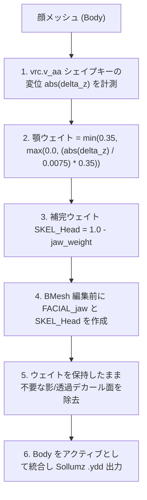

# 導入・技術ガイド: GTA V Legacy 用 VRChat アバター変換
## 3D 変換・リギング・指 30 本・リップシンク・2K テクスチャ・First-Run・3 主人公への展開

**言語 / Language / Idioma:** [Technical Guide (EN)](DEPLOYMENT_GUIDE.md) | [Guia Técnico (PT-BR)](DEPLOYMENT_GUIDE.pt-BR.md) | **技術ガイド (日本語)** | [README (EN)](../README.md) | [README (PT-BR)](../README.pt-BR.md) | [README (日本語)](../README.ja.md)

---

### 構成サマリー

| GTA V 主人公 | Ped ID | VRChat アバター | 衣装・スタイル | フォルダ |
| :--- | :--- | :--- | :--- | :--- |
| **Michael De Santa** | `player_zero` | **Shinano** | Eternal Reunion (ゴシックドレス + 懐中時計) | `2_Michael_Shinano_EternalReunion/` |
| **Franklin Clinton** | `player_one` | **Shinano** | カジュアル / 制服風 (赤スカート、青染めヘア) | `1_Franklin_Shinano_Casual/` |
| **Trevor Philips** | `player_two` | **Miltina** | クラシックメイド (黒白ロングドレス、エプロン) | `3_Trevor_Miltina_Maid/` |

---

## 1. ディレクトリ構成と著作権ポリシー (First-Run)

本リポジトリはバージョン管理された Python 自動化スクリプトと、Rockstar Games 本体データやローカルでコンパイルされる生成物を明確に分離しています:

```text
vrc2gtav/
├── RUN_MANAGER.bat                                  # OS ロケール対応 Windows ランチャー
├── EXECUTAR_GERENCIADOR.bat                         # ポルトガル語名のランチャーエイリアス
├── run_mod_manager.py                               # マスターオーケストレーター (対話メニュー + CLI)
├── vrc2gtav.cfg.example                             # バージョン管理された INI 設定テンプレート
├── configs/                                         # ブレンドシェイプ設定 (*_blendshapes.cfg) および PhysBones (*_physbones.cfg)
├── README.md / README.pt-BR.md / README.ja.md       # GitHub トップページ用 README (3か国語)
├── docs/                                            # 詳細な技術・導入ドキュメント
│   ├── DEPLOYMENT_GUIDE.md                          # 英語技術ガイド
│   ├── DEPLOYMENT_GUIDE.pt-BR.md                    # ポルトガル語技術ガイド
│   └── DEPLOYMENT_GUIDE.ja.md                       # 本技術ガイド (日本語)
│
├── _deploy_tools/                                   # 実行時ミラー & 軽量ダミーメッシュ
│   ├── head_000_r.ydd                               # 非表示ボディ用ダミーメッシュ (629 バイト)
│   ├── p_eyes_dummy.ydd                             # 眼鏡抑制用リジッドダミー (p_eyes_* スロット)
│   ├── setup_first_run.py                           # 初回セットアップウィザード (.cfg 生成 + RPF 展開)
│   ├── repack_and_deploy_everything.py              # RPF7 再パック + TOC 修正 + mods/ 配置
│   └── ...                                          # unity_scene_helper, texture_calibration_helper, hand_skeleton_helper, i18n, paths, apply_*
│
├── scripts/                                         # ソースコード本体 (Python/C++ + i18n)
│   ├── common_tools/                                # 共通ヘルパー・マネージャー・検証スイート
│   ├── physbones_asi/                               # リアルタイム VRChat PhysBones ASI (GTAVPhysBones.asi / .ini)
│   ├── Shinano_Casual_Franklin/                     # Franklin テクスチャ・Blender ビルド
│   ├── Shinano_EternalReunion_Michael/              # Michael テクスチャ・Blender・デプロイ
│   └── Miltina_Maid_Trevor/                         # Trevor テクスチャ・Blender・ステージング
│
├── 1_Franklin_Shinano_Casual/                       # 実行ミラー・ローカル生成物 (.gitignore)
├── 2_Michael_Shinano_EternalReunion/                # 実行ミラー・ローカル生成物 (.gitignore)
└── 3_Trevor_Miltina_Maid/                           # 実行ミラー・ローカル生成物 (.gitignore)
```

### 著作権分離と `.gitignore` ルール
著作権保護された GTA V のゲーム本体ファイルやローカルレンダー画像は Git 管理に含まれません。`staging/`、`renders/`、`backups/`、`vrc2gtav.cfg`、および `.yft`、`.ytd`、`.dds`、`.ydd.xml`、`.backup_*`、コンパイル済み `.ydd` は除外され、**First-Run** 時にユーザー自身の正規環境からローカルで生成されます。

`_deploy_tools/` に同梱されている `.ydd` は技術用の空ダミー 2 点のみです:
- [`_deploy_tools/head_000_r.ydd`](../_deploy_tools/head_000_r.ydd) — 629 バイトの非表示ボディダミー。
- [`_deploy_tools/p_eyes_dummy.ydd`](../_deploy_tools/p_eyes_dummy.ydd) — バニラのサングラス/眼鏡 (`p_eyes_*`) を非表示にするリジッドダミー。

---

## 2. `.cfg` マルチプラットフォーム設定・多言語対応 (`en` / `ja` / `pt`)

### 2.1 `vrc2gtav.cfg` とパス解決
スクリプト内に環境依存の絶対パスは埋め込まれていません。[`scripts/common_tools/vrc2gtav_paths.py`](../scripts/common_tools/vrc2gtav_paths.py) が以下の優先順でパスを解決します:

1. **CLI フラグ (`--gtav-root`, `--unity-assets`, `--blender`, `--rage`)**
2. **環境変数:** `VRC2GTAV_ROOT`、`VRC_ASSETS_DIR`、`GTAV_MODS_DIR`、`RAGE_CLI`、`BLENDER_EXE`、`VRC2GTAV_LANG`
3. **ローカル `vrc2gtav.cfg`:** First-Run (`setup_first_run.py`) により [`vrc2gtav.cfg.example`](../vrc2gtav.cfg.example) から生成
4. **Windows / Linux (WSL) 自動変換:** ネイティブ Windows と WSL を判別し、`D:/GTAV` ↔ `/mnt/d/GTAV` を自動変換
5. **等倍スケール `1.0` デフォルトと `.unity` 解析 (`unity_scene_helper.py`):** 初期構成 (`unity_scene =` 空欄) では体・頭・ボーン・小物のスケールをすべて `1.0` に保ちます。`[franklin]`・`[michael]`・`[trevor]` に `unity_scene`（必要に応じて `unity_avatar_name`）を設定すると、`Transform` / `PrefabInstance` の上書きスケールや `PhysBone`/Marshmallow の打ち消しを抽出して腕・指再配置前へ反映します
6. **デフォルトヘアー & 基本顔テクスチャの自動フォールバック (`texture_calibration_helper.py`):** `custom_hair` / `fbx_hair`（例: *ねこタイドボブヘア*）や任意の瞳・メイクパックが空欄または未配置でも、ベースアバター標準の髪 (`Hair_*` / `Shinano_hair.png`、`Milltina_hair_*` / 補正済み `Milltina_Hair.png`) と顔 (`Shinano_face.png`、`Milltina_Face.png`) へ安全にフォールバックします
7. **Unity 抽出 & `.cfg` ブレンドシェイプ管理 (`blendshape_helper.py`):** ビルドスクリプト内の固定ブレンドシェイプ辞書を廃止しました。表情（`.anim`）・素体シュリンク・衣装・小物・ヘアの全ウェイトは `unity_scene`（`.unity` / `.prefab` / FBX チャンネル名）から自動抽出するか、UTF-8 プリセット（`configs/shinano_blendshapes.cfg`・`configs/shinano_er_blendshapes.cfg`・`configs/miltina_blendshapes.cfg`）から `blendshapes_source = auto | unity | cfg` および `--blendshapes-source` / `--blendshapes-cfg` / `--save-blendshapes-cfg` / `--export-blendshapes` で読み書きします
8. **汎用 Unity カスタムヘアー自動移植 (`unity_hair_helper.py` + `blender_hair_helper.py`):** `shinano_casual`・`shinano_er`・`miltina_maid` すべてで、任意の `.prefab`・`m_SourcePrefab` 継承 `PrefabVariant`・Modular Avatar (`MergeArmature`/`BoneProxy`)・`.fbx` + `.mat` を `--hair` (`auto | default | none | <パス>`)、`vrc2gtav.cfg` の `custom_hair`、または対話メニュー `[8]` で指定できます。`unity_hair_helper.py` が `.fbx.meta` マテリアル対応表・非表示パーツ除外・lilToon 色調/HSV (`_Color`, `_MainTexHSVG`) を UV タイル (`custom_hair_manifest.json`) へベイクし、`blender_hair_helper.py` が頭部フィット (`--hair-scale`, `--hair-offset`) と `SKEL_Head` ウェイト転送、元ケモ耳保持を自動実行します
9. **3 主人公標準 VRChat PhysBones・自動インポーター & 優先度パッカー ([`physbone_helper.py`](../scripts/common_tools/physbone_helper.py) + [`scripts/physbones_asi/`](../scripts/physbones_asi/gtav_physbones.cpp)):** 標準構成では多関節カスタムボーン `PB_*`（計 `79` チェーン・`182` カスタムボーンを RAGE の `.ydd` 上限カスタム `<= 63`・合計 `<= 128` 内へ ELF ハッシュ衝突 `0` で配置）を Blender アーマチュアと `.yft` スケルトンへ注入し、`GTAVPhysBones.asi` と `GTAVPhysBones.ini` でリアルタイム物理演算します（マイケル `30` チェーン / `62` ボーン、フランクリン `24` チェーン / `62` ボーン、トレバー `25` チェーン / `58` ボーン — **すべて RAGE 上限内のため破棄 0**）。`Marshmallow PB` の胸プリセットは既定で無効化されており（`physbones_marshmallow = false`）、必要な場合のみ `--physbones-marshmallow` または `physbones_marshmallow = true` で有効化できます（計 `81` チェーン / `186` ボーン）。`MAX_CUSTOM_PHYSBONES_PER_PED = 63` を超えるカスタムアバターでは、`PHYSBONE_PRIORITY_TIERS` により Tier 1〜3 の必須部位（耳・主要髪/ツインテール・尻尾・翼・スカート・コート・スカーフ・袖・主要胸部）および `.L/.R` 対称ペアを優先維持し、Tier 5〜7 の非必須小物（`keychain`・`bag`・`pouch`・`plush`・`badge`・`hairpin`・`earring`・`cheek`・`belt`）を除外して元の剛体親ボーン (`SKEL_Head`・`SKEL_Pelvis` 等) へ安全に固定バインドします。さらにインポート時には `extract_unity_scene_physbones` と `prune_orphaned_physbone_chains` が**旧衣装の孤立 PhysBone**（無効化・`EditorOnly`・`m_RemovedGameObjects`/`m_RemovedComponents`・Modular Avatar 非表示・FBX ウェイトゼロの削除済み衣装メッシュや参照切れ/非アクティブな `rootTransform`）を自動で検出・除外します。`physbones_source = auto | unity | cfg`・`--physbones-source`・`--physbones-marshmallow`・`--physbones-cfg`・`--save-physbones-cfg`・`--export-physbones`・`--overwrite-physbones-from-unity`・対話メニュー `[10]` から自動同期できます。

### 2.2 3か国語ローカライズ (`en` / `ja` / `pt`)
[`scripts/common_tools/vrc2gtav_i18n.py`](../scripts/common_tools/vrc2gtav_i18n.py) により **英語 (`en`)**・**日本語 (`ja`)**・**ポルトガル語 (`pt`)** に完全対応しています:
- **自動判定順:** `--lang` フラグ → 環境変数 `VRC2GTAV_LANG` → `vrc2gtav.cfg` の `[general] language` → OS ロケール（未対応時は `en`）
- **Windows バッチランチャー:** [`RUN_MANAGER.bat`](../RUN_MANAGER.bat) / [`EXECUTAR_GERENCIADOR.bat`](../EXECUTAR_GERENCIADOR.bat) は `chcp 65001` を設定し、OS 言語に応じたメッセージを出力して Python を起動
- **Blender 実行時の引数指定:** Blender 本体の `--` 区切りの後ろに渡します (`blender -b -P <script.py> -- --lang ja`)

---

## 3. Blender 3D アーキテクチャ & GTA V リギング

### 3.1 コアスケルトン・腕・完全関節指ボーン (30 本)
GTA V の純正 `.yft` にはアニメ調アバターの姿勢を崩す補助ボーンや揺れボーンが多数含まれています。各ビルドでは必須の人体骨格 (`SKEL_ROOT`、`SKEL_Pelvis`、`SKEL_Spine_Root`、`SKEL_Spine0`..`SKEL_Spine3`、`SKEL_Neck_1`、`SKEL_Head`、脚、足、`FACIAL_facialRoot`、`FACIAL_jaw`) を残した上で、[`scripts/common_tools/hand_skeleton_helper.py`](../scripts/common_tools/hand_skeleton_helper.py) により手と腕を再構成します:

- **指ボーン 30 本 (1:1 対応):** `SKEL_L_Finger00`〜`SKEL_L_Finger42` および `SKEL_R_Finger00`〜`SKEL_R_Finger42` (`GTAV_FINGER_BONE_NAMES`)
- **腕・手首補助ボーン 8 本:** `RB_L_ArmRoll`、`RB_R_ArmRoll`、`RB_L_ForeArmRoll`、`RB_R_ForeArmRoll`、`PH_L_Hand`、`PH_R_Hand`、`IK_L_Hand`、`IK_R_Hand` (`EXTRA_ARM_HELPER_BONES`)
- **レストポーズ再配置 & `.yft` パッチ適用:**
  1. `extract_avatar_arm_hand_targets` で VRChat アバターから肩・肘・手首・全 30 本の指関節座標を取得
  2. `relocate_blender_armature_bones` で GTA V アーマチュア側をアニメ体型に合わせて移動し、カットシーン・運転・武器把持で指の開閉が自然になるよう調整
  3. `patch_yft_skeleton` で `player_zero.yft` / `player_one.yft` / `player_two.yft` のバインド変換行列を更新してエクスポート

### 3.2 リギング & ジオメトリの重要修正
1. **ツインテール・横髪ルール:** `twin`、`pony`、`twintail` を含むボーンは必ず `SKEL_Head` にマップし、単純な `"tail"` 部分一致で腰 (`SKEL_Pelvis`) に引っ張られないよう保護します。
2. **T ポーズから A ポーズへの変換 (-55°):** ウェイト転送とボーン再配置の前に、VRChat モデルの腕を GTA V の基準 A ポーズへ回転させます。
3. **RAGE `uint16` 頂点上限分割 (`split_oversized_material_geometries`):** チャンクあたり `30000` 頂点を超えるメッシュを自動分割し、`lod_dist_high` を `9998.0` に設定します。
4. **Michael Eternal Reunion — 腰ハート飾り・スカートウェイト & 懐中時計 ([`build_michael_er.py`](../scripts/Shinano_EternalReunion_Michael/build_michael_er.py)):**
   - 歩行時に位置ズレしていた腰スカートとハート装飾のウェイトを `SKEL_Pelvis`・`SKEL_L_Thigh`・`SKEL_R_Thigh` 間で最適化し、GTA V の 1 頂点最大 4 ボーン制限内に正規化します。
   - `Pocket Watch` を `Pocket Watch_Root` に精密位置合わせし、補正シェイプキーと 4×2 アトラス ([`generate_er_atlas.py`](../scripts/Shinano_EternalReunion_Michael/generate_er_atlas.py)) の専用タイル UV を割り当ててテクスチャ欠落を解消します。

---

## 4. アニメリップシンクシステム (`FACIAL_jaw`)

カットシーン、会話、携帯電話通話で口元を動かすため、3 キャラクターすべてで `Body` メッシュの表情シェイプキー `vrc.v_aa` の変位量から `FACIAL_jaw` ウェイトを算出します:



### 垂直減衰式
$$\text{weight}_{\text{jaw}} = \min\left(0.35, \max\left(0.0, \frac{|\Delta z|}{0.0075} \times 0.35\right)\right)$$
$$\text{weight}_{\text{head}} = 1.0 - \text{weight}_{\text{jaw}}$$

- **なぜ `0.35` で上限クランプするのか？** GTA V の顎ボーン回転量は実写の人間骨格を前提としているため、`1.0` のままだとアニメ調の小さな顔が過度に伸びて破綻します。`0.35` に制限することで自然な発話アニメになります。

---

## 5. テクスチャ & `.ytd` 辞書 (2K 規格・JOAAT 順)

### 5.1 2K (2048×2048) アトラスと DXT5 圧縮
- すべてのアトラス生成スクリプト ([`generate_franklin_atlas.py`](../scripts/Shinano_Casual_Franklin/generate_franklin_atlas.py)、[`generate_er_atlas.py`](../scripts/Shinano_EternalReunion_Michael/generate_er_atlas.py)、[`generate_miltina_atlas.py`](../scripts/Miltina_Maid_Trevor/generate_miltina_atlas.py)) は **2048×2048** テクスチャを出力し、`rage` 経由でミップマップ付き **DXT5 (BC3)** に変換します。
- Michael (*Eternal Reunion*) は UN1〜UN3 衣装に加え懐中時計用 UN4、金属パーツ、バックル、レンズを **4×2 アトラス** へ統合します。
- コンパイル済みメッシュは `ped_default.sps` を使用し、`DiffuseSampler`・`BumpSampler`・`SpecSampler` を接続します。

### 5.2 JOAAT ハッシュ登録順の安定性
RAGE Engine は Jenkins One-at-a-Time (**JOAAT**) ハッシュで `.ytd` 内のテクスチャを参照します。順序や名前の不整合があるとモデルが真っ黒になったりテクスチャが入れ替わります。各生成スクリプトと Blender ビルダーは拡散・スペキュラ・法線マップを一貫した順序でバインドします。

---

## 6. 配置戦略: ユニバーサルスロット置換とダミーメッシュ

GTA V の主人公服装は複数スロット (`uppr`, `lowr`, `feet`, `head`, `hair`, `berd`, `hand`, `teef`, `accs`, `task`, `jbib`) と顔プロップ (`p_eyes_*`) に分かれています。`uppr_000` だけを置換するとミッション中や着替え時に元の男性主人公の腕・頭・サングラスが貫通します。

### 解決方法:
1. **`uppr` スロットに全身モデルを配置:** [`scripts/common_tools/apply_characters.py`](../scripts/common_tools/apply_characters.py) がコンパイル済み全身 `.ydd`・`.ytd`・`.yft` を対象 `uppr` スロットへ展開します。
2. **ボディ用ダミー ([`_deploy_tools/head_000_r.ydd`](../_deploy_tools/head_000_r.ydd)):** その他のパーツスロット (`lowr`, `feet`, `head`, `hair`, `berd`, `hand`, `teef`, `accs`, `task`, `jbib`) を 629 バイトの空ダミーで置き換えます。
3. **眼鏡抑制ダミー ([`_deploy_tools/p_eyes_dummy.ydd`](../_deploy_tools/p_eyes_dummy.ydd)):** `streamedpedprops.rpf` / `x64v_modded.rpf` 内の全 35 個の `p_eyes_*.ydd` を空のリジッドダミーで上書きし、バニラ眼鏡がキャラクターの目に突き刺さるのを防ぎます。

---

## 7. RPF7 再パックと `ERR_GEN_ZLIB_2` の防止

[`scripts/common_tools/repack_and_deploy_everything.py`](../scripts/common_tools/repack_and_deploy_everything.py) は進捗バー付きで `mppatches.rpf`、`mppatchesng_dlc.rpf`、`streamedpeds_players.rpf`、`streamedpedprops.rpf`、`x64v_modded.rpf` を再パックし、次の 2 つの必須バイナリパッチを適用します:

1. **`b'OPEN'` ヘッダーフラグ (Offset 12):** `b'7FPR'` マジック検証後、オフセット 12 を `b'OPEN'` に書き換えて非暗号化カスタム RPF を RAGE が読み込めるようにします。
2. **TOC `f_size` ゼロ化 (1 エントリ 16 バイト):** 非圧縮のネストされたバイナリエントリに 0 以外の圧縮サイズ値が残るとゲーム実行時に **`ERR_GEN_ZLIB_2`** が発生するため、TOC を走査して該当エントリの圧縮サイズバイトをゼロクリアします。

---

## 8. パイプライン実行 (First-Run・マネージャー・検証)

### 8.1 First-Run・`.zip`/Unity 読込 & Blender 4.0.2 自動取得
VRChat SDK とアバターだけが入った新規 Unity プロジェクトや配布 `.zip`（例: `Shinano.zip`）から直接環境構築できます:

```bash
python scripts/common_tools/setup_first_run.py --avatar-zip "/path/to/Shinano_ver1.02.zip" --download-blender --verbose
# または既存 Unity プロジェクトを指定して実行:
python run_mod_manager.py --setup --unity-project "/path/to/UnityProject" --download-blender
```

主な機能 ([`setup_first_run.py`](../scripts/common_tools/setup_first_run.py)・[`avatar_archive_helper.py`](../scripts/common_tools/avatar_archive_helper.py)・[`modular_avatar_helper.py`](../scripts/common_tools/modular_avatar_helper.py)・[`build_universal_avatar.py`](../scripts/common_tools/build_universal_avatar.py)):
1. **Blender `4.0.2` + `Sollumz` 自動導入**: バージョンとアドオンを検査し、不足時はポータブル版を `tools/` へ安全に取得・展開します。
2. **`.zip` / `.unitypackage` 安全展開**: Zip-Slip 対策済みで `imported_unity_projects/` へ展開し、`.meta` GUID を保持します。
3. **10 件ページング＋`Next` アバター選択メニュー**: シーンの `SceneRoots`・`PrefabInstance` を解析し、1ページ10件ずつ `[N] Next` / `[P] Prev` で選択できます。
4. **ネイティブ Modular Avatar (NDMF) ベイク**: `MergeArmature`・`BoneProxy`・`ScaleAdjuster`・`MeshSettings`・`ObjectToggle`/`Activator`・`ReplaceObject`・`ShapeChanger`・`BlendshapeSync`・内蔵 `VRCPhysBone`・lilToon をそのまま統合ベイクします。
5. **顔/体ブレンドシェイプ個別確認＋カスタム衣装含む全ゼロ `.cfg`**: `--import-face-blendshapes` / `--import-body-blendshapes` の指定や対話回答に応じ、不要時はアバター＋カスタム衣装 FBX 由来の全キーを `0.0` で保存します。
6. **専用エラーハンドラ＆ `--verbose` 日時ログ**: [`error_handler_helper.py`](../scripts/common_tools/error_handler_helper.py) により通常表示を簡潔に保ち、`--verbose` 時は `logs/` へ日時・アバター名付きログを保存します。

### 8.2 対話式マネージャーと CLI モード
Windows では [`RUN_MANAGER.bat`](../RUN_MANAGER.bat)（または [`EXECUTAR_GERENCIADOR.bat`](../EXECUTAR_GERENCIADOR.bat)）をダブルクリックするか、ターミナルで以下を実行します:

```bash
# 汎用 Modular Avatar ビルダーを起動:
python scripts/common_tools/build_universal_avatar.py --avatar-zip "/path/to/Shinano_ver1.02.zip" --interactive --verbose

# 対話式メニューを起動:
python run_mod_manager.py

# 3キャラクターすべてをビルドして GTA V mods/ へ導入:
python run_mod_manager.py --character all

# 個別キャラクターのみ実行 (michael, franklin, trevor):
python run_mod_manager.py --character michael --lang ja

# 任意の主人公へ任意の VRChat プリセット (shinano_casual, shinano_er, miltina_maid) をビルド・保存:
python run_mod_manager.py --character franklin --avatar miltina_maid --save-assignment

# 任意の Unity カスタムヘア (.prefab, PrefabVariant, .fbx, default, none) を移植:
python run_mod_manager.py --character michael --hair "/path/to/CustomHair.prefab" --save-hair
# 対話メニュー [8] から custom_hair・hair_scale・hair_offset を対話形式で設定することも可能です。

# テクスチャ/Blender をスキップし配置・RPF 再パックのみ実行:
python run_mod_manager.py --deploy-only

# 環境および依存ツールのみ確認:
python run_mod_manager.py --check-env
```

### 8.3 自動検証スイート
[`scripts/common_tools/test_mod_suite.py`](../scripts/common_tools/test_mod_suite.py) はソース規約とビルド済み出力の双方を検証します:

```bash
# フルスイート (11項目: First-Run・ビルド・導入済み環境向け):
python scripts/common_tools/test_mod_suite.py --lang ja

# ソースのみ検証 (8項目: クローン直後・First-Run 前の環境でも実行可能):
python scripts/common_tools/test_mod_suite.py --source-only --lang ja
```

---

## 9. 手動ステップ実行リファレンス

```bash
# ステップ 1: 2K テクスチャアトラス (.dds / .ytd) 生成 (--hair / --hair-mat / --hair-tex 指定でカスタムヘアもベイク)
python scripts/Shinano_Casual_Franklin/generate_franklin_atlas.py
python scripts/Shinano_EternalReunion_Michael/generate_er_atlas.py
python scripts/Miltina_Maid_Trevor/generate_miltina_atlas.py

# ステップ 2: Blender + Sollumz で 3D モデルをコンパイル (--target-character と --hair / --hair-scale / --hair-offset 対応)
python scripts/Shinano_Casual_Franklin/run_build_franklin.py --target-character franklin
python scripts/Shinano_EternalReunion_Michael/run_build_er.py --target-character michael
python scripts/Miltina_Maid_Trevor/run_pipeline.py --target-character trevor

# ステップ 3: 展開済みステージングスロットへ反映 (単体・--avatar 指定または一括)
python scripts/common_tools/apply_characters.py --character player_zero
python scripts/common_tools/apply_characters.py --character franklin --avatar miltina_maid
python scripts/common_tools/apply_all_characters.py

# ステップ 4: RPF 再パック (OPEN + TOC 修正) して mods/ へ配置
python scripts/common_tools/repack_and_deploy_everything.py
```

---

## 10. アセット & ツールクレジット

本リポジトリには **Python 自動化スクリプト、ランチャー、ドキュメント、最小限の空ダミーメッシュのみ** が含まれています。3D キャラクターモデル・衣装・髪型・瞳テクスチャ・表情プリセットは各制作者に権利が帰属し **本リポジトリには同梱されていません**。公式ショップより各自ご入手ください:

### 10.1 アバター・衣装・ヘアー・アイテクスチャ

| カテゴリ | アセット名 | 制作者 / ショップ | 使用キャラクター | 公式リンク |
| :--- | :--- | :--- | :--- | :--- |
| **ベースアバター & カジュアル衣装** | オリジナル3Dモデル「しなの」 (*Shinano*) | ポンデロニウム研究所 (`ponderogen`) | Michael, Franklin | [BOOTH](https://ponderogen.booth.pm/items/6106863) / [ショップ](https://ponderogen.booth.pm/) |
| **ベースアバター & メイド服** | オリジナル3Dモデル『ミルティナ』 (*Milltina*) | DOLOS art (`dolosart`) | Trevor | [BOOTH](https://dolosart.booth.pm/items/6538026) / [ショップ](https://dolosart.booth.pm/) |
| **ドレス・靴・小物一式** | 【15アバター対応】エターナル・リユニオン【MA対応】 (*Eternal Reunion* + *Pocket Watch*) | VAGRANT (`Vagrant Brand`) | Michael | [BOOTH](https://vagrant.booth.pm/items/5634313) / [ショップ](https://vagrant.booth.pm/) |
| **ヘアー・猫耳・ヘアピン・ヘイロー (任意)** | ねこタイドボブヘア (*Neko Tied Bob hair*) | Li-ne (`Li-ne_Shop`) | Michael *(未設定時は Shinano 標準髪へ切替)* | [BOOTH](https://li-ne.booth.pm/items/7977491) / [ショップ](https://li-ne.booth.pm/) |
| **アイテクスチャ (Shinano 用・任意)** | `[eye17アバター対応]MoonButterfly eye & Rurune Make` | ha-oa | Michael, Franklin *(未設定時は `Shinano_face.png`)* | [BOOTH](https://ha-oa.booth.pm/items/8483652) / [ショップ](https://ha-oa.booth.pm/) |
| **アイテクスチャ (Milltina 用・任意)** | お魚が泳ぐ あわあわ水光 Eye Texture【10Color】【23Avatar】 (`Milltina_AWEyes`) | NAGIMA (`nagikawamart`) | Trevor *(未設定時は `Milltina_Face.png`)* | [BOOTH](https://nagikawamart.booth.pm/items/6837271) / [ショップ](https://nagikawamart.booth.pm/) |

### 10.2 ツール・シェーダー & オープンソースユーティリティ

| ツール / プロジェクト | 制作者 / 保守者 | パイプライン内の役割 | 公式リンク |
| :--- | :--- | :--- | :--- |
| **lilToon** (v2.4.1) | `lilxyzw` | 2K アトラスベイク時のレイヤー/マスク設計基準 | [GitHub](https://github.com/lilxyzw/lilToon) / [Docs](https://lilxyzw.github.io/lilToon/) |
| **FaceEmo** (v1.7.0) | `suzuryg` | `.anim` 表情プリセット作成 (`ShinanoDefAdultNewv5.anim`, `Miltina_close eyes_Base_adult.anim`) | [GitHub](https://github.com/suzuryg/face-emo) / [Docs](https://suzuryg.github.io/face-emo/) |
| **Modular Avatar** (v1.18.7) | `bd_` (Nadena) | Unity (`waifuv4`) 上での衣装/ヘアー非破壊構築 | [GitHub](https://github.com/bdunderscore/modular-avatar) / [Site](https://modular-avatar.nadena.dev/) |
| **Blender** (4.0.2) | Blender Foundation | リギング・ウェイト転送・ブレンドシェイプ・確認レンダー | [公式サイト](https://www.blender.org/) |
| **Sollumz** (v2.9.0) | `Skylumz`, `Colton`, `alexguirre` | GTA V `.ydd` / `.yft` / XML 入出力用 Blender アドオン | [GitHub](https://github.com/Sollumz/Sollumz) / [Docs](https://docs.sollumz.org/) |
| **rage-cli** (`rage` 0.28.1) | `VIRUXE` | `.rpf` 展開・再パック、`.ytd` 構築、RAGE レンダー | [GitHub](https://github.com/VIRUXE/rage-cli) |
| **RageOpenV** | `Chiheb-Bacha` | GTA V で `mods/` から RPF を読み込む `.asi` プラグイン | [GitHub](https://github.com/Chiheb-Bacha/RageOpenV) |
| **Ultimate ASI Loader** | `ThirteenAG` | `.asi` 読み込み用プロキシ DLL (`dinput8.dll`) | [GitHub](https://github.com/ThirteenAG/Ultimate-ASI-Loader) |
