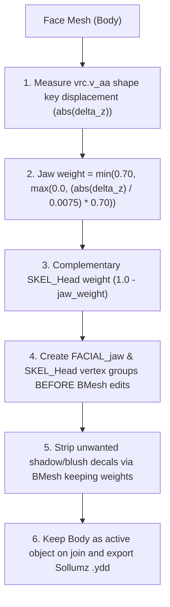

# Deployment & Technical Guide: VRChat Avatars in GTA V Legacy
## Unity Editor Plugin, 3D Conversion, Rigging, `GTAVVToon.asi`, Articulated Hands, Lip Sync, Single-Mip 2K `.ytd`s, Restore Vanilla & RPF7 Safety

**Language / Idioma / 言語:** **Technical Guide (EN)** | [Guia Técnico (PT-BR)](DEPLOYMENT_GUIDE.pt-BR.md) | [技術ガイド (日本語)](DEPLOYMENT_GUIDE.ja.md) | [README (EN)](../README.md) | [README (PT-BR)](../README.pt-BR.md) | [README (日本語)](../README.ja.md)

---

### Executive Configuration Summary

| GTA V Protagonist | In-Game Ped ID | VRChat Avatar | Outfit / Style | Character Folder |
| :--- | :--- | :--- | :--- | :--- |
| **Michael De Santa** | `player_zero` | **Shinano** | Eternal Reunion (Gothic Dress + Pocket Watch) | `2_Michael_Shinano_EternalReunion/` |
| **Franklin Clinton** | `player_one` | **Shinano** | Casual / School Uniform (Red Skirt, Blue Hair) | `1_Franklin_Shinano_Casual/` |
| **Trevor Philips** | `player_two` | **Miltina** | Classic Maid (Black/White Long Dress, Apron) | `3_Trevor_Miltina_Maid/` |

---

## 1. Unified Directory Layout & Copyright Policy (First-Run)

The repository uses a modular structure separating version-controlled automation scripts, the Unity Editor plugin, and real-time ASI plugins from Rockstar Games base game files and locally generated build artifacts:

```text
vrc2gtav/
├── VRCAvatar2GTAV.unitypackage                      # Self-contained Unity Editor plugin + Toolchain (.gitignore / built via build_unitypackage.py)
├── RUN_MANAGER.bat                                  # Windows launcher with system locale detection
├── EXECUTAR_GERENCIADOR.bat                         # Portuguese-named launcher mirror
├── run_mod_manager.py                               # Master orchestrator (interactive menu + CLI)
├── setup_first_run.py                               # First-Run wizard entrypoint
├── vrc2gtav.cfg.example                             # Versioned INI configuration template
├── configs/                                         # Blendshape presets (*_blendshapes.cfg), PhysBones (*_physbones.cfg), & local npc_registry.json / active_multi_slots.json (.gitignore)
├── npcs/                                            # Local NPC & street ped workspaces / compiled models (gitignored)
├── unity_plugin/
│   ├── Assets/VRCAvatar2GTAV/
│   │   ├── Editor/                                  # 9 C# Editor scripts (VRCAvatar2GTAV.Editor.asmdef)
│   │   └── Toolchain/                               # Staged clean copy of scripts, launchers & docs for portable Unity installs
│   ├── build_unitypackage.py                        # Packages Editor UI + Toolchain into VRCAvatar2GTAV.unitypackage
│   └── install_unity_plugin.py                      # Non-destructive installer for existing Unity projects
├── README.md / README.pt-BR.md / README.ja.md       # Trilingual GitHub landing READMEs
├── docs/                                            # Deep-dive deployment & architecture guides
│   ├── DEPLOYMENT_GUIDE.md                          # This technical guide in English
│   ├── DEPLOYMENT_GUIDE.pt-BR.md                    # Matching technical guide in Portuguese
│   └── DEPLOYMENT_GUIDE.ja.md                       # Matching technical guide in Japanese
│
├── _deploy_tools/                                   # Runtime mirror & empty dummy drawables
│   ├── head_000_r.ydd                               # 629-byte invisible dummy body mesh
│   ├── p_eyes_dummy.ydd                             # Invisible rigid prop dummy (p_*.ydd slots)
│   ├── setup_first_run.py                           # First-Run wizard (config + RPF extraction)
│   ├── restore_vanilla_helper.py                    # Selective per-ped Rockstar vanilla restore & multi-slot runner
│   ├── repack_and_deploy_everything.py              # RPF7 repacker + TOC patcher + ASI/profile deployer
│   └── ...                                          # Mirrors of VToon, PhysBones, eye-blink, hair, MA, NPC, i18n, paths helpers
│
├── scripts/                                         # Canonical Python/C++ source tree (English + i18n)
│   ├── common_tools/                                # Shared helpers, manager, builders, VToon/Restore helpers, and test suite
│   ├── physbones_asi/                               # Real-time VRChat PhysBones ASI solver (GTAVPhysBones.asi / .ini)
│   ├── vtoon_asi/                                   # Real-time D3D11 lilToon shader ASI (GTAVVToon.asi / .ini / vtoon_profiles)
│   ├── Shinano_Casual_Franklin/                     # Franklin texture & Blender build pipeline
│   ├── Shinano_EternalReunion_Michael/              # Michael texture, Blender build & deploy pipeline
│   └── Miltina_Maid_Trevor/                         # Trevor texture, Blender build & staging pipeline
│
├── 1_Franklin_Shinano_Casual/                       # Execution mirrors & local outputs (gitignored)
├── 2_Michael_Shinano_EternalReunion/                # Execution mirrors & local outputs (gitignored)
└── 3_Trevor_Miltina_Maid/                           # Execution mirrors & local outputs (gitignored)
```

### Copyright Separation & `.gitignore` Policy
No copyrighted GTA V game files, BOOTH assets, or local render screenshots are tracked in Git or bundled in [`VRCAvatar2GTAV.unitypackage`](../VRCAvatar2GTAV.unitypackage). Folders and configs such as `staging/`, `renders/`, `backups/`, `imported_unity_projects/`, `npcs/`, `vtoon_profiles/`, `VRCAvatar2GTAV_Work/`, `vrc2gtav.cfg`, `configs/npc_registry.json`, `configs/active_multi_slots.json`, `3_Trevor_Miltina_Maid/3_textures_gtav/custom_hair_manifest.json`, `1_Franklin_Shinano_Casual/5_rpf_package/`, `3_Trevor_Miltina_Maid/5_rpf_package/`, as well as `.zip`, `.unitypackage`, `.yft`, `.ytd`, `.dds`, `.ydd.xml`, `.backup_*`, and compiled `.ydd` files are gitignored and built locally from the user's own legal installation during **First-Run**, **Unity Export**, or **NPC conversion**.

The only `.ydd` files stored under `_deploy_tools/` are the two minimal scratch-built dummy meshes:
- [`_deploy_tools/head_000_r.ydd`](../_deploy_tools/head_000_r.ydd) — 629-byte empty invisible body dummy.
- [`_deploy_tools/p_eyes_dummy.ydd`](../_deploy_tools/p_eyes_dummy.ydd) — empty rigid prop dummy used to suppress vanilla hats, eyewear, and ear props (`p_*.ydd`).

---

## 2. Cross-Platform `.cfg` Configuration & Trilingual Support (`en` / `ja` / `pt`)

### 2.1 `vrc2gtav.cfg` and Path Resolution
Paths are never hardcoded in scripts. [`scripts/common_tools/vrc2gtav_paths.py`](../scripts/common_tools/vrc2gtav_paths.py) resolves locations in the following precedence order:

1. **CLI flags (`--gtav-root`, `--unity-assets`, `--blender`, `--rage`).**
2. **Environment variables:** `VRC2GTAV_ROOT`, `VRC_ASSETS_DIR`, `GTAV_MODS_DIR`, `RAGE_CLI`, `BLENDER_EXE`, `VRC2GTAV_LANG`.
3. **Local `vrc2gtav.cfg` file:** initialized from [`vrc2gtav.cfg.example`](../vrc2gtav.cfg.example) during First-Run (`setup_first_run.py`) or saved by the Unity Exporter (`Vrc2GtavConfigDiscovery.SaveToConfig`).
4. **Cross-platform auto-detection:** detects native **Windows** vs. **Linux / WSL** execution and converts drive-letter paths (e.g., `D:/GTAV` ↔ `/mnt/d/GTAV`) via `pathlib.Path`.
5. **Unit `1.0` default scales & `.unity` extraction (`unity_scene_helper.py`):** Clean repository defaults (`unity_scene =` blank) keep all avatar body, head, bone, and prop scales at `1.0`. Setting `unity_scene` (and optional `unity_avatar_name`) under `[franklin]`, `[michael]`, or `[trevor]` extracts customized `Transform` / `PrefabInstance` scales (canceling `PhysBone`/Marshmallow scale wrappers) and height-normalizes bones before arm/hand retargeting.
6. **Default hair & texture fallback (`texture_calibration_helper.py`):** Blank or missing `custom_hair` / `fbx_hair` (*Neko Tied Bob hair*) or optional eye/makeup packs automatically fall back to the base avatar's built-in hair (`Hair_*` / `Shinano_hair.png` for Shinano, `Milltina_hair_*` / calibrated `Milltina_Hair.png` for Miltina) and base face texture (`Shinano_face.png`, `Milltina_Face.png`).
7. **Unity, `.cfg` & `.anim` blendshape resolution (`blendshape_helper.py`, `universal_gtav_rigging_layer.py`):** Per-mesh blendshapes (facial `.anim` curves, body shrinks, outfit, accessory, and hair keys) are extracted live from `unity_scene` (+ nested `.prefab`s and FBX channel tables) or loaded from portable UTF-8 `.cfg` presets (`configs/shinano_blendshapes.cfg`, `configs/shinano_er_blendshapes.cfg`, `configs/miltina_blendshapes.cfg`) according to `blendshapes_source = auto | unity | cfg` and `--blendshapes-source` / `--blendshapes-cfg` / `--face-anim` / `--save-blendshapes-cfg` / `--export-blendshapes`. When `--face-anim` is blank or all-zero, Unity scene/preset facial blendshapes are preserved instead of wiped.
8. **Universal custom Unity hair porting (`unity_hair_helper.py` + `blender_hair_helper.py`):** Any VRChat Unity hair (`.prefab`, `PrefabVariant` chains via `m_SourcePrefab`, Modular Avatar `MergeArmature`/`BoneProxy` setups, `m_Materials` overrides, or raw `.fbx` + `.mat`) can be assigned via `--hair` (`auto | default | none | <path>`), `custom_hair` in `vrc2gtav.cfg`, or interactive menu option `[8]` on `shinano_casual`, `shinano_er`, or `miltina_maid`. `unity_hair_helper.py` resolves `.fbx.meta` material maps, suppresses inactive/editor-only hair parts, preserves glass/lens transparency (`preserve_alpha`), bakes lilToon textures/`_Color`/`_MainTexHSVG` tints into UV tiles (`custom_hair_manifest.json`), and `blender_hair_helper.py` fits the mesh to the avatar skull (with `--hair-scale`, `--hair-offset`, and `_partition_component_by_z_bands`), transfers `SKEL_Head` skinning, and preserves base animal ears.
9. **Complete multi-ped VRChat PhysBones, Auto-Importer, Spoke Unwrapping & Priority Packer ([`physbone_helper.py`](../scripts/common_tools/physbone_helper.py) + [`scripts/physbones_asi/`](../scripts/physbones_asi/gtav_physbones.cpp)):** Custom articulated `PB_*` chains (`182` custom bones across `79` protagonist chains by default inside RAGE's `<= 63` custom / `<= 128` total `.ydd` ceiling per ped, with `0` ELF tag collisions) are injected into Blender armatures + `.yft` skeletons and driven live in-game by `GTAVPhysBones.asi` and `GTAVPhysBones.ini` across up to **32 simultaneous tracked peds (`kMaxTrackedPeds = 32`)**, filtering `[Chain_*]` and `[Blink_*]` sections by `model = <ped_name>` / `modelHash` so protagonists and custom NPCs never collide, and applying VRChat `Advanced` (`integrationType == 1`) parent-relative `stiffness` in `ComputeChainMatrices`: Michael (`configs/michael_neko_mimi_physbones.cfg`, `30` chains / `62` bones), Franklin (`configs/shinano_casual_physbones.cfg`, `24` chains / `62` bones), and Trevor (`configs/miltina_maid_physbones.cfg`, `25` chains / `58` bones — **all keeping 100% of chains / `0` discarded**). Optional `Marshmallow PB` breast overrides are off by default (`physbones_marshmallow = false`) and can be enabled via `--physbones-marshmallow` (`81` chains / `186` bones). In `physbone_scene_extractor_layer.py`, `_unwrap_container_spokes` unwraps container spokes cleanly for lower-hair strands and bows/ribbons (`effective root transform`) and `prune_orphaned_physbone_chains` strips orphaned old-dress PhysBones before priority packing (`PHYSBONE_PRIORITY_TIERS`, binding discarded over-limit props rigidly to `parent_bone`).

### 2.2 Trilingual Localization (`en` / `ja` / `pt`)
[`scripts/common_tools/vrc2gtav_i18n.py`](../scripts/common_tools/vrc2gtav_i18n.py) (and [`Vrc2GtavLocalization.cs`](../unity_plugin/Assets/VRCAvatar2GTAV/Editor/Vrc2GtavLocalization.cs) in Unity) provides full runtime translations in **English (`en`)**, **Japanese (`ja`)**, and **Portuguese (`pt`)**:
- **Auto-detection order:** `--lang` flag → `VRC2GTAV_LANG` environment variable → `[general] language` in `vrc2gtav.cfg` → OS locale (falling back to `en`).
- **Windows launchers:** [`RUN_MANAGER.bat`](../RUN_MANAGER.bat) and [`EXECUTAR_GERENCIADOR.bat`](../EXECUTAR_GERENCIADOR.bat) inspect `VRC2GTAV_LANG` or `HKCU\Control Panel\International\LocaleName` with `chcp 65001`.
- **Blender invocations:** custom arguments must follow Blender's `--` delimiter: `blender -b -P <script.py> -- --lang ja`.

---

## 3. Blender 3D Architecture & GTA V Rigging

### 3.1 Core Skeleton, Arms & Full Articulated Finger Bones
Vanilla protagonist `.yft` skeletons contain dozens of helper/cloth bones that destabilize stylized anime meshes. Each build retains the canonical humanoid core (`SKEL_ROOT`, `SKEL_Pelvis`, `SKEL_Spine_Root`, `SKEL_Spine0`..`SKEL_Spine3`, `SKEL_Neck_1`, `SKEL_Head`, legs, feet, `FACIAL_facialRoot`, `FACIAL_jaw`) combined with the articulated hand/arm system implemented in [`scripts/common_tools/hand_skeleton_helper.py`](../scripts/common_tools/hand_skeleton_helper.py):

- **30 1:1 finger bones:** `SKEL_L_Finger00` through `SKEL_L_Finger42` and `SKEL_R_Finger00` through `SKEL_R_Finger42` (`GTAV_FINGER_BONE_NAMES`).
- **8 arm & wrist helper bones:** `RB_L_ArmRoll`, `RB_R_ArmRoll`, `RB_L_ForeArmRoll`, `RB_R_ForeArmRoll`, `PH_L_Hand`, `PH_R_Hand`, `IK_L_Hand`, `IK_R_Hand` (`EXTRA_ARM_HELPER_BONES`).
- **Rest-pose relocation & `.yft` bind-pose patching:** `extract_avatar_arm_hand_targets` reads exact VRChat joint coordinates, `relocate_blender_armature_bones` repositions GTA V armature joints, and `patch_yft_skeleton` updates `.yft` bind transforms.

### 3.2 Critical Rigging & Geometry Fixes
1. **Twintail & sidelock bone rule:** bones containing `twin`, `pony`, or `twintail` map strictly to `SKEL_Head` so naive `"tail"` matching does not bind hair to `SKEL_Pelvis`.
2. **T-Pose to A-Pose (-55°):** VRChat arms are rotated downward into GTA V's native A-Pose before weight transfer and bone relocation.
3. **Submesh slot alignment (`map_blender_slots_to_unity_submeshes`):** Maps Blender FBX material slot indices onto Unity `Mesh` submesh first-triangle order so Modular Avatar `m_Materials` overrides match textures 1:1 in [`universal_gtav_builder.py`](../scripts/common_tools/universal_gtav_builder.py).
4. **RAGE `uint16` vertex split (`split_oversized_material_geometries`):** meshes exceeding `30000` vertices per chunk are split to stay within RAGE index limits, and `lod_dist_high` is set to `9998.0`.
5. **Michael Eternal Reunion — Hip Heart, Skirt Weights & Pocket Watch ([`build_michael_er.py`](../scripts/Shinano_EternalReunion_Michael/build_michael_er.py)):** Balances waist/hip skirt & heart weights across `SKEL_Pelvis`, `SKEL_L_Thigh`, and `SKEL_R_Thigh` (`<= 4` influences/vertex), aligns `Pocket Watch` to `Pocket Watch_Root`, and maps its dedicated 4×2 atlas tile ([`generate_er_atlas.py`](../scripts/Shinano_EternalReunion_Michael/generate_er_atlas.py)).

---

## 4. Anime Lip Sync System (`FACIAL_jaw`)

To animate mouths cleanly during cutscenes, dialogue, and phone calls, all character builders compute `FACIAL_jaw` weights from the `vrc.v_aa` (or equivalent vowel-A / `JawOpen`) shape key displacement on `Body`, scaled by `--mouth-open-strength` (`DEFAULT_MOUTH_OPEN_STRENGTH = 0.70` in [`eye_blink_helper.py`](../scripts/common_tools/eye_blink_helper.py) and Unity UI slider):



### Vertical Decay Formula
$$\text{weight}_{\text{jaw}} = \min\left(0.70, \max\left(0.0, \frac{|\Delta z|}{0.0075} \times 0.70\right)\right)$$
$$\text{weight}_{\text{head}} = 1.0 - \text{weight}_{\text{jaw}}$$

- **Why clamp at `0.70` by default?** GTA V jaw rotations assume realistic human jaw depth; scaling with `0.70` (configurable from `0.00` to `1.00` in Unity or via `--mouth-open-strength`) gives expressive yet clean anime mouth articulation.

---

## 5. Textures, Single-Mip `.ytd`s, Blood Decals & `GTAVVToon.asi`

### 5.1 Single-Mip (`--mips 1`) 2K `.ytd` Dictionaries, Embedded Maps & Blood Decals
- [`universal_atlas_builder.py`](../scripts/common_tools/universal_atlas_builder.py) (as well as [`generate_franklin_atlas.py`](../scripts/Shinano_Casual_Franklin/generate_franklin_atlas.py), [`generate_er_atlas.py`](../scripts/Shinano_EternalReunion_Michael/generate_er_atlas.py), and [`generate_miltina_atlas.py`](../scripts/Miltina_Maid_Trevor/generate_miltina_atlas.py)) bakes VRChat/Unity `.mat` / lilToon properties into **single-texture external `.ytd`** dictionaries compressed as **DXT5 (BC3)** and locked with **`--mips 1`** (`rage textures build --mips 1`) at **2048×2048** by default (configurable via `--atlas-size` `512/1024/2048/4096`). Locking `--mips 1` prevents GTA V's texture streamer from downgrading ped mip levels when multiple custom avatars share a scene or cutscene.
- Supporting normal/bump and specular maps stay saved for embedded `.ydd` materials (using valid uncompressed `A8R8G8B8` DX9 DDS helpers in `blender_hair_helper.py` when flat/neutral so `DiffuseSampler` index `0` in external `.ytd` always binds cleanly). Transparent glass/eyewear materials retain alpha cleanly (`preserve_alpha=True`).
- Compiled meshes bind `ped.sps` with [`scripts/common_tools/ped_damage_helper.py`](../scripts/common_tools/ped_damage_helper.py) generating 6-zone cylindrical `UVMap 1` (`TexCoord1`) and vanilla ped vertex colors (`Color 1 = #FF8000FF`, `Color 2 = #00000000`) for native GTA V blood/wound decals (`--blood-decals`, enabled by default; `--no-blood-decals` switches to `ped_default.sps`). Whenever `TexCoord1` + `Tangent` push heavy outfits over RPF7's `16 MiB` (`0xFFFFFF`) entry limit, `enforce_ped_rpf7_poly_budget` automatically trims dense non-body accessories while preserving face/body geometry.

### 5.2 JOAAT Texture Order Stability
The RAGE Engine looks up `.ytd` textures using Jenkins One-at-a-Time (**JOAAT**) hashes. Using single-texture external `.ytd`s matching vanilla GTA V streamed ped layout guarantees consistent `DiffuseSampler` resolution without pitch-black textures or swapped maps.

### 5.3 Real-Time `GTAVVToon.asi` D3D11 lilToon Shader Engine (`scripts/vtoon_asi/`)
To overcome GTA V's harsh Lambertian PBR lighting and skin blur on anime characters, [`scripts/vtoon_asi/`](../scripts/vtoon_asi/gtav_vtoon.cpp) paired with [`scripts/common_tools/vtoon_profile_helper.py`](../scripts/common_tools/vtoon_profile_helper.py) runs a native Direct3D 11 shader override:
1. **8×4 BC-Aligned Watermark & Profile IDs (`MAX_VTOON_SLOTS = 16`)**: `stamp_vtoon_watermark_block` stamps a mip0 8×4 DXT-safe bottom-right signature (`char_id` `1..15`; protagonist IDs `player_zero=1`, `player_one=2`, `player_two=3`), matched against per-character UV-region LUTs and MatCap PNGs (`vtoon_profiles/` + `GTAVVToon.ini`) baked from Unity lilToon `.mat` files.
2. **D3D11, `DeviceContext1` & Overlay-Safe Hooking**: `vtoon_detour.hpp` and `gtav_vtoon.cpp` hook `D3D11CreateDevice*`, `ID3D11Device`, Immediate/Deferred `ID3D11DeviceContext`, `ID3D11DeviceContext1`, `IDXGISwapChain`, and `ScriptHookV`'s present callback (supporting overlays cleanly and **`F10` hot-reload** of `GTAVVToon.ini`).
3. **Custom HLSL Shaders (`vtoon_shaders_hlsl.hpp`)**:
   - `kVToonPedGBufferHlsl` (plus MSAA `SV_Coverage` alpha-to-coverage variants) writes calibrated GBuffer outputs with `targetAoEm.w = 1.0` to bypass GTA V's blurry `PS_pedSkinPassNG` skin pass while outputting `SV_Target4` VToon character metadata.
   - `kVToonDeferredOverlayHlsl` (non-MSAA and MSAA per-sample) replaces flat GTA lighting with lilToon Half-Lambert dual-border cel shading, warm SSS terminator tinting, rim lighting, MatCap hair highlights, and CSM shadows (`vtoon_probe.hpp`).
   - `kVToonForwardAlphaHlsl` overrides `ped_alpha.sps` forward passes for wispy semi-transparent bangs and translucent glasses lenses so eyelashes and eyes remain visible cleanly.
4. **SHA-256 Sync Verification**: `repack_and_deploy_everything.py` verifies SHA-256 parity between built/staged `.asi` binaries and `GTAV` game directory copies on deployment.

---

## 6. Deployment Strategy, Selective Restore-Vanilla & Universal NPCs

GTA V ped components vary between `streamed` multi-slot characters (protagonists, `ig_*` story NPCs, `cs_*` cutscene NPCs) and packed `componentpeds` street pedestrians (`a_f_*`, `a_m_*`, etc.), alongside facial/head props (`*_p` / `p_*.ydd`).

### Replacement & Restore Architecture:
1. **Full Avatar in `uppr` (Protagonists) + Dummy Slots**: [`scripts/common_tools/apply_characters.py`](../scripts/common_tools/apply_characters.py) installs the compiled avatar across `uppr` slots, suppresses unused body parts (`lowr`, `feet`, `head`, `hair`, `berd`, `hand`, `teef`, `accs`, `task`, `jbib`) with [`_deploy_tools/head_000_r.ydd`](../_deploy_tools/head_000_r.ydd), and backs up/replaces 119 protagonist wearable prop entries (`p_head_*`, `p_eyes_*`, `p_ears_*`) plus NPC `*_p` props with [`_deploy_tools/p_eyes_dummy.ydd`](../_deploy_tools/p_eyes_dummy.ydd).
2. **Selective Restore-to-Vanilla ([`restore_vanilla_helper.py`](../scripts/common_tools/restore_vanilla_helper.py))**: Passing `--restore-peds player_zero` (or comma-separated peds / `--restore-all`, or clicking the Unity UI restore buttons) extracts **only** the requested ped's vanilla files from Rockstar's original RPFs into the existing `mods/`-seeded staging dirs—keeping all other modded protagonists and NPCs untouched—and prunes only those ped entries from `GTAVPhysBones.ini`, `GTAVVToon.ini`, and `configs/npc_registry.json`.
3. **Universal NPC & Cutscene Packing ([`npc_registry_helper.py`](../scripts/common_tools/npc_registry_helper.py), [`universal_gtav_builder.py`](../scripts/common_tools/universal_gtav_builder.py)):** Resolves `streamed` (`ig_*`, `cs_*`, `patchday*`) vs `componentpeds` (`peds.rpf`), remaps native jaw bones (`FB_Jaw_000` / `FACIAL_C_Jaw` / `FACIAL_jaw`), resolves `.001` vs `" 1"` bone suffixes (`0` ungrouped vertices), preserves `.ymt` dummy attributes, and registers builds in `configs/npc_registry.json` + `npcs/<ped_name>/`.

---

## 7. RPF7 Repacking, Secondary Budget & Preventing `ERR_GEN_ZLIB_2`

[`scripts/common_tools/repack_and_deploy_everything.py`](../scripts/common_tools/repack_and_deploy_everything.py) repacks protagonist archives (`mppatches.rpf`, `mppatchesng_dlc.rpf`, `streamedpeds_players.rpf`, `streamedpedprops.rpf`, `x64v_modded.rpf`) alongside registered NPC/pedestrian archives (`x64e.rpf`, `x64g.rpf`, `x64v.rpf`, `patchday3ng`/`patchday4ng`) — using read-only `--keys` extraction without modifying `GTA5.exe` — with mandatory binary guards:

1. **`b'OPEN'` Header Flag (Offset 12):** sets offset 12 to `b'OPEN'` after verifying `b'7FPR'`.
2. **TOC `f_size` Zeroing:** zeroes compressed-size fields on uncompressed nested binary entries (preventing **`ERR_GEN_ZLIB_2`**).
3. **16 MiB (`0xFFFFFF`) Resource & 4.00 GiB Sector Offset Guards ([`ped_damage_helper.py`](../scripts/common_tools/ped_damage_helper.py)):** enforces polygon budgets (`enforce_ped_rpf7_poly_budget`), `.ydd`/`.yft` size limits (`validate_rpf7_resource_file`), `.ytd` single-entry limits (`enforce_ytd_rpf7_size_budget`), pre-pack directory scans (`assert_directory_rpf7_resources_valid`), and outer + nested RPF TOC audits (`inspect_rpf7_archive_limits`).
4. **Secondary Outfit Resolution Budgeting (`ensure_x64v_streamed_budget` & `--secondary-atlas-size`)**: Controls duplicate secondary outfit `.ytd`s (`uppr_diff_001+`) while always keeping primary `uppr_000` slots at full quality (`0` auto compacts safely below `3.7 GiB`; explicit `512`, `1024`, or `2048` lets users trade disk/RPF headroom for secondary slot fidelity).

---

## 8. Running the Pipeline (Unity Editor UI, First-Run, CLI & Tests)

### 8.1 Unity Editor Exporter Plugin (`Tools > VRCAvatar2GTAV > Export Avatar to GTA V`)
Install via [`VRCAvatar2GTAV.unitypackage`](../VRCAvatar2GTAV.unitypackage) or run:
```bash
python unity_plugin/install_unity_plugin.py --unity-project "/path/to/UnityProject"
# To rebuild VRCAvatar2GTAV.unitypackage from repo source after edits:
python unity_plugin/build_unitypackage.py
```
Key capabilities across the 9 C# Editor scripts (`unity_plugin/Assets/VRCAvatar2GTAV/Editor/`):
- **Shared vs. Tabbed Per-Protagonist Multi-Slot (`PerProtagonistSlots`)**: Configure all selected protagonists together or switch tabs (`Michael`, `Franklin`, `Trevor`) with completely independent avatars (Scene `GameObject`, `.prefab`, `.unity`, `.zip`, `.unitypackage`), textures, blendshape/PhysBone settings, `.anim` overrides, mouth opening (`0.70` default + reset button), and eye blink sliders—serialized to `configs/active_multi_slots.json` and executed sequentially in one RPF7 repack (`--slots-json`).
- **Textures & Live RPF7 Estimator (`Vrc2GtavTexturesPanel`)**: Configure Primary Atlas (`512`, `1024`, `2048`, `4096`), Normal Map (`Auto`, `Off (64 px)`, `256`, `512`, `1024`), Secondary Outfit (`Auto <3.7 GiB Safe RPF`, `512`, `1024`, `2048`), global (`*`) or per-material `_MainTex` overrides, and inspect projected `.ytd` / RPF7 footprint before building.
- **Bundled Toolchain Isolation & Runtime Status Pills (`Vrc2GtavConfigDiscovery`, `Vrc2GtavLogConsoleWidget`)**: Defaults to the self-contained `Assets/VRCAvatar2GTAV/Toolchain` folder while redirecting generated `staging/`, `logs/`, `1_...`, `2_...`, `3_...`, `npcs/` into `<ProjectRoot>/VRCAvatar2GTAV_Work/`. Displays live status badges for `dinput8.dll`, `PhysBones.asi`, `VToon.asi`, `ScriptHookV.dll`, and `OpenIV.asi`/RageOpenV, lets users toggle `Auto` / `Windows Native` / `WSL`, auto-saves dirty scenes if enabled, provides a resizable build log console, and includes one-click **Restore Vanilla** buttons (`Michael`, `Franklin`, `Trevor`, `All`).

### 8.2 First-Run Setup, `.zip`/Unity Ingestion & Blender 4.0.2 Auto-Download
```bash
python scripts/common_tools/setup_first_run.py --avatar-zip "/path/to/Shinano_ver1.02.zip" --download-blender --verbose
# Or via an existing Unity project / master orchestrator:
python run_mod_manager.py --setup --unity-project "/path/to/MyUnityProject" --download-blender --download-rage
# Or build & deploy any GTA V NPC / street ped directly from an avatar .zip or .unitypackage:
python run_mod_manager.py --npc ig_lamardavis --avatar-zip "/path/to/Karin.zip"
```
Includes portable Blender `4.0.2` + `Sollumz` & `rage-cli` auto-download into `tools/`, Zip-Slip protected extraction into `imported_unity_projects/`, 10-per-page paginated avatar picker, Native Modular Avatar (NDMF) bake, separate Face/Body blendshape prompts, and `error_handler_helper.py` timestamped `--verbose` logs in `logs/`.

### 8.3 Interactive Manager & CLI Modes
On Windows, double-click [`RUN_MANAGER.bat`](../RUN_MANAGER.bat) (or [`EXECUTAR_GERENCIADOR.bat`](../EXECUTAR_GERENCIADOR.bat)), or run via terminal:

```bash
# Universal Modular Avatar workflow (CLI or interactive wizard):
python scripts/common_tools/build_universal_avatar.py --avatar-zip "/path/to/Shinano_ver1.02.zip" --interactive --verbose

# Sequential multi-slot build from Unity/JSON manifest with explicit mouth opening & secondary resolution:
python scripts/common_tools/universal_gtav_builder.py --slots-json "configs/active_multi_slots.json" --secondary-atlas-size 2048

# Single-slot universal build with explicit atlas, mouth opening (0.70 default), and face .anim override:
python scripts/common_tools/universal_gtav_builder.py --source "/path/to/Avatar.prefab" --target-ped player_one --atlas-size 2048 --mouth-open-strength 0.70 --face-anim "/path/to/Face.anim"

# Selectively restore one protagonist or all modded peds back to Rockstar vanilla:
python scripts/common_tools/universal_gtav_builder.py --restore-peds player_zero
python scripts/common_tools/universal_gtav_builder.py --restore-all

# Master orchestrator interactive menu & protagonist builds:
python run_mod_manager.py
python run_mod_manager.py --character all
python run_mod_manager.py --character michael --lang en
python run_mod_manager.py --character franklin --avatar miltina_maid --save-assignment
python run_mod_manager.py --character michael --hair "/path/to/CustomHair.prefab" --save-hair

# Custom NPCs & street pedestrians (or interactive option [11]):
python run_mod_manager.py --npc ig_lamardavis --avatar-zip "/path/to/Karin.zip"
python scripts/common_tools/build_universal_avatar.py --avatar-zip "/path/to/Karin.zip" --target-ped cs_lamardavis --deploy-npc
python run_mod_manager.py --all-npcs

# Deploy / repack only & environment audit:
python run_mod_manager.py --deploy-only
python run_mod_manager.py --check-env
```

### 8.4 Automated Validation Suite
[`scripts/common_tools/test_mod_suite.py`](../scripts/common_tools/test_mod_suite.py) validates both source invariants (including Unity C# exporter bounds, `.unitypackage` build & Toolchain mirror parity, VToon watermark/INI/ALU checks, single-mip `.ytd`s, Restore-Vanilla, and multi-slot pipeline) and compiled game outputs:

```bash
# Full suite (13 checks; requires First-Run, build, and deploy):
python scripts/common_tools/test_mod_suite.py --lang en

# Source-only suite (10 checks; runs on a fresh clone prior to First-Run):
python scripts/common_tools/test_mod_suite.py --source-only --lang en
```

---

## 9. Manual Step-by-Step Reference

```bash
# Step 1: Generate 2K single-mip texture atlases (.dds and .ytd; add --hair / --hair-mat / --hair-tex to bake custom hair)
python scripts/Shinano_Casual_Franklin/generate_franklin_atlas.py
python scripts/Shinano_EternalReunion_Michael/generate_er_atlas.py
python scripts/Miltina_Maid_Trevor/generate_miltina_atlas.py

# Step 2: Compile 3D models in Blender + Sollumz (supports --target-character, --hair / --hair-scale / --hair-offset, --mouth-open-strength)
python scripts/Shinano_Casual_Franklin/run_build_franklin.py --target-character franklin
python scripts/Shinano_EternalReunion_Michael/run_build_er.py --target-character michael
python scripts/Miltina_Maid_Trevor/run_pipeline.py --target-character trevor

# Step 3: Populate staging slots (single protagonist, optional --avatar override, or all three)
python scripts/common_tools/apply_characters.py --character player_zero
python scripts/common_tools/apply_characters.py --character franklin --avatar miltina_maid
python scripts/common_tools/apply_all_characters.py

# Step 4: Repack RPFs (OPEN header + TOC fix + ASI/VToon/PhysBones sync) and install into mods/
python scripts/common_tools/repack_and_deploy_everything.py
```

---

## 10. Assets & Tools Credits

This repository contains **only automation scripts, C# Unity Editor plugin code, C++ ASI plugin sources/tools, launchers, documentation, and minimal empty dummy meshes**. All 3D character models, outfits, hair, eye textures, and expression presets belong to their respective creators and **are not bundled here**; obtain each asset from its official storefront below:

### 10.1 Avatars, Outfits, Hair & Eye Textures

| Category | Asset Name | Creator / Shop | Used On | Official Link |
| :--- | :--- | :--- | :--- | :--- |
| **Base Avatar & Casual Outfit** | オリジナル3Dモデル「しなの」 (*Shinano*) | ポンデロニウム研究所 (`ponderogen`) | Michael, Franklin | [BOOTH](https://ponderogen.booth.pm/items/6106863) / [Shop](https://ponderogen.booth.pm/) |
| **Base Avatar & Maid Outfit** | オリジナル3Dモデル『ミルティナ』 (*Milltina*) | DOLOS art (`dolosart`) | Trevor | [BOOTH](https://dolosart.booth.pm/items/6538026) / [Shop](https://dolosart.booth.pm/) |
| **Dress, Shoes & Accessories** | 【15アバター対応】エターナル・リユニオン【MA対応】 (*Eternal Reunion* + *Pocket Watch*) | VAGRANT (`Vagrant Brand`) | Michael | [BOOTH](https://vagrant.booth.pm/items/5634313) / [Shop](https://vagrant.booth.pm/) |
| **Hair, Cat Ears, Clips & Halo (Optional)** | ねこタイドボブヘア (*Neko Tied Bob hair*) | Li-ne (`Li-ne_Shop`) | Michael *(defaults to Shinano hair if absent)* | [BOOTH](https://li-ne.booth.pm/items/7977491) / [Shop](https://li-ne.booth.pm/) |
| **Eye Texture (Shinano, Optional)** | `[eye17アバター対応]MoonButterfly eye & Rurune Make` | ha-oa | Michael, Franklin *(defaults to `Shinano_face.png`)* | [BOOTH](https://ha-oa.booth.pm/items/8483652) / [Shop](https://ha-oa.booth.pm/) |
| **Eye Texture (Milltina, Optional)** | お魚が泳ぐ あわあわ水光 Eye Texture【10Color】【23Avatar】 (`Milltina_AWEyes`) | NAGIMA (`nagikawamart`) | Trevor *(defaults to `Milltina_Face.png`)* | [BOOTH](https://nagikawamart.booth.pm/items/6837271) / [Shop](https://nagikawamart.booth.pm/) |

### 10.2 Tools, Shaders & Open-Source Utilities

| Tool / Project | Author / Maintainer | Pipeline Role | Official Link |
| :--- | :--- | :--- | :--- |
| **lilToon** (v2.4.1) | `lilxyzw` | Layer/mask/shader baseline for 2K atlas & `GTAVVToon.asi` | [GitHub](https://github.com/lilxyzw/lilToon) / [Docs](https://lilxyzw.github.io/lilToon/) |
| **FaceEmo** (v1.7.0) | `suzuryg` | Facial `.anim` authoring (`ShinanoDefAdultNewv5.anim`, `Miltina_close eyes_Base_adult.anim`) | [GitHub](https://github.com/suzuryg/face-emo) / [Docs](https://suzuryg.github.io/face-emo/) |
| **Modular Avatar** (v1.18.7) | `bd_` (Nadena) | Non-destructive Unity outfit/hair assembly (`waifuv4`) | [GitHub](https://github.com/bdunderscore/modular-avatar) / [Site](https://modular-avatar.nadena.dev/) |
| **Blender** (4.0.2) | Blender Foundation | Rigging, weight transfer, blendshapes, and verification renders | [Official Site](https://www.blender.org/) |
| **Sollumz** (v2.9.0) | `Skylumz`, `Colton`, `alexguirre` | Blender add-on for GTA V `.ydd` / `.yft` / XML import & export | [GitHub](https://github.com/Sollumz/Sollumz) / [Docs](https://docs.sollumz.org/) |
| **rage-cli** (`rage` 0.28.1) | `VIRUXE` | `.rpf` extraction/repacking, `--mips 1` `.ytd` builds, and RAGE renders | [GitHub](https://github.com/VIRUXE/rage-cli) |
| **RageOpenV** | `Chiheb-Bacha` | `.asi` plugin loading RPF archives from `mods/` in GTA V | [GitHub](https://github.com/Chiheb-Bacha/RageOpenV) |
| **ScriptHookV** | `Alexander Blade` | Runtime native/Present hook integration for `GTAVVToon.asi` & `GTAVPhysBones.asi` | [Website](https://www.dev-c.com/gtav/scripthookv/) |
| **Ultimate ASI Loader** | `ThirteenAG` | Proxy DLL (`dinput8.dll`) for loading `.asi` mods | [GitHub](https://github.com/ThirteenAG/Ultimate-ASI-Loader) |
