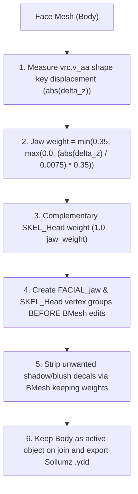

# Deployment & Technical Guide: VRChat Avatars in GTA V Legacy
## 3D Conversion, Rigging, Articulated Hands, Lip Sync, 2K Textures, First-Run, Protagonist & Universal NPC Deployment

**Language / Idioma / 言語:** **Technical Guide (EN)** | [Guia Técnico (PT-BR)](DEPLOYMENT_GUIDE.pt-BR.md) | [技術ガイド (日本語)](DEPLOYMENT_GUIDE.ja.md) | [README (EN)](../README.md) | [README (PT-BR)](../README.pt-BR.md) | [README (日本語)](../README.ja.md)

---

### Executive Configuration Summary

| GTA V Protagonist | In-Game Ped ID | VRChat Avatar | Outfit / Style | Character Folder |
| :--- | :--- | :--- | :--- | :--- |
| **Michael De Santa** | `player_zero` | **Shinano** | Eternal Reunion (Gothic Dress + Pocket Watch) | `2_Michael_Shinano_EternalReunion/` |
| **Franklin Clinton** | `player_one` | **Shinano** | Casual / School Uniform (Red Skirt, Blue Hair) | `1_Franklin_Shinano_Casual/` |
| **Trevor Philips** | `player_two` | **Miltina** | Classic Maid (Black/White Long Dress, Apron) | `3_Trevor_Miltina_Maid/` |

---

## 1. Unified Directory Layout & Copyright Policy (First-Run)

The repository uses a modular structure separating version-controlled automation scripts from Rockstar Games base game files and locally generated build artifacts:

```text
vrc2gtav/
├── RUN_MANAGER.bat                                  # Windows launcher with system locale detection
├── EXECUTAR_GERENCIADOR.bat                         # Portuguese-named launcher mirror
├── run_mod_manager.py                               # Master orchestrator (interactive menu + CLI)
├── vrc2gtav.cfg.example                             # Versioned INI configuration template
├── configs/                                         # Blendshape presets (*_blendshapes.cfg), PhysBones (*_physbones.cfg), & local npc_registry.json (gitignored)
├── npcs/                                            # Local NPC & street ped workspaces / compiled models (gitignored)
├── README.md / README.pt-BR.md / README.ja.md       # Trilingual GitHub landing READMEs
├── docs/                                            # Deep-dive deployment & architecture guides
│   ├── DEPLOYMENT_GUIDE.md                          # This technical guide in English
│   ├── DEPLOYMENT_GUIDE.pt-BR.md                    # Matching technical guide in Portuguese
│   └── DEPLOYMENT_GUIDE.ja.md                       # Matching technical guide in Japanese
│
├── _deploy_tools/                                   # Runtime mirror & empty dummy drawables
│   ├── head_000_r.ydd                               # 629-byte invisible dummy body mesh
│   ├── p_eyes_dummy.ydd                             # Invisible rigid prop dummy (p_*.ydd slots)
│   ├── setup_first_run.py                           # First-Run wizard (config + RPF extraction)
│   ├── repack_and_deploy_everything.py              # RPF7 repacker + TOC patcher + installer
│   └── ...                                          # Mirrors of unity_scene_helper, texture_calibration_helper, hand_skeleton_helper, i18n, paths, apply_*
│
├── scripts/                                         # Canonical Python/C++ source tree (English + i18n)
│   ├── common_tools/                                # Shared helpers, manager, and test suite
│   ├── physbones_asi/                               # Real-time VRChat PhysBones ASI solver (GTAVPhysBones.asi / .ini)
│   ├── Shinano_Casual_Franklin/                     # Franklin texture & Blender build pipeline
│   ├── Shinano_EternalReunion_Michael/              # Michael texture, Blender build & deploy pipeline
│   └── Miltina_Maid_Trevor/                         # Trevor texture, Blender build & staging pipeline
│
├── 1_Franklin_Shinano_Casual/                       # Execution mirrors & local outputs (gitignored)
├── 2_Michael_Shinano_EternalReunion/                # Execution mirrors & local outputs (gitignored)
└── 3_Trevor_Miltina_Maid/                           # Execution mirrors & local outputs (gitignored)
```

### Copyright Separation & `.gitignore` Policy
No copyrighted GTA V game files, BOOTH assets, or local render screenshots are tracked in Git. Folders and configs such as `staging/`, `renders/`, `backups/`, `imported_unity_projects/`, `npcs/`, `vrc2gtav.cfg`, `configs/npc_registry.json`, `3_Trevor_Miltina_Maid/3_textures_gtav/custom_hair_manifest.json`, `1_Franklin_Shinano_Casual/5_rpf_package/`, `3_Trevor_Miltina_Maid/5_rpf_package/`, as well as `.zip`, `.unitypackage`, `.yft`, `.ytd`, `.dds`, `.ydd.xml`, `.backup_*`, and compiled `.ydd` files are gitignored and built locally from the user's own legal installation during **First-Run** or NPC conversion.

The only `.ydd` files stored under `_deploy_tools/` are the two minimal scratch-built dummy meshes:
- [`_deploy_tools/head_000_r.ydd`](../_deploy_tools/head_000_r.ydd) — 629-byte empty invisible body dummy.
- [`_deploy_tools/p_eyes_dummy.ydd`](../_deploy_tools/p_eyes_dummy.ydd) — empty rigid prop dummy used to suppress vanilla hats, eyewear, and ear props (`p_*.ydd`).

---

## 2. Cross-Platform `.cfg` Configuration & Trilingual Support (`en` / `ja` / `pt`)

### 2.1 `vrc2gtav.cfg` and Path Resolution
Paths are never hardcoded in scripts. [`scripts/common_tools/vrc2gtav_paths.py`](../scripts/common_tools/vrc2gtav_paths.py) resolves locations in the following precedence order:

1. **CLI flags (`--gtav-root`, `--unity-assets`, `--blender`, `--rage`).**
2. **Environment variables:** `VRC2GTAV_ROOT`, `VRC_ASSETS_DIR`, `GTAV_MODS_DIR`, `RAGE_CLI`, `BLENDER_EXE`, `VRC2GTAV_LANG`.
3. **Local `vrc2gtav.cfg` file:** initialized from [`vrc2gtav.cfg.example`](../vrc2gtav.cfg.example) during First-Run (`setup_first_run.py`).
4. **Cross-platform auto-detection:** detects native **Windows** vs. **Linux / WSL** execution and converts drive-letter paths (e.g., `D:/GTAV` ↔ `/mnt/d/GTAV`) via `pathlib.Path`.
5. **Unit `1.0` default scales & `.unity` extraction (`unity_scene_helper.py`):** Clean repository defaults (`unity_scene =` blank) keep all avatar body, head, bone, and prop scales at `1.0`. Setting `unity_scene` (and optional `unity_avatar_name`) under `[franklin]`, `[michael]`, or `[trevor]` extracts customized `Transform` / `PrefabInstance` scales (canceling `PhysBone`/Marshmallow scale wrappers) and height-normalizes bones before arm/hand retargeting.
6. **Default hair & texture fallback (`texture_calibration_helper.py`):** Blank or missing `custom_hair` / `fbx_hair` (*Neko Tied Bob hair*) or optional eye/makeup packs automatically fall back to the base avatar's built-in hair (`Hair_*` / `Shinano_hair.png` for Shinano, `Milltina_hair_*` / calibrated `Milltina_Hair.png` for Miltina) and base face texture (`Shinano_face.png`, `Milltina_Face.png`).
7. **Unity & `.cfg` blendshape resolution (`blendshape_helper.py`):** Hardcoded blendshape tables are removed from build scripts. Per-mesh blendshapes (facial `.anim` curves, body shrinks, outfit, accessory, and hair keys) are extracted live from `unity_scene` (+ nested `.prefab`s and FBX channel tables) or loaded from portable UTF-8 `.cfg` presets (`configs/shinano_blendshapes.cfg`, `configs/shinano_er_blendshapes.cfg`, `configs/miltina_blendshapes.cfg`) according to `blendshapes_source = auto | unity | cfg` and `--blendshapes-source` / `--blendshapes-cfg` / `--save-blendshapes-cfg` / `--export-blendshapes`.
8. **Universal custom Unity hair porting (`unity_hair_helper.py` + `blender_hair_helper.py`):** Any VRChat Unity hair (`.prefab`, `PrefabVariant` chains via `m_SourcePrefab`, Modular Avatar `MergeArmature`/`BoneProxy` setups, or raw `.fbx` + `.mat`) can be assigned via `--hair` (`auto | default | none | <path>`), `custom_hair` in `vrc2gtav.cfg`, or interactive menu option `[8]` on `shinano_casual`, `shinano_er`, or `miltina_maid`. `unity_hair_helper.py` resolves `.fbx.meta` material maps, suppresses inactive/editor-only hair parts, bakes lilToon textures/`_Color`/`_MainTexHSVG` tints into UV tiles (`custom_hair_manifest.json`), and `blender_hair_helper.py` fits the mesh to the avatar skull (with `--hair-scale` and `--hair-offset`), transfers `SKEL_Head` skinning, and preserves base animal ears.
9. **Complete multi-ped VRChat PhysBones, Auto-Importer & Priority Packer ([`physbone_helper.py`](../scripts/common_tools/physbone_helper.py) + [`scripts/physbones_asi/`](../scripts/physbones_asi/gtav_physbones.cpp)):** Custom articulated `PB_*` chains (`182` custom bones across `79` protagonist chains by default inside RAGE's `<= 63` custom / `<= 128` total `.ydd` ceiling per ped, with `0` ELF tag collisions) are injected into Blender armatures + `.yft` skeletons and driven live in-game by `GTAVPhysBones.asi` and `GTAVPhysBones.ini` across up to **32 simultaneous tracked peds (`kMaxTrackedPeds = 32`)**, filtering `[Chain_*]` and `[Blink_*]` sections by `model = <ped_name>` / `modelHash` so protagonists and custom NPCs never collide, and applying VRChat `Advanced` (`integrationType == 1`) parent-relative `stiffness` in `ComputeChainMatrices`: Michael (`configs/michael_neko_mimi_physbones.cfg`, `30` chains / `62` bones), Franklin (`configs/shinano_casual_physbones.cfg`, `24` chains / `62` bones), and Trevor (`configs/miltina_maid_physbones.cfg`, `25` chains / `58` bones — standard non-Marshmallow Miltina rig, **all keeping 100% of chains / `0` discarded**). Optional `Marshmallow PB` breast overrides are off by default (`physbones_marshmallow = false`) and can be enabled via `--physbones-marshmallow` or `physbones_marshmallow = true` (`81` chains / `186` bones). When an arbitrary custom avatar exceeds `MAX_CUSTOM_PHYSBONES_PER_PED = 63`, `PHYSBONE_PRIORITY_TIERS` preserves Tier 1–3 essentials (ears, primary hair/twintails, tails, wings, skirts, coats, scarves, sleeves, main chest) and symmetric `.L/.R` pairs while discarding Tier 5–7 non-essential props (`keychain`, `bag`, `pouch`, `plush`, `badge`, `hairpin`, `earring`, `cheek`, `belt`) and binding discarded vertices rigidly to their `parent_bone` (`SKEL_Head`, `SKEL_Pelvis`, etc.); during import, `extract_unity_scene_physbones` and `prune_orphaned_physbone_chains` also strip **orphaned old-dress PhysBones** (disabled/`EditorOnly`/`m_RemovedGameObjects`/`m_RemovedComponents`/MA-toggled/deleted dress meshes with zero active weights, plus dangling or inactive `rootTransform`s). Controlled via `physbones_source = auto | unity | cfg`, `--physbones-source`, `--physbones-marshmallow`, `--physbones-cfg`, `--save-physbones-cfg`, `--export-physbones`, `--overwrite-physbones-from-unity`, and interactive menu option `[10]`.

### 2.2 Trilingual Localization (`en` / `ja` / `pt`)
[`scripts/common_tools/vrc2gtav_i18n.py`](../scripts/common_tools/vrc2gtav_i18n.py) provides full runtime translations in **English (`en`)**, **Japanese (`ja`)**, and **Portuguese (`pt`)**:
- **Auto-detection order:** `--lang` flag → `VRC2GTAV_LANG` environment variable → `[general] language` in `vrc2gtav.cfg` → OS locale (falling back to `en`).
- **Windows launchers:** [`RUN_MANAGER.bat`](../RUN_MANAGER.bat) and [`EXECUTAR_GERENCIADOR.bat`](../EXECUTAR_GERENCIADOR.bat) inspect `VRC2GTAV_LANG` or `HKCU\Control Panel\International\LocaleName` with `chcp 65001`, printing localized prompts before launching Python.
- **Blender invocations:** custom arguments must follow Blender's `--` delimiter: `blender -b -P <script.py> -- --lang ja`.

---

## 3. Blender 3D Architecture & GTA V Rigging

### 3.1 Core Skeleton, Arms & Full Articulated Finger Bones
Vanilla protagonist `.yft` skeletons contain dozens of helper/cloth bones that destabilize stylized anime meshes. Each build retains the canonical humanoid core (`SKEL_ROOT`, `SKEL_Pelvis`, `SKEL_Spine_Root`, `SKEL_Spine0`..`SKEL_Spine3`, `SKEL_Neck_1`, `SKEL_Head`, legs, feet, `FACIAL_facialRoot`, `FACIAL_jaw`) combined with the articulated hand/arm system implemented in [`scripts/common_tools/hand_skeleton_helper.py`](../scripts/common_tools/hand_skeleton_helper.py):

- **30 1:1 finger bones:** `SKEL_L_Finger00` through `SKEL_L_Finger42` and `SKEL_R_Finger00` through `SKEL_R_Finger42` (`GTAV_FINGER_BONE_NAMES`).
- **8 arm & wrist helper bones:** `RB_L_ArmRoll`, `RB_R_ArmRoll`, `RB_L_ForeArmRoll`, `RB_R_ForeArmRoll`, `PH_L_Hand`, `PH_R_Hand`, `IK_L_Hand`, `IK_R_Hand` (`EXTRA_ARM_HELPER_BONES`).
- **Rest-pose relocation & `.yft` bind-pose patching:**
  1. `extract_avatar_arm_hand_targets` reads exact shoulder, elbow, wrist, and all 30 finger joint positions from the VRChat avatar.
  2. `relocate_blender_armature_bones` moves the GTA V armature bones in Blender to match the anime proportions so fingers open and close naturally in cutscenes, driving, and weapon-grip animations.
  3. `patch_yft_skeleton` updates the `.yft` bind matrices (`player_zero.yft`, `player_one.yft`, `player_two.yft`) exported alongside the `.ydd`.

### 3.2 Critical Rigging & Geometry Fixes
1. **Twintail & sidelock bone rule:** bones containing `twin`, `pony`, or `twintail` map strictly to `SKEL_Head` so naive `"tail"` matching does not bind hair to `SKEL_Pelvis`.
2. **T-Pose to A-Pose (-55°):** VRChat arms are rotated downward into GTA V's native A-Pose before weight transfer and bone relocation.
3. **RAGE `uint16` vertex split (`split_oversized_material_geometries`):** meshes exceeding `30000` vertices per chunk are split to stay within RAGE index limits, and `lod_dist_high` is set to `9998.0`.
4. **Michael Eternal Reunion — Hip Heart, Skirt Weights & Pocket Watch ([`build_michael_er.py`](../scripts/Shinano_EternalReunion_Michael/build_michael_er.py)):**
   - Waist/hip skirt and heart ornament weights (which previously detached or drifted during leg movement) are balanced across `SKEL_Pelvis`, `SKEL_L_Thigh`, and `SKEL_R_Thigh`, clamped to GTA V's 4-bone influence limit per vertex.
   - `Pocket Watch` aligns precisely to `Pocket Watch_Root`, applies its corrective blendshape, and maps UVs into its dedicated tile of the 4×2 atlas ([`generate_er_atlas.py`](../scripts/Shinano_EternalReunion_Michael/generate_er_atlas.py)) so it renders fully textured.

---

## 4. Anime Lip Sync System (`FACIAL_jaw`)

To animate mouths cleanly during cutscenes, dialogue, and phone calls, all three character builders compute `FACIAL_jaw` weights from the `vrc.v_aa` facial shape key displacement on `Body`:



### Vertical Decay Formula
$$\text{weight}_{\text{jaw}} = \min\left(0.35, \max\left(0.0, \frac{|\Delta z|}{0.0075} \times 0.35\right)\right)$$
$$\text{weight}_{\text{head}} = 1.0 - \text{weight}_{\text{jaw}}$$

- **Why clamp at `0.35`?** GTA V jaw rotations assume realistic human jaw depth; a full `1.0` weight overstretches compact anime faces. Capping at `0.35` produces clean, anime-accurate mouth articulation.

---

## 5. Textures & `.ytd` Dictionaries (2K Standard & JOAAT Order)

### 5.1 2K (2048×2048) Atlas & DXT5 Compression
- All protagonist atlas generators ([`generate_franklin_atlas.py`](../scripts/Shinano_Casual_Franklin/generate_franklin_atlas.py), [`generate_er_atlas.py`](../scripts/Shinano_EternalReunion_Michael/generate_er_atlas.py), [`generate_miltina_atlas.py`](../scripts/Miltina_Maid_Trevor/generate_miltina_atlas.py)) and the dynamic NPC/custom avatar baker ([`universal_atlas_builder.py`](../scripts/common_tools/universal_atlas_builder.py)) output **2048×2048** textures compressed as **DXT5 (BC3)** with mipmaps via `rage`.
- [`universal_atlas_builder.py`](../scripts/common_tools/universal_atlas_builder.py) parses Unity `.mat` / lilToon properties directly from `.zip`, `.unitypackage`, or Unity projects, automatically preserving hair transparency while filtering unwanted body alpha overlay layers.
- Michael (*Eternal Reunion*) packs all outfit variations UN1–UN3 plus the Pocket Watch tile UN4, metallic golds, buckles, and lenses into a **4×2 texture atlas**.
- Compiled meshes bind `ped.sps` with `DiffuseSampler`, `BumpSampler`, and `SpecSampler`, plus [`scripts/common_tools/ped_damage_helper.py`](../scripts/common_tools/ped_damage_helper.py) generating the 6-zone cylindrical `UVMap 1` (`TexCoord1`) layout from `peddamage.xml` (`CPedDamageCylinderInfoSet::HUMAN`) and vanilla ped vertex colors (`Color 1 = #FF8000FF`, `Color 2 = #00000000`) for native GTA V blood/wound decals (`--blood-decals`, enabled by default; pass `--no-blood-decals` for `ped_default.sps`). Whenever `TexCoord1` + `Tangent` vertex attributes push heavy outfits over RPF7's 24-bit `16 MiB` (`0xFFFFFF`) entry limit, `enforce_ped_rpf7_poly_budget` automatically trims only high-poly accessories while leaving face/body meshes untouched.

### 5.2 JOAAT Texture Order Stability
The RAGE Engine looks up `.ytd` textures using Jenkins One-at-a-Time (**JOAAT**) hashes. Reordering textures or mismatching shader/dictionary names causes pitch-black rendering or swapped maps. Each atlas script and Blender builder keeps diffuse, specular, and normal maps synchronized in deterministic order.

---

## 6. Deployment Strategy: Protagonists, Story/Cutscene NPCs & Street Peds

GTA V ped components vary between `streamed` multi-slot characters (protagonists, `ig_*` story NPCs, and `cs_*` cutscene NPCs) and packed `componentpeds` street pedestrians (`a_f_*`, `a_m_*`, etc.), alongside facial/head props (`*_p` / `p_*.ydd`). Replacing only `uppr_000` allows original limbs, clothing, hats, or glasses to clip back in during missions or cutscenes.

### How Universal Replacement Solves This:
1. **Full Avatar in `uppr` (Protagonists):** [`scripts/common_tools/apply_characters.py`](../scripts/common_tools/apply_characters.py) replicates the compiled full-body `.ydd`, `.ytd`, and `.yft` across all target `uppr` slots in staging.
2. **Body Dummy ([`_deploy_tools/head_000_r.ydd`](../_deploy_tools/head_000_r.ydd)):** every remaining humanoid slot (`lowr`, `feet`, `head`, `hair`, `berd`, `hand`, `teef`, `accs`, `task`, `jbib`) is replaced with the 629-byte invisible dummy drawable.
3. **Hat / Eyewear / Prop Dummy ([`_deploy_tools/p_eyes_dummy.ydd`](../_deploy_tools/p_eyes_dummy.ydd)):** all 119 protagonist wearable prop entries (`p_head_*.ydd`, `p_eyes_*.ydd`, `p_ears_*.ydd`) in `streamedpedprops.rpf` / `x64v_modded.rpf` (as well as NPC `*_p` prop entries like `ig_lamardavis_p` / `cs_lamardavis_p`) are backed up cleanly and replaced with empty rigid prop dummies so vanilla caps, hats, headsets, and glasses never poke through characters during missions or cutscenes.
4. **Universal NPC & Cutscene Packing ([`npc_registry_helper.py`](../scripts/common_tools/npc_registry_helper.py), [`universal_gtav_builder.py`](../scripts/common_tools/universal_gtav_builder.py)):** automatically resolves whether any target ped belongs to `streamed` (`ig_lamardavis` in `x64e.rpf`/`x64v.rpf`, `cs_lamardavis` in `x64g.rpf`/`x64v.rpf`, `patchday*`) or packed `componentpeds` (`peds.rpf` inside `x64e.rpf`, e.g., `a_f_m_beach_01`), remaps native NPC jaw bones (`FB_Jaw_000` / `FACIAL_C_Jaw` / `FACIAL_jaw`), matches `.001` vs `" 1"` bone suffixes cleanly with `0` ungrouped vertices, preserves `.ymt` dummy attributes for `componentpeds`, and registers builds in `configs/npc_registry.json` + `npcs/<ped_name>/`.

---

## 7. RPF7 Repacking & Preventing `ERR_GEN_ZLIB_2`

[`scripts/common_tools/repack_and_deploy_everything.py`](../scripts/common_tools/repack_and_deploy_everything.py) repacks protagonist archives (`mppatches.rpf`, `mppatchesng_dlc.rpf`, `streamedpeds_players.rpf`, `streamedpedprops.rpf`, `x64v_modded.rpf`) alongside registered NPC/pedestrian archives (`x64e.rpf`, `x64g.rpf`, `x64v.rpf`, `patchday3ng`/`patchday4ng`) — using read-only `--keys` extraction without modifying `GTA5.exe` — with live terminal progress bars and mandatory low-level binary fixes:

1. **`b'OPEN'` Header Flag (Offset 12):** after verifying `b'7FPR'` magic, sets offset 12 to `b'OPEN'` so the RAGE Engine loads unencrypted custom RPFs.
2. **TOC `f_size` Zeroing (16 bytes per TOC entry):** uncompressed nested binary entries written by CLI tools with non-zero compressed-size fields trigger **`ERR_GEN_ZLIB_2`** at game runtime. The repacker walks the TOC and zeroes the compressed-size bytes for uncompressed binary entries.
3. **16 MiB (`0xFFFFFF`) Resource & 4.00 GiB Offset Guards ([`ped_damage_helper.py`](../scripts/common_tools/ped_damage_helper.py)):** pre-build polygon budgeting (`enforce_ped_rpf7_poly_budget` for both `ped.sps` and `--no-blood-decals`), `.ydd`/`.yft` validation (`validate_rpf7_resource_file`), automatic 4K→2K `.ytd` downscaling (`enforce_ytd_rpf7_size_budget`), pre-pack directory scans (`assert_directory_rpf7_resources_valid`), and outer + nested RPF TOC audits (`inspect_rpf7_archive_limits`) block any 24-bit resource truncation (`f_size == 0xFFFFFF`) or 23-bit `4.00 GiB` sector offset wrap across `x64v.rpf`, `mppatchesng`, and `patchday4ng`.

---

## 8. Running the Pipeline (First-Run, Manager & Tests)

### 8.1 First-Run Setup, `.zip`/Unity Ingestion & Blender 4.0.2 Auto-Download
Starting from a clean GitHub clone, a standalone avatar `.zip` / `.unitypackage` / `.prefab`, or a Unity project containing VRChat SDK + your avatar (e.g., `Shinano.zip` or `Karin.zip`):

```bash
python scripts/common_tools/setup_first_run.py --avatar-zip "/path/to/Shinano_ver1.02.zip" --download-blender --verbose
# Or via an existing Unity project / master orchestrator:
python run_mod_manager.py --setup --unity-project "/path/to/MyUnityProject" --download-blender
# Or build & deploy any GTA V NPC / street ped directly from an avatar .zip or .unitypackage:
python run_mod_manager.py --npc ig_lamardavis --avatar-zip "/path/to/Karin.zip"
```

Key behaviors built into [`setup_first_run.py`](../scripts/common_tools/setup_first_run.py), [`avatar_archive_helper.py`](../scripts/common_tools/avatar_archive_helper.py), [`modular_avatar_helper.py`](../scripts/common_tools/modular_avatar_helper.py), [`npc_registry_helper.py`](../scripts/common_tools/npc_registry_helper.py), [`universal_gtav_builder.py`](../scripts/common_tools/universal_gtav_builder.py), and [`build_universal_avatar.py`](../scripts/common_tools/build_universal_avatar.py):
1. **Portable Blender `4.0.2` + `Sollumz` Auto-Install**: Checks the configured Blender binary version (`4.0.x`) and verifies `4.0/scripts/addons/sollumz/__init__.py`. If absent, `--download-blender` (or confirming the prompt) fetches portable Blender `4.0.2` + `Sollumz` atomically into `tools/`.
2. **Safe `.zip` / `.unitypackage` Extraction**: Extracts Archives with Zip-Slip protection into gitignored `imported_unity_projects/`, preserving `.meta` GUIDs so Unity scenes, outfits, and materials resolve accurately.
3. **Paginated Scene Avatar Selector (`10` / page + `Next`)**: Scans `SceneRoots` + `PrefabInstance` hierarchies cleanly and presents pages of 10 avatars with `[N] Next page >>` / `[P] << Prev` navigation.
4. **Native Modular Avatar (NDMF) Bake Engine**: Supports arbitrary dresses/accessories carrying `ModularAvatarMergeArmature`, `BoneProxy`, `ScaleAdjuster`, `MeshSettings`, `ObjectToggle`/`Activator`, `ReplaceObject`, `ShapeChanger`, `BlendshapeSync`, embedded `VRCPhysBone`s, and lilToon textures onto `michael`, `franklin`, or `trevor`.
5. **Separate Face & Body Blendshape Import Prompts**: Prompts independently for face (`--import-face-blendshapes`) and body (`--import-body-blendshapes`). Selecting **No** writes a `.cfg` containing all avatar + custom dress FBX blendshapes zeroed (`0.0`).
6. **Error Handling & `--verbose` Logs**: [`error_handler_helper.py`](../scripts/common_tools/error_handler_helper.py) wraps downloads, extractions, parsers, and subprocesses in structured `try/except` stages, keeping default stdout concise while `--verbose` writes timestamped `logs/<YYYYMMDD_HHMMSS>_<avatar>_<stage>.log` files.

### 8.2 Interactive Manager & CLI Modes
On Windows, double-click [`RUN_MANAGER.bat`](../RUN_MANAGER.bat) (or [`EXECUTAR_GERENCIADOR.bat`](../EXECUTAR_GERENCIADOR.bat)), or run via terminal:

```bash
# Universal Modular Avatar workflow (CLI or interactive wizard):
python scripts/common_tools/build_universal_avatar.py --avatar-zip "/path/to/Shinano_ver1.02.zip" --interactive --verbose

# Launch interactive menu:
python run_mod_manager.py

# Build and deploy all three characters into GTA V mods/:
python run_mod_manager.py --character all

# Build a single character (michael, franklin, or trevor) in English:
python run_mod_manager.py --character michael --lang en

# Assign & build any VRChat preset on any protagonist (shinano_casual, shinano_er, miltina_maid):
python run_mod_manager.py --character franklin --avatar miltina_maid --save-assignment

# Port any Unity custom hair (.prefab, PrefabVariant, .fbx, default, or none) onto any protagonist:
python run_mod_manager.py --character michael --hair "/path/to/CustomHair.prefab" --save-hair
# Interactive menu option [8] provides guided selection for custom_hair, hair_scale, and hair_offset.

# Build & deploy any GTA V NPC / street ped from a .zip, .unitypackage, or Unity project (or menu [11]):
python run_mod_manager.py --npc ig_lamardavis --avatar-zip "/path/to/Karin.zip"
python scripts/common_tools/build_universal_avatar.py --avatar-zip "/path/to/Karin.zip" --target-ped cs_lamardavis --deploy-npc
python run_mod_manager.py --all-npcs

# Skip texture & Blender stages and run deployment + RPF repack only:
python run_mod_manager.py --deploy-only

# Verify system prerequisites only:
python run_mod_manager.py --check-env
```

### 8.3 Automated Validation Suite
[`scripts/common_tools/test_mod_suite.py`](../scripts/common_tools/test_mod_suite.py) validates both source invariants and compiled game outputs:

```bash
# Full suite (12 checks; requires First-Run, build, and deploy):
python scripts/common_tools/test_mod_suite.py --lang en

# Source-only suite (9 checks; runs on a fresh clone prior to First-Run):
python scripts/common_tools/test_mod_suite.py --source-only --lang en
```

---

## 9. Manual Step-by-Step Reference

```bash
# Step 1: Generate 2K texture atlases (.dds and .ytd; add --hair / --hair-mat / --hair-tex to bake custom hair)
python scripts/Shinano_Casual_Franklin/generate_franklin_atlas.py
python scripts/Shinano_EternalReunion_Michael/generate_er_atlas.py
python scripts/Miltina_Maid_Trevor/generate_miltina_atlas.py

# Step 2: Compile 3D models in Blender + Sollumz (supports --target-character and --hair / --hair-scale / --hair-offset)
python scripts/Shinano_Casual_Franklin/run_build_franklin.py --target-character franklin
python scripts/Shinano_EternalReunion_Michael/run_build_er.py --target-character michael
python scripts/Miltina_Maid_Trevor/run_pipeline.py --target-character trevor

# Step 3: Populate staging slots (single protagonist, optional --avatar override, or all three)
python scripts/common_tools/apply_characters.py --character player_zero
python scripts/common_tools/apply_characters.py --character franklin --avatar miltina_maid
python scripts/common_tools/apply_all_characters.py

# Step 4: Repack RPFs (OPEN header + TOC fix) and install into mods/
python scripts/common_tools/repack_and_deploy_everything.py
```

---

## 10. Assets & Tools Credits

This repository contains **only Python automation scripts, launchers, documentation, and minimal empty dummy meshes**. All 3D character models, outfits, hair, eye textures, and expression presets belong to their respective creators and **are not bundled here**; obtain each asset from its official storefront below:

### 10.1 Avatars, Outfits, Hair & Eye Textures

| Category | Asset Name | Creator / Shop | Used On | Official Link |
| :--- | :--- | :--- | :--- | :--- |
| **Base Avatar & Casual Outfit** | オリジナル3Dモデル「しなの」 (*Shinano*) | ポンデロニウム研究所 (`ponderogen`) | Michael, Franklin | [BOOTH](https://ponderogen.booth.pm/items/6106863) / [Shop](https://ponderogen.booth.pm/) |
| **Base Avatar & Maid Outfit** | オリジナル3Dモデル『ミルティナ』 (*Milltina*) | DOLOS art (`dolosart`) | Trevor | [BOOTH](https://dolosart.booth.pm/items/6538026) / [Shop](https://dolosart.booth.pm/) |
| **Dress, Shoes & Accessories** | 【15アバター対応】エターナル・リユニオン【MA対応】 (*Eternal Reunion* + *Pocket Watch*) | VAGRANT (`Vagrant Brand`) | Michael | [BOOTH](https://vagrant.booth.pm/items/5634313) / [Shop](https://vagrant.booth.pm/) |
| **Hair, Cat Ears, Clips & Halo (Optional)** | ねこタイドボブヘア (*Neko Tied Bob hair*) | Li-ne (`Li-ne_Shop`) | Michael *(defaults to Shinano hair if absent)* | [BOOTH](https://li-ne.booth.pm/items/7977491) / [Shop](https://li-ne.booth.pm/) |
| **Eye Texture (Shinano, Optional)** | `[eye17アバター対応]MoonButterfly eye & Rurune Make` | ha-oa | Michael, Franklin *(defaults to `Shinano_face.png`)* | [BOOTH](https://ha-oa.booth.pm/items/8483652) / [Shop](https://ha-oa.booth.pm/) |
| **Eye Texture (Milltina, Optional)** | お魚が泳ぐ あわあわ水光 Eye Texture【10Color】【23Avatar】 (`Milltina_AWEyes`) | NAGIMA (`nagikawamart`) | Trevor *(defaults to `Milltina_Face.png`)* | [BOOTH](https://nagikawamart.booth.pm/items/6837271) / [Shop](https://nagikawamart.booth.pm/) |

### 10.2 Tools, Shaders & Open-Source Utilities

| Tool / Project | Author / Maintainer | Pipeline Role | Official Link |
| :--- | :--- | :--- | :--- |
| **lilToon** (v2.4.1) | `lilxyzw` | Layer/mask reference for 2K atlas baking | [GitHub](https://github.com/lilxyzw/lilToon) / [Docs](https://lilxyzw.github.io/lilToon/) |
| **FaceEmo** (v1.7.0) | `suzuryg` | Facial `.anim` authoring (`ShinanoDefAdultNewv5.anim`, `Miltina_close eyes_Base_adult.anim`) | [GitHub](https://github.com/suzuryg/face-emo) / [Docs](https://suzuryg.github.io/face-emo/) |
| **Modular Avatar** (v1.18.7) | `bd_` (Nadena) | Non-destructive Unity outfit/hair assembly (`waifuv4`) | [GitHub](https://github.com/bdunderscore/modular-avatar) / [Site](https://modular-avatar.nadena.dev/) |
| **Blender** (4.0.2) | Blender Foundation | Rigging, weight transfer, blendshapes, and verification renders | [Official Site](https://www.blender.org/) |
| **Sollumz** (v2.9.0) | `Skylumz`, `Colton`, `alexguirre` | Blender add-on for GTA V `.ydd` / `.yft` / XML import & export | [GitHub](https://github.com/Sollumz/Sollumz) / [Docs](https://docs.sollumz.org/) |
| **rage-cli** (`rage` 0.28.1) | `VIRUXE` | `.rpf` extraction/repacking, `.ytd` builds, and RAGE renders | [GitHub](https://github.com/VIRUXE/rage-cli) |
| **RageOpenV** | `Chiheb-Bacha` | `.asi` plugin loading RPF archives from `mods/` in GTA V | [GitHub](https://github.com/Chiheb-Bacha/RageOpenV) |
| **Ultimate ASI Loader** | `ThirteenAG` | Proxy DLL (`dinput8.dll`) for loading `.asi` mods | [GitHub](https://github.com/ThirteenAG/Ultimate-ASI-Loader) |
