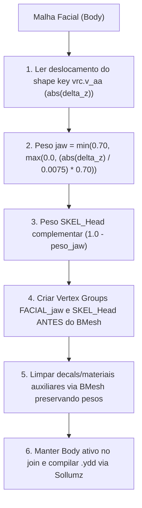

# Guia Técnico e de Implantação: Avatares VRChat no GTA V Legacy
## Plugin do Unity Editor, Conversão 3D, Rigging, `GTAVVToon.asi`, Mãos Articuladas, Lip Sync, `.ytd` 2K de Mip Único, Restore Vanilla e Segurança RPF7

**Idioma / Language / 言語:** [Technical Guide (EN)](DEPLOYMENT_GUIDE.md) | **Guia Técnico (PT-BR)** | [技術ガイド (日本語)](DEPLOYMENT_GUIDE.ja.md) | [README (EN)](../README.md) | [README (PT-BR)](../README.pt-BR.md) | [README (日本語)](../README.ja.md)

---

### Resumo Executivo da Configuração

| Protagonista GTA V | ID no Jogo (`ped`) | Avatar VRChat | Vestimenta / Estilo | Pasta do Personagem |
| :--- | :--- | :--- | :--- | :--- |
| **Michael De Santa** | `player_zero` | **Shinano** | Eternal Reunion (Vestido Gótico + *Pocket Watch*) | `2_Michael_Shinano_EternalReunion/` |
| **Franklin Clinton** | `player_one` | **Shinano** | Casual / Uniforme Escolar (Saia Vermelha, Cabelo Azul) | `1_Franklin_Shinano_Casual/` |
| **Trevor Philips** | `player_two` | **Miltina** | Maid Clássica (Vestido Longo Preto/Branco, Avental) | `3_Trevor_Miltina_Maid/` |

---

## 1. Estrutura Unificada e Política de Copyright (First-Run)

O repositório segue uma arquitetura modular que separa os scripts de automação versionados, o plugin do Unity Editor e os plugins ASI em tempo real dos arquivos originais da Rockstar Games e das pastas de compilação geradas localmente:

```text
vrc2gtav/
├── VRCAvatar2GTAV.unitypackage                      # Plugin autocontido para Unity + Toolchain (.gitignore / compilado via build_unitypackage.py)
├── RUN_MANAGER.bat                                  # Inicializador Windows com detecção de idioma
├── EXECUTAR_GERENCIADOR.bat                         # Espelho em português do inicializador Windows
├── run_mod_manager.py                               # Orquestrador principal (menu interativo + CLI)
├── setup_first_run.py                               # Ponto de entrada do First-Run
├── vrc2gtav.cfg.example                             # Modelo versionado de configuração (.cfg)
├── configs/                                         # Predefinições de blendshapes (*_blendshapes.cfg), PhysBones (*_physbones.cfg), npc_registry.json e active_multi_slots.json (.gitignore)
├── npcs/                                            # Workspaces locais e modelos compilados de NPCs e pedestres (.gitignore)
├── unity_plugin/
│   ├── Assets/VRCAvatar2GTAV/
│   │   ├── Editor/                                  # 9 scripts C# do Unity Editor (VRCAvatar2GTAV.Editor.asmdef)
│   │   └── Toolchain/                               # Cópia empacotada dos scripts limpos e guias para uso portátil no Unity
│   ├── build_unitypackage.py                        # Gera o pacote VRCAvatar2GTAV.unitypackage sem assets proprietários
│   └── install_unity_plugin.py                      # Instalador não destrutivo para projetos Unity existentes
├── README.md / README.pt-BR.md / README.ja.md       # READMEs trilíngues na página inicial do GitHub
├── docs/                                            # Guias técnicos e arquiteturais detalhados
│   ├── DEPLOYMENT_GUIDE.md                          # Guia técnico completo em inglês
│   ├── DEPLOYMENT_GUIDE.pt-BR.md                    # Este guia técnico em português
│   └── DEPLOYMENT_GUIDE.ja.md                       # Guia técnico equivalente em japonês
│
├── _deploy_tools/                                   # Espelho operacional e dummies leves
│   ├── head_000_r.ydd                               # Malha dummy invisível de 629 bytes (slots de corpo)
│   ├── p_eyes_dummy.ydd                             # Malha prop dummy rígida invisível (slots p_*.ydd)
│   ├── setup_first_run.py                           # Assistente First-Run (configuração + extração RPF)
│   ├── restore_vanilla_helper.py                    # Restauração seletiva ao original Rockstar e executor multi-slot
│   ├── repack_and_deploy_everything.py              # Empacotador RPF7 + correção de TOC + sincronizador de ASIs/perfis
│   └── ...                                          # Espelhos de VToon, PhysBones, piscar, cabelo, MA, NPCs, i18n, paths
│
├── scripts/                                         # Código-fonte canônico (Python/C++ em inglês + i18n)
│   ├── common_tools/                                # Utilitários compartilhados, gerenciador, builders, VToon/Restore e suíte de testes
│   ├── physbones_asi/                               # Solver de VRChat PhysBones em tempo real (GTAVPhysBones.asi / .ini)
│   ├── vtoon_asi/                                   # Shader lilToon D3D11 em tempo real (GTAVVToon.asi / .ini / vtoon_profiles)
│   ├── Shinano_Casual_Franklin/                     # Pipeline de texturas e Blender do Franklin
│   ├── Shinano_EternalReunion_Michael/              # Pipeline de texturas, Blender e deploy do Michael
│   └── Miltina_Maid_Trevor/                         # Pipeline de texturas, Blender e staging do Trevor
│
├── 1_Franklin_Shinano_Casual/                       # Espelhos de execução + saídas locais (ignoradas no Git)
├── 2_Michael_Shinano_EternalReunion/                # Espelhos de execução + saídas locais (ignoradas no Git)
└── 3_Trevor_Miltina_Maid/                           # Espelhos de execução + saídas locais (ignoradas no Git)
```

### Separação de Copyright e Arquivos Ignorados (`.gitignore`)
Nenhum arquivo original do GTA V, asset BOOTH ou renderização local é enviado ao GitHub nem incluído no [`VRCAvatar2GTAV.unitypackage`](../VRCAvatar2GTAV.unitypackage). Pastas e configs como `staging/`, `renders/`, `backups/`, `imported_unity_projects/`, `npcs/`, `vtoon_profiles/`, `VRCAvatar2GTAV_Work/`, `vrc2gtav.cfg`, `configs/npc_registry.json`, `configs/active_multi_slots.json`, `3_Trevor_Miltina_Maid/3_textures_gtav/custom_hair_manifest.json`, `1_Franklin_Shinano_Casual/5_rpf_package/`, `3_Trevor_Miltina_Maid/5_rpf_package/`, além de `.zip`, `.unitypackage`, `.yft`, `.ytd`, `.dds`, `.ydd.xml`, `.backup_*` e `.ydd` compilados, são mantidos fora do controle de versão e reconstruídos localmente a partir da cópia legal do usuário durante o **First-Run**, **Exportação no Unity** ou **conversão de NPCs**.

Os únicos arquivos `.ydd` versionados em `_deploy_tools/` são os dois dummies mínimos criados do zero:
- [`_deploy_tools/head_000_r.ydd`](../_deploy_tools/head_000_r.ydd) — malha dummy de corpo invisível (629 bytes).
- [`_deploy_tools/p_eyes_dummy.ydd`](../_deploy_tools/p_eyes_dummy.ydd) — malha dummy rígida invisível para ocultar chapéus, óculos e acessórios nativos (`p_*.ydd`).

---

## 2. Configuração Multiplataforma (`.cfg`) e Internacionalização (`en` / `ja` / `pt`)

### 2.1 Arquivo `vrc2gtav.cfg` e Resolução de Caminhos
Os caminhos de trabalho não são fixos em código. O módulo [`scripts/common_tools/vrc2gtav_paths.py`](../scripts/common_tools/vrc2gtav_paths.py) resolve os diretórios na seguinte ordem de prioridade:

1. **Argumentos de linha de comando (`--gtav-root`, `--unity-assets`, `--blender`, `--rage`).**
2. **Variáveis de ambiente:** `VRC2GTAV_ROOT`, `VRC_ASSETS_DIR`, `GTAV_MODS_DIR`, `RAGE_CLI`, `BLENDER_EXE`, `VRC2GTAV_LANG`.
3. **Arquivo local `vrc2gtav.cfg`:** criado a partir de [`vrc2gtav.cfg.example`](../vrc2gtav.cfg.example) durante o First-Run (`setup_first_run.py`) ou gravado pela UI do Unity (`Vrc2GtavConfigDiscovery.SaveToConfig`).
4. **Detecção automática multiplataforma:** reconhece execução no **Windows** nativo ou no **Linux / WSL** (traduzindo `D:/GTAV` ↔ `/mnt/d/GTAV` via `pathlib.Path`).
5. **Escala padrão `1.0` e extração automática de `.unity` (`unity_scene_helper.py`):** No repositório limpo (`unity_scene =` vazio), todas as escalas corporais, de cabeça, ossos e acessórios permanecem em `1.0`. Ao informar `unity_scene` (e opcionalmente `unity_avatar_name`), o extrator lê `Transform` / sobrescritas de `PrefabInstance` (cancelando multiplicadores de `PhysBone`/Marshmallow) e normaliza as proporções antes da realocação de braços e mãos.
6. **Fallback automático de cabelo e rosto padrão (`texture_calibration_helper.py`):** Quando `custom_hair` / `fbx_hair` (*Neko Tied Bob hair*) ou texturas opcionais de olhos/maquiagem estão vazias ou ausentes no disco, ambos os avatares usam o cabelo padrão original (`Hair_*` / `Shinano_hair.png` na Shinano; `Milltina_hair_*` / `Milltina_Hair.png` calibrada na Miltina) e o rosto base (`Shinano_face.png`, `Milltina_Face.png`).
7. **Importação Unity, `.cfg` e preservação de `.anim` (`blendshape_helper.py`, `universal_gtav_rigging_layer.py`):** Todos os *blendshapes* (expressões faciais `.anim`, encolhimentos do corpo, roupas, acessórios e cabelos) são importados de `unity_scene` (`.unity` + `.prefab`s + canais do FBX) ou carregados de predefinições UTF-8 (`configs/shinano_blendshapes.cfg`, `configs/shinano_er_blendshapes.cfg`, `configs/miltina_blendshapes.cfg`) segundo `blendshapes_source = auto | unity | cfg` e as flags `--blendshapes-source`, `--blendshapes-cfg`, `--face-anim`, `--save-blendshapes-cfg` e `--export-blendshapes`. Quando `--face-anim` está vazio ou todos os pesos do `.anim` são zero, os *blendshapes* faciais da cena Unity ou `.cfg` são preservados sem serem apagados.
8. **Porte universal de cabelos customizados Unity (`unity_hair_helper.py` + `blender_hair_helper.py`):** Qualquer cabelo VRChat do Unity (`.prefab`, cadeias de `PrefabVariant` via `m_SourcePrefab`, anexos *Modular Avatar* `MergeArmature`/`BoneProxy`, sobrescritas `m_Materials`, ou `.fbx` + `.mat`) pode ser selecionado via `--hair` (`auto | default | none | <caminho>`), `custom_hair` no `vrc2gtav.cfg` ou opção `[8]` do menu interativo em `shinano_casual`, `shinano_er` ou `miltina_maid`. O `unity_hair_helper.py` resolve mapas `.fbx.meta`, oculta partes desativadas/EditorOnly, preserva transparência de lentes/vidros (`preserve_alpha`) e assa texturas/cores lilToon (`_Color`, `_MainTexHSVG`) em ladrilhos UV (`custom_hair_manifest.json`), enquanto `blender_hair_helper.py` alinha ao crânio do avatar (`--hair-scale`, `--hair-offset` e `_partition_component_by_z_bands`), aplica *skinning* em `SKEL_Head` e preserva as orelhas animais originais.
9. **VRChat PhysBones multi-ped, Desembrulho de Fios Inferiores/Laços & Priorização ([`physbone_helper.py`](../scripts/common_tools/physbone_helper.py) + [`scripts/physbones_asi/`](../scripts/physbones_asi/gtav_physbones.cpp)):** Cadeias articuladas `PB_*` (`182` ossos customizados em `79` cadeias nos protagonistas, dentro do teto `<= 63` customizados / `<= 128` totais do `.ydd` por ped com `0` colisões ELF) são simuladas em tempo real pelo `GTAVPhysBones.asi` e `GTAVPhysBones.ini` para até **32 peds simultâneos (`kMaxTrackedPeds = 32`)**, filtrando `[Chain_*]` e `[Blink_*]` por `model = <ped_name>` / `modelHash` e aplicando rigidez `stiffness` relativa ao pai do modo `Advanced` (`integrationType == 1`): Michael (`30` cadeias / `62` ossos), Franklin (`24` cadeias / `62` ossos) e Trevor (`25` cadeias / `58` ossos — **100% preservadas sem descartes**). O `Marshmallow PB` fica desligado por padrão (`--physbones-marshmallow` ativa `81` cadeias / `186` ossos). Em `physbone_scene_extractor_layer.py`, `_unwrap_container_spokes` desembrulha corretamente raios de containers para fios inferiores do cabelo e laços (`rootTransform` efetivo) e `prune_orphaned_physbone_chains` remove cadeias órfãs de vestidos antigos antes da priorização (`PHYSBONE_PRIORITY_TIERS`, vinculando itens excedentes de forma rígida ao `parent_bone`).

### 2.2 Sistema Trilíngue (`en` / `ja` / `pt`)
[`scripts/common_tools/vrc2gtav_i18n.py`](../scripts/common_tools/vrc2gtav_i18n.py) e [`Vrc2GtavLocalization.cs`](../unity_plugin/Assets/VRCAvatar2GTAV/Editor/Vrc2GtavLocalization.cs) oferecem traduções completas em **inglês (`en`)**, **japonês (`ja`)** e **português (`pt`)**:
- **Detecção automática:** lê `--lang` → `VRC2GTAV_LANG` → `[general] language` no `vrc2gtav.cfg` → *locale* do sistema operacional (*fallback* para `en`).
- **Inicializadores Windows:** [`RUN_MANAGER.bat`](../RUN_MANAGER.bat) e [`EXECUTAR_GERENCIADOR.bat`](../EXECUTAR_GERENCIADOR.bat) configuram `chcp 65001` e exibem mensagens no idioma detectado.
- **Uso dentro do Blender:** argumentos customizados devem seguir após `--`: `blender -b -P <script.py> -- --lang pt`.

---

## 3. Arquitetura 3D no Blender e Rigging GTA V

### 3.1 Esqueleto Base, Braços e Articulação Completa das Mãos
Cada build preserva o esqueleto humanoide canônico (`SKEL_ROOT`, `SKEL_Pelvis`, `SKEL_Spine_Root`, `SKEL_Spine0`..`SKEL_Spine3`, `SKEL_Neck_1`, `SKEL_Head`, pernas, pés, `FACIAL_facialRoot`, `FACIAL_jaw`) acrescido dos ossos gerenciados por [`scripts/common_tools/hand_skeleton_helper.py`](../scripts/common_tools/hand_skeleton_helper.py):

- **30 ossos de dedos 1:1:** `SKEL_L_Finger00` até `SKEL_L_Finger42` e `SKEL_R_Finger00` até `SKEL_R_Finger42` (`GTAV_FINGER_BONE_NAMES`).
- **8 ossos auxiliares de braço/punho:** `RB_L_ArmRoll`, `RB_R_ArmRoll`, `RB_L_ForeArmRoll`, `RB_R_ForeArmRoll`, `PH_L_Hand`, `PH_R_Hand`, `IK_L_Hand`, `IK_R_Hand` (`EXTRA_ARM_HELPER_BONES`).
- **Realocação e patch no `.yft`:** `extract_avatar_arm_hand_targets`, `relocate_blender_armature_bones` e `patch_yft_skeleton` ajustam as juntas do esqueleto e gravam as matrizes de *bind pose* nos arquivos `.yft`.

### 3.2 Correções Críticas de Rigging e Geometria
1. **Marias-chiquinhas e cabelos laterais (*Twintails*):** ossos com `twin`, `pony` ou `twintail` vinculam-se estritamente a `SKEL_Head`, evitando que o quadril (`SKEL_Pelvis`) puxe o cabelo.
2. **Conversão de T-Pose para A-Pose (-55°):** rotaciona os braços do avatar VRChat para a A-Pose nativa da RAGE Engine antes da transferência de pesos.
3. **Ordem de submeshes Unity (`map_blender_slots_to_unity_submeshes`):** mapeia os slots de material do FBX no Blender seguindo a ordem exata de primeiro triângulo do `Mesh` no Unity para manter sobrescritas `m_Materials` sincronizadas em [`universal_gtav_builder.py`](../scripts/common_tools/universal_gtav_builder.py).
4. **Limite `uint16` de vértices (`split_oversized_material_geometries`):** subdivide malhas acima de `30000` vértices por chunk e define `lod_dist_high = 9998.0`.
5. **Michael Eternal Reunion — Vestido nos Quadris e *Pocket Watch* ([`build_michael_er.py`](../scripts/Shinano_EternalReunion_Michael/build_michael_er.py)):** redistribui pesos do quadril entre `SKEL_Pelvis`, `SKEL_L_Thigh` e `SKEL_R_Thigh` (`<= 4` influências/vértice), alinha `Pocket Watch` a `Pocket Watch_Root` e mapeia seu ladrilho próprio no atlas 4×2 ([`generate_er_atlas.py`](../scripts/Shinano_EternalReunion_Michael/generate_er_atlas.py)).

---

## 4. Sistema de Lip Sync (Sincronia Labial de Anime)

Para que as personagens movimentem a boca em cutscenes, diálogos e ligações telefônicas, todos os construtores derivam os pesos do osso `FACIAL_jaw` diretamente do *shape key* `vrc.v_aa` da malha facial (`Body`), escalados por `--mouth-open-strength` (`DEFAULT_MOUTH_OPEN_STRENGTH = 0.70` em [`eye_blink_helper.py`](../scripts/common_tools/eye_blink_helper.py) e na interface do Unity):



### Fórmula de Decaimento Vertical
$$\text{peso}_{\text{jaw}} = \min\left(0.70, \max\left(0.0, \frac{|\Delta z|}{0.0075} \times 0.70\right)\right)$$
$$\text{peso}_{\text{head}} = 1.0 - \text{peso}_{\text{jaw}}$$

- **Por que limitar o padrão em `0.70`?** As animações faciais do GTA V foram calibradas para mandíbulas humanas realistas; usar `0.70` como padrão (ajustável de `0.00` a `1.00` no Unity ou via `--mouth-open-strength`) entrega abertura labial natural e expressiva em rostos de anime.

---

## 5. Texturas, `.ytd` de Mip Único, Decals de Sangue e `GTAVVToon.asi`

### 5.1 Padrão 2K de Textura Única (`--mips 1`), Mapas Embutidos e Decals
- [`universal_atlas_builder.py`](../scripts/common_tools/universal_atlas_builder.py) (e os geradores dos protagonistas) compila texturas **DXT5 (BC3)** em **2048×2048** por padrão (`--atlas-size` `512/1024/2048/4096`) dentro de dicionários `.ytd` externos com **textura única e `--mips 1`** (`rage textures build --mips 1`), evitando que o *texture streamer* do GTA V reduza a nitidez dos personagens quando vários avatares dividem a mesma cena ou cutscene.
- Mapas normal/bump e especular permanecem salvos para os materiais embutidos do `.ydd` (usando helpers DX9 DDS válidos `A8R8G8B8` em `blender_hair_helper.py` quando neutros, mantendo o índice `0` do `.ytd` externo livre para `DiffuseSampler`). Materiais transparentes de óculos/lentes preservam o canal alpha (`preserve_alpha=True`).
- O shader base utiliza `ped.sps` junto a [`scripts/common_tools/ped_damage_helper.py`](../scripts/common_tools/ped_damage_helper.py), gerando projeção cilíndrica `UVMap 1` (`TexCoord1`) em 6 zonas e cores de vértice padrão (`Color 1 = #FF8000FF`, `Color 2 = #00000000`) para decals de sangue/ferimentos (`--blood-decals` ativo por padrão; `--no-blood-decals` muda para `ped_default.sps`), além de `enforce_ped_rpf7_poly_budget` para não exceder `16 MiB` (`0xFFFFFF`).

### 5.2 Ordem JOAAT
A RAGE Engine resolve texturas no `.ytd` pelo hash Jenkins One-at-a-Time (**JOAAT**). Gerar `.ytd`s externos de textura única seguindo exatamente o layout *streamed* original garante ligação confiável em `DiffuseSampler`.

### 5.3 Motor Shader D3D11 lilToon em Tempo Real (`GTAVVToon.asi` — `scripts/vtoon_asi/`)
Para substituir a iluminação PBR dura e o filtro borrado de pele do GTA V por sombreamento cel estilo lilToon, [`scripts/vtoon_asi/`](../scripts/vtoon_asi/gtav_vtoon.cpp) + [`scripts/common_tools/vtoon_profile_helper.py`](../scripts/common_tools/vtoon_profile_helper.py) operam em tempo real no Direct3D 11:
1. **Marca d'água mip0 alinhada `8×4` (`MAX_VTOON_SLOTS = 16`)**: `stamp_vtoon_watermark_block` grava um bloco DXT-safe `8×4` no canto inferior direito (`char_id` `1..15`; IDs `player_zero=1`, `player_one=2`, `player_two=3`), associado às LUTs por região UV e PNGs de MatCap (`vtoon_profiles/` + `GTAVVToon.ini`) gerados direto dos arquivos `.mat` do lilToon.
2. **Hooks D3D11, `DeviceContext1` e Proteção de Overlays**: `vtoon_detour.hpp` e `gtav_vtoon.cpp` interceptam `D3D11CreateDevice*`, `ID3D11Device`, `ID3D11DeviceContext` imediato/diferido, `ID3D11DeviceContext1`, `IDXGISwapChain` e o callback Present do `ScriptHookV` (preservando overlays e habilitando **hot-reload via `F10`** do `GTAVVToon.ini`).
3. **Shaders HLSL Embutidos (`vtoon_shaders_hlsl.hpp`)**:
   - `kVToonPedGBufferHlsl` (incluindo variantes MSAA `SV_Coverage` A2C) grava `targetAoEm.w = 1.0` para ignorar o pass `PS_pedSkinPassNG` de pele borrada do GTA V e escreve metadados VToon em `SV_Target4`.
   - `kVToonDeferredOverlayHlsl` (padrão e por amostra MSAA) aplica Half-Lambert de duas bordas, terminador SSS quente, *rim light*, MatCap em cabelo/roupas e sombras CSM (`vtoon_probe.hpp`).
   - `kVToonForwardAlphaHlsl` sobrescreve o pass `ped_alpha.sps` em franjas semitransparentes e lentes de óculos para manter cílios e olhos visíveis.
4. **Checagem SHA-256 na Implantação**: `repack_and_deploy_everything.py` valida por SHA-256 que os `.asi` copiados na pasta do GTA V correspondem exatamente às versões compiladas/empacotadas.

---

## 6. Estratégia de Deploy, Restore-Vanilla Seletivo e NPCs Universais

1. **Avatar Completo no `uppr` + Dummies (`_deploy_tools/head_000_r.ydd`, `p_eyes_dummy.ydd`)**: [`scripts/common_tools/apply_characters.py`](../scripts/common_tools/apply_characters.py) preenche os slots `uppr`, oculta demais partes humanas com o dummy de 629 bytes e substitui 119 slots de props dos protagonistas (e props `*_p` de NPCs) após backup automático.
2. **Restauração Seletiva ao Original ([`restore_vanilla_helper.py`](../scripts/common_tools/restore_vanilla_helper.py))**: Ao rodar `--restore-peds player_zero` (ou `--restore-all`, ou clicar nos botões *Restaurar GTA V Original* no Unity), o script extrai dos RPFs originais da Rockstar **apenas** os arquivos do ped solicitado para o staging existente — mantendo intactos os demais protagonistas/NPCs modificados — e limpa apenas suas entradas em `GTAVPhysBones.ini`, `GTAVVToon.ini` e `configs/npc_registry.json`.
3. **Pipeline Universal de NPCs e Cutscenes ([`npc_registry_helper.py`](../scripts/common_tools/npc_registry_helper.py), [`universal_gtav_builder.py`](../scripts/common_tools/universal_gtav_builder.py)):** detecta `streamed` (`ig_*`, `cs_*`, `patchday*`) vs `componentpeds` (`peds.rpf`), remapeia mandíbula nativa (`FB_Jaw_000` / `FACIAL_C_Jaw` / `FACIAL_jaw`), casa sufixos `.001` vs `" 1"`, preserva `.ymt` e registra tudo em `configs/npc_registry.json` + `npcs/<ped_name>/`.

---

## 7. Empacotamento RPF7, Orçamento Secundário e Prevenção do `ERR_GEN_ZLIB_2`

[`scripts/common_tools/repack_and_deploy_everything.py`](../scripts/common_tools/repack_and_deploy_everything.py) empacota `mppatches.rpf`, `mppatchesng_dlc.rpf`, `streamedpeds_players.rpf`, `streamedpedprops.rpf`, `x64v_modded.rpf`, `x64e.rpf`, `x64g.rpf`, `patchday3ng` e `patchday4ng` usando `--keys` somente leitura (sem alterar `GTA5.exe`) e garantindo:
1. **Flag `b'OPEN'` (Offset 12)** após verificar `b'7FPR'`.
2. **Zeramento de `f_size` na TOC** em binários não comprimidos aninhados (impedindo **`ERR_GEN_ZLIB_2`**).
3. **Limites de 16 MiB (`0xFFFFFF`) e 4.00 GiB ([`ped_damage_helper.py`](../scripts/common_tools/ped_damage_helper.py)):** `enforce_ped_rpf7_poly_budget`, `validate_rpf7_resource_file`, `enforce_ytd_rpf7_size_budget`, `assert_directory_rpf7_resources_valid` e auditoria `inspect_rpf7_archive_limits`.
4. **Orçamento Secundário (`ensure_x64v_streamed_budget` e `--secondary-atlas-size`)**: Mantém o slot primário `uppr_000` sempre em qualidade total enquanto compacta opcionalmente duplicatas secundárias `uppr_diff_001+` (`0` = automático abaixo de `3.7 GiB`, ou explícito `512` / `1024` / `2048`).

---

## 8. Como Executar (Plugin Unity UI, First-Run, CLI e Testes)

### 8.1 Plugin Exportador no Unity Editor (`Tools > VRCAvatar2GTAV > Export Avatar to GTA V`)
Importe [`VRCAvatar2GTAV.unitypackage`](../VRCAvatar2GTAV.unitypackage) no seu projeto Unity ou instale pela CLI:
```bash
python unity_plugin/install_unity_plugin.py --unity-project "/caminho/ProjetoUnity"
# Para recompilar VRCAvatar2GTAV.unitypackage após alterações no repositório:
python unity_plugin/build_unitypackage.py
```
Principais recursos dos 9 scripts C# (`unity_plugin/Assets/VRCAvatar2GTAV/Editor/`):
- **Modo Compartilhado vs. Abas por Protagonista (`PerProtagonistSlots`)**: Use um único perfil ou habilite abas independentes para **Michael**, **Franklin** e **Trevor** (GameObject da cena, `.prefab`, `.unity`, `.zip`, `.unitypackage`, overrides de textura, blendshapes/PhysBones, `.anim` facial, abertura da boca padrão `0.70` + botão `"0.70"`, força de piscar), salvando `configs/active_multi_slots.json` para execução sequencial com empacotamento único (`--slots-json`).
- **Painel de Texturas & Estimador RPF7 (`Vrc2GtavTexturesPanel`)**: Atlas Primário (`512`, `1024`, `2048`, `4096`), Mapa Normal (`Auto`, `Off (64 px)`, `256`, `512`, `1024`), Roupas Secundárias (`Auto <3.7 GiB Safe RPF`, `512`, `1024`, `2048`), sobrescritas globais (`*`) ou por material (`_MainTex`) e cálculo em tempo real do tamanho no `x64v.rpf`.
- **Toolchain Embutido & Status Runtime (`Vrc2GtavConfigDiscovery`, `Vrc2GtavLogConsoleWidget`)**: Prioriza `Assets/VRCAvatar2GTAV/Toolchain` e redireciona os arquivos de trabalho para `<RaizDoProjeto>/VRCAvatar2GTAV_Work/`. Mostra pílulas de status de `dinput8.dll`, `PhysBones.asi`, `VToon.asi`, `ScriptHookV.dll` e `OpenIV.asi`/RageOpenV, alterna `Auto` / `Windows Native` / `WSL`, traz console redimensionável e botões **Restaurar Original** (`Michael`, `Franklin`, `Trevor`, `Todos`).

### 8.2 First-Run, Ingestão de `.zip`/Unity e Download do Blender 4.0.2
```bash
python scripts/common_tools/setup_first_run.py --avatar-zip "/caminho/Shinano_ver1.02.zip" --download-blender --verbose
# Ou via projeto Unity existente:
python run_mod_manager.py --setup --unity-project "/caminho/ProjetoUnity" --download-blender --download-rage
# Ou converter e instalar qualquer NPC / pedestre direto de .zip / .unitypackage:
python run_mod_manager.py --npc ig_lamardavis --avatar-zip "/caminho/Karin.zip"
```

### 8.3 Orquestrador Interativo e CLI
No Windows, abra [`RUN_MANAGER.bat`](../RUN_MANAGER.bat) (ou [`EXECUTAR_GERENCIADOR.bat`](../EXECUTAR_GERENCIADOR.bat)), ou execute no terminal:

```bash
# Construtor universal Modular Avatar (10 opções/página + Next):
python scripts/common_tools/build_universal_avatar.py --avatar-zip "/caminho/Shinano_ver1.02.zip" --interactive --verbose

# Build multi-slot sequencial com manifesto JSON:
python scripts/common_tools/universal_gtav_builder.py --slots-json "configs/active_multi_slots.json" --secondary-atlas-size 2048

# Build avulso definindo resolução, abertura da boca (padrão 0.70) e .anim facial:
python scripts/common_tools/universal_gtav_builder.py --source "/caminho/Avatar.prefab" --target-ped player_one --atlas-size 2048 --mouth-open-strength 0.70 --face-anim "/caminho/Face.anim"

# Restauração seletiva ao padrão original do GTA V:
python scripts/common_tools/universal_gtav_builder.py --restore-peds player_zero
python scripts/common_tools/universal_gtav_builder.py --restore-all

# Menu interativo e builds de protagonistas:
python run_mod_manager.py
python run_mod_manager.py --character all
python run_mod_manager.py --character michael --lang pt
python run_mod_manager.py --character franklin --avatar miltina_maid --save-assignment
python run_mod_manager.py --character michael --hair "/caminho/CustomHair.prefab" --save-hair

# NPCs customizados e pedestres de rua (ou opção [11] do menu):
python run_mod_manager.py --npc ig_lamardavis --avatar-zip "/caminho/Karin.zip"
python scripts/common_tools/build_universal_avatar.py --avatar-zip "/caminho/Karin.zip" --target-ped cs_lamardavis --deploy-npc
python run_mod_manager.py --all-npcs

# Apenas repacotar / implantar ou diagnosticar ambiente:
python run_mod_manager.py --deploy-only
python run_mod_manager.py --check-env
```

### 8.4 Suíte de Validação Automatizada
O arquivo [`scripts/common_tools/test_mod_suite.py`](../scripts/common_tools/test_mod_suite.py) valida tanto regras de código-fonte (UI C#, `.unitypackage` e espelhos `Toolchain/`, VToon LUT/watermark/INI, `--mips 1`, Restore Vanilla e multi-slot) quanto os arquivos compilados em `mods/`:

```bash
# Modo completo (13 suítes; requer First-Run, build e deploy):
python scripts/common_tools/test_mod_suite.py --lang pt

# Modo apenas código-fonte (10 suítes; roda em clone limpo antes do First-Run):
python scripts/common_tools/test_mod_suite.py --source-only --lang pt
```

---

## 9. Referência Técnica Manual (Passo a Passo)

```bash
# 1. Gerar atlas 2K de mip único (.dds e .ytd; aceita --hair / --hair-mat / --hair-tex)
python scripts/Shinano_Casual_Franklin/generate_franklin_atlas.py
python scripts/Shinano_EternalReunion_Michael/generate_er_atlas.py
python scripts/Miltina_Maid_Trevor/generate_miltina_atlas.py

# 2. Compilar modelos 3D no Blender + Sollumz (aceita --target-character, --hair / --hair-scale / --hair-offset, --mouth-open-strength)
python scripts/Shinano_Casual_Franklin/run_build_franklin.py --target-character franklin
python scripts/Shinano_EternalReunion_Michael/run_build_er.py --target-character michael
python scripts/Miltina_Maid_Trevor/run_pipeline.py --target-character trevor

# 3. Aplicar nos diretórios de staging (individual, com --avatar opcional, ou todos)
python scripts/common_tools/apply_characters.py --character player_zero
python scripts/common_tools/apply_characters.py --character franklin --avatar miltina_maid
python scripts/common_tools/apply_all_characters.py

# 4. Empacotar RPFs (OPEN + correção de TOC + sync ASI/VToon/PhysBones) e instalar na pasta mods/
python scripts/common_tools/repack_and_deploy_everything.py
```

---

## 10. Créditos dos Assets e Ferramentas

Este repositório contém **apenas scripts de automação em Python, código C# do plugin Unity, fontes/ferramentas ASI em C++, inicializadores, documentação e malhas dummy vazias**. Todos os modelos 3D, roupas, cabelos, texturas de olhos e predefinições de expressão pertencem aos seus respectivos criadores e **não estão incluídos aqui**; adquira cada item diretamente nas lojas oficiais no BOOTH:

### 10.1 Avatares Base, Roupas, Cabelos e Acessórios

| Categoria | Nome do Asset | Criador / Loja | Personagem | Link Oficial |
| :--- | :--- | :--- | :--- | :--- |
| **Avatar Base & Roupa Casual** | オリジナル3Dモデル「しなの」 (*Shinano*) | ポンデロニウム研究所 (`ponderogen`) | Michael, Franklin | [BOOTH](https://ponderogen.booth.pm/items/6106863) / [Loja](https://ponderogen.booth.pm/) |
| **Avatar Base & Vestido Maid** | オリジナル3Dモデル『ミルティナ』 (*Milltina*) | DOLOS art (`dolosart`) | Trevor | [BOOTH](https://dolosart.booth.pm/items/6538026) / [Loja](https://dolosart.booth.pm/) |
| **Vestido, Sapatos & Acessórios** | 【15アバター対応】エターナル・リユニオン【MA対応】 (*Eternal Reunion* + *Pocket Watch*) | VAGRANT (`Vagrant Brand`) | Michael | [BOOTH](https://vagrant.booth.pm/items/5634313) / [Loja](https://vagrant.booth.pm/) |
| **Cabelo, Orelhas, Presilhas & Halo (Opcional)** | ねこタイドボブヘア (*Neko Tied Bob hair*) | Li-ne (`Li-ne_Shop`) | Michael *(usa cabelo padrão Shinano se ausente)* | [BOOTH](https://li-ne.booth.pm/items/7977491) / [Loja](https://li-ne.booth.pm/) |
| **Textura de Olhos (Shinano, Opcional)** | `[eye17アバター対応]MoonButterfly eye & Rurune Make` | ha-oa | Michael, Franklin *(usa `Shinano_face.png` se ausente)* | [BOOTH](https://ha-oa.booth.pm/items/8483652) / [Loja](https://ha-oa.booth.pm/) |
| **Textura de Olhos (Milltina, Opcional)** | お魚が泳ぐ あわあわ水光 Eye Texture【10Color】【23Avatar】 (`Milltina_AWEyes`) | NAGIMA (`nagikawamart`) | Trevor *(usa `Milltina_Face.png` se ausente)* | [BOOTH](https://nagikawamart.booth.pm/items/6837271) / [Loja](https://nagikawamart.booth.pm/) |

### 10.2 Ferramentas, Shaders e Utilitários Utilizados

| Ferramenta / Projeto | Autor / Mantenedor | Uso no Pipeline | Link Oficial |
| :--- | :--- | :--- | :--- |
| **lilToon** (v2.4.1) | `lilxyzw` | Referência de camadas, máscaras e shader para atlas 2K & `GTAVVToon.asi` | [GitHub](https://github.com/lilxyzw/lilToon) / [Docs](https://lilxyzw.github.io/lilToon/) |
| **FaceEmo** (v1.7.0) | `suzuryg` | Autoria e exportação dos `.anim` faciais (`ShinanoDefAdultNewv5.anim`, `Miltina_close eyes_Base_adult.anim`) | [GitHub](https://github.com/suzuryg/face-emo) / [Docs](https://suzuryg.github.io/face-emo/) |
| **Modular Avatar** (v1.18.7) | `bd_` (Nadena) | Montagem não destrutiva de roupas e cabelos no Unity (`waifuv4`) | [GitHub](https://github.com/bdunderscore/modular-avatar) / [Site](https://modular-avatar.nadena.dev/) |
| **Blender** (4.0.2) | Blender Foundation | Rigging, transferência de pesos, blendshapes e renders | [Site Oficial](https://www.blender.org/) |
| **Sollumz** (v2.9.0) | `Skylumz`, `Colton`, `alexguirre` | Add-on do Blender para importação/exportação `.ydd` / `.yft` / XML | [GitHub](https://github.com/Sollumz/Sollumz) / [Docs](https://docs.sollumz.org/) |
| **rage-cli** (`rage` 0.28.1) | `VIRUXE` | Extração/empacotamento `.rpf`, compilação `.ytd` (`--mips 1`) e renders RAGE | [GitHub](https://github.com/VIRUXE/rage-cli) |
| **RageOpenV** | `Chiheb-Bacha` | Plugin `.asi` para carregar RPFs em `mods/` no GTA V | [GitHub](https://github.com/Chiheb-Bacha/RageOpenV) |
| **ScriptHookV** | `Alexander Blade` | Integração Present/hotkey e nativos para `GTAVVToon.asi` e `GTAVPhysBones.asi` | [Site](https://www.dev-c.com/gtav/scripthookv/) |
| **Ultimate ASI Loader** | `ThirteenAG` | Proxy DLL (`dinput8.dll`) para carregamento de mods `.asi` | [GitHub](https://github.com/ThirteenAG/Ultimate-ASI-Loader) |
