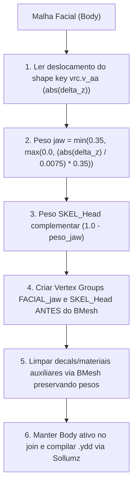

# Guia Técnico e de Implantação: Avatares VRChat no GTA V Legacy
## Conversão, Rigging, Mãos Articuladas, Lip Sync, Texturas 2K, First-Run e Deploy dos Três Protagonistas

**Idioma / Language / 言語:** [Technical Guide (EN)](DEPLOYMENT_GUIDE.md) | **Guia Técnico (PT-BR)** | [技術ガイド (日本語)](DEPLOYMENT_GUIDE.ja.md) | [README (EN)](../README.md) | [README (PT-BR)](../README.pt-BR.md) | [README (日本語)](../README.ja.md)

---

### Resumo Executivo da Configuração

| Protagonista GTA V | ID no Jogo (`ped`) | Avatar VRChat | Vestimenta / Estilo | Pasta do Personagem |
| :--- | :--- | :--- | :--- | :--- |
| **Michael De Santa** | `player_zero` | **Shinano** | Eternal Reunion (Vestido Gótico + *Pocket Watch*) | `2_Michael_Shinano_EternalReunion/` |
| **Franklin Clinton** | `player_one` | **Shinano** | Casual / Uniforme Escolar (Saia Vermelha, Cabelo Azul) | `1_Franklin_Shinano_Casual/` |
| **Trevor Philips** | `player_two` | **Miltina** | Maid Clássica (Vestido Longo Preto/Branco, Avental) | `3_Trevor_Miltina_Maid/` |

---

## 1. Estrutura Unificada e Política de Copyright (First-Run)

O repositório segue uma arquitetura modular que separa os scripts versionados dos arquivos binários originais da Rockstar Games e das pastas de compilação geradas localmente:

```text
vrc2gtav/
├── RUN_MANAGER.bat                                  # Inicializador Windows com detecção de idioma
├── EXECUTAR_GERENCIADOR.bat                         # Espelho em português do inicializador Windows
├── run_mod_manager.py                               # Orquestrador principal (menu interativo + CLI)
├── vrc2gtav.cfg.example                             # Modelo versionado de configuração (.cfg)
├── README.md / README.pt-BR.md / README.ja.md       # READMEs trilíngues na página inicial do GitHub
├── docs/                                            # Guias técnicos e arquiteturais detalhados
│   ├── DEPLOYMENT_GUIDE.md                          # Guia técnico completo em inglês
│   ├── DEPLOYMENT_GUIDE.pt-BR.md                    # Este guia técnico em português
│   └── DEPLOYMENT_GUIDE.ja.md                       # Guia técnico equivalente em japonês
│
├── _deploy_tools/                                   # Espelho operacional e dummies leves
│   ├── head_000_r.ydd                               # Malha dummy invisível de 629 bytes (slots de corpo)
│   ├── p_eyes_dummy.ydd                             # Malha prop dummy rígida invisível (slots p_eyes_*)
│   ├── setup_first_run.py                           # Assistente First-Run (configuração + extração RPF)
│   ├── repack_and_deploy_everything.py              # Empacotador RPF7 + correção de TOC + instalação
│   └── ...                                          # Espelhos de unity_scene_helper, texture_calibration_helper, hand_skeleton_helper, i18n, paths, apply_*
│
├── scripts/                                         # Código-fonte canônico (Python em inglês + i18n)
│   ├── common_tools/                                # Utilitários compartilhados, gerenciador e suíte de testes
│   ├── Shinano_Casual_Franklin/                     # Pipeline de texturas e Blender do Franklin
│   ├── Shinano_EternalReunion_Michael/              # Pipeline de texturas, Blender e deploy do Michael
│   └── Miltina_Maid_Trevor/                         # Pipeline de texturas, Blender e staging do Trevor
│
├── 1_Franklin_Shinano_Casual/                       # Espelhos de execução + saídas locais (ignoradas no Git)
├── 2_Michael_Shinano_EternalReunion/                # Espelhos de execução + saídas locais (ignoradas no Git)
└── 3_Trevor_Miltina_Maid/                           # Espelhos de execução + saídas locais (ignoradas no Git)
```

### Separação de Copyright e Arquivos Ignorados (`.gitignore`)
Nenhum arquivo original do GTA V nem renderização local é enviado ao GitHub. Pastas `staging/`, `renders/`, `backups/`, `vrc2gtav.cfg`, além de `.yft`, `.ytd`, `.dds`, `.ydd.xml`, `.backup_*` e `.ydd` compilados, são mantidos fora do controle de versão e reconstruídos localmente a partir da cópia legal do usuário durante o **First-Run**.

Os únicos arquivos `.ydd` versionados em `_deploy_tools/` são os dois dummies mínimos criados do zero:
- [`_deploy_tools/head_000_r.ydd`](../_deploy_tools/head_000_r.ydd) — malha dummy de corpo invisível (629 bytes).
- [`_deploy_tools/p_eyes_dummy.ydd`](../_deploy_tools/p_eyes_dummy.ydd) — malha dummy rígida invisível para ocultar óculos nativos (`p_eyes_*`).

---

## 2. Configuração Multiplataforma (`.cfg`) e Internacionalização (`en` / `ja` / `pt`)

### 2.1 Arquivo `vrc2gtav.cfg` e Resolução de Caminhos
Os caminhos de trabalho não são mais fixos em código. O módulo [`scripts/common_tools/vrc2gtav_paths.py`](../scripts/common_tools/vrc2gtav_paths.py) resolve os diretórios na seguinte ordem de prioridade:

1. **Argumentos de linha de comando (`--gtav-root`, `--unity-assets`, `--blender`, `--rage`).**
2. **Variáveis de ambiente:** `VRC2GTAV_ROOT`, `VRC_ASSETS_DIR`, `GTAV_MODS_DIR`, `RAGE_CLI`, `BLENDER_EXE`, `VRC2GTAV_LANG`.
3. **Arquivo local `vrc2gtav.cfg`:** criado a partir de [`vrc2gtav.cfg.example`](../vrc2gtav.cfg.example) durante o First-Run (`setup_first_run.py`).
4. **Detecção automática multiplataforma:** reconhece execução no **Windows** nativo ou no **Linux / WSL** (traduzindo letras de unidade como `D:/GTAV` ↔ `/mnt/d/GTAV` via `pathlib.Path`).
5. **Escala padrão `1.0` e extração automática de `.unity` (`unity_scene_helper.py`):** No repositório limpo (`unity_scene =` vazio), todas as escalas corporais, de cabeça, ossos e acessórios permanecem em `1.0`. Ao informar `unity_scene` (e opcionalmente `unity_avatar_name`) em `[franklin]`, `[michael]` ou `[trevor]`, o extrator lê `Transform` / sobrescritas de `PrefabInstance` (cancelando multiplicadores de `PhysBone`/Marshmallow) e normaliza as proporções antes da realocação de braços e mãos.
6. **Fallback automático de cabelo e rosto padrão (`texture_calibration_helper.py`):** Quando `fbx_hair` (*Neko Tied Bob hair*) ou texturas opcionais de olhos/maquiagem estão vazias ou ausentes no disco, ambos os avatares usam o cabelo padrão original (`Hair_*` / `Shinano_hair.png` na Shinano; `Milltina_hair_*` / `Milltina_Hair.png` calibrada na Miltina) e o rosto base (`Shinano_face.png`, `Milltina_Face.png`). Tanto a Shinano quanto a Miltina também aceitam `fbx_hair` customizado quando configurado.

### 2.2 Sistema Trilíngue (`en` / `ja` / `pt`)
O catálogo central [`scripts/common_tools/vrc2gtav_i18n.py`](../scripts/common_tools/vrc2gtav_i18n.py) fornece suporte completo em **inglês (`en`)**, **japonês (`ja`)** e **português (`pt`)**:
- **Detecção automática:** lê `--lang`, depois `VRC2GTAV_LANG`, depois `[general] language` no `vrc2gtav.cfg` e, em seguida, o *locale* do sistema operacional (com *fallback* para `en`).
- **Inicializadores Windows:** [`RUN_MANAGER.bat`](../RUN_MANAGER.bat) e [`EXECUTAR_GERENCIADOR.bat`](../EXECUTAR_GERENCIADOR.bat) consultam `VRC2GTAV_LANG` ou a chave `HKCU\Control Panel\International\LocaleName` com `chcp 65001`, exibindo mensagens no idioma correspondente.
- **Uso dentro do Blender:** ao chamar o Blender manualmente, passe o argumento após o separador `--`: `blender -b -P <script.py> -- --lang pt`.

---

## 3. Arquitetura 3D no Blender e Rigging GTA V

### 3.1 Esqueleto Base, Braços e Articulação Completa das Mãos
Os modelos `.yft` originais dos protagonistas possuem dezenas de ossos auxiliares que não pertencem aos avatares de anime. Cada build preserva o esqueleto humanoide canônico (coluna `SKEL_ROOT`, `SKEL_Pelvis`, `SKEL_Spine_Root`, `SKEL_Spine0`..`SKEL_Spine3`, `SKEL_Neck_1`, `SKEL_Head`, braços, pernas, pés, `FACIAL_facialRoot`, `FACIAL_jaw`) acrescido dos ossos de mão e dedos gerenciados pelo módulo [`scripts/common_tools/hand_skeleton_helper.py`](../scripts/common_tools/hand_skeleton_helper.py):

- **30 ossos de dedos 1:1:** `SKEL_L_Finger00` até `SKEL_L_Finger42` e `SKEL_R_Finger00` até `SKEL_R_Finger42` (`GTAV_FINGER_BONE_NAMES`).
- **8 ossos auxiliares de braço/punho:** `RB_L_ArmRoll`, `RB_R_ArmRoll`, `RB_L_ForeArmRoll`, `RB_R_ForeArmRoll`, `PH_L_Hand`, `PH_R_Hand`, `IK_L_Hand`, `IK_R_Hand` (`EXTRA_ARM_HELPER_BONES`).
- **Realocação espacial e patch no `.yft`:**
  1. `extract_avatar_arm_hand_targets` extrai as posições exatas das juntas de ombro, cotovelo, punho e dos 30 ossos de dedos do avatar Unity/VRChat.
  2. `relocate_blender_armature_bones` reposiciona os ossos no *Armature* de destino do Blender para que a abertura e o fechamento dos dedos sigam as proporções anatômicas do avatar em cutscenes, direção e empunhadura de armas.
  3. `patch_yft_skeleton` atualiza os *bind transforms* dos arquivos `player_zero.yft`, `player_one.yft` e `player_two.yft` exportados junto com os `.ydd`.

### 3.2 Correções Críticas de Rigging e Geometria
1. **Marias-chiquinhas e cabelos laterais (*Twintails*):** ossos contendo `twin`, `pony` ou `twintail` são vinculados diretamente a `SKEL_Head`, evitando que o cabelo seja puxado pelo quadril (`SKEL_Pelvis`) durante a caminhada.
2. **Conversão de T-Pose para A-Pose (-55°):** os braços em T-Pose rígida dos avatares VRChat são rotacionados para a A-Pose compatível com as animações da RAGE Engine.
3. **Limite `uint16` de vértices (`split_oversized_material_geometries`):** malhas que excedem `30000` vértices por chunk são subdivididas automaticamente para impedir corrupção de índices de vértice na exportação Sollumz, e o LOD do *Drawable* recebe `lod_dist_high = 9998.0`.
4. **Michael Eternal Reunion — Vestido nos Quadris e *Pocket Watch* ([`build_michael_er.py`](../scripts/Shinano_EternalReunion_Michael/build_michael_er.py)):**
   - Os ossos e pesos do vestido na região do quadril/coração (que antes deformavam ou saíam de posição ao caminhar) foram redistribuídos entre `SKEL_Pelvis`, `SKEL_L_Thigh` e `SKEL_R_Thigh`, mantendo no máximo 4 influências por vértice exigidas pelo GTA V.
   - O relógio de bolso (`Pocket Watch`) recebe alinhamento preciso à junta `Pocket Watch_Root`, *blendshapes* configurados e remapeamento UV dedicado para seu ladrilho próprio no atlas 4×2 (evitando que o relógio aparecesse sem textura).

---

## 4. Sistema de Lip Sync (Sincronia Labial de Anime)

Para que as personagens movimentem a boca em cutscenes, diálogos e ligações telefônicas, todos os três construtores derivam os pesos do osso `FACIAL_jaw` diretamente do *shape key* `vrc.v_aa` da malha facial (`Body`):



### Fórmula de Decaimento Vertical
$$\text{peso}_{\text{jaw}} = \min\left(0.35, \max\left(0.0, \frac{|\Delta z|}{0.0075} \times 0.35\right)\right)$$
$$\text{peso}_{\text{head}} = 1.0 - \text{peso}_{\text{jaw}}$$

- **Por que limitar o máximo em `0.35`?** As animações faciais do GTA V foram calibradas para mandíbulas humanas realistas; aplicar peso `1.0` em rostos estilizados de anime estica excessivamente o queixo e abre buracos na boca. O teto de `0.35` mantém a abertura labial natural e proporcional.

---

## 5. Texturas e Dicionários `.ytd` (Padrão 2K e Hash JOAAT)

### 5.1 Padrão 2K (2048×2048) e Compressão DXT5
- Todos os atlas de textura ([`generate_franklin_atlas.py`](../scripts/Shinano_Casual_Franklin/generate_franklin_atlas.py), [`generate_er_atlas.py`](../scripts/Shinano_EternalReunion_Michael/generate_er_atlas.py), [`generate_miltina_atlas.py`](../scripts/Miltina_Maid_Trevor/generate_miltina_atlas.py)) são gerados em **2048×2048 pixels** e compilados em **DXT5 (BC3)** com *mipmaps* via `rage`.
- No Michael (*Eternal Reunion*), o atlas segue uma grade **4×2**, reunindo pele, corpo, cabelo, vestido UN1–UN3 e o ladrilho exclusivo UN4 para o *Pocket Watch*, metais dourados, fivelas e lentes.
- O shader unificado utiliza `ped_default.sps` conectando `DiffuseSampler`, `BumpSampler` e `SpecSampler`.

### 5.2 Ordem de Inserção para Lookup JOAAT
A RAGE Engine resolve texturas no `.ytd` pelo hash Jenkins One-at-a-Time (**JOAAT**). Reordenar entradas no XML ou quebrar a correspondência entre os nomes do shader e os nomes no `.ytd` resulta em modelo preto ou texturas trocadas. Cada construtor garante o registro consistente de mapas difuso, especular e normal em cada `.ytd`.

---

## 6. Estratégia de Deploy: Universal Slot Replacement e Dummies

No GTA V, roupas dos protagonistas são divididas entre vários componentes e acessórios (`uppr`, `lowr`, `feet`, `head`, `hair`, `berd`, `hand`, `teef`, `accs`, `task`, `jbib`, além dos props faciais `p_eyes_*`). Trocar apenas um slot `uppr_000` faz partes masculinas originais ou óculos atravessarem o avatar durante missões, mudanças de roupa automáticas ou cutscenes.

### Solução Adotada no Mod:
1. **Avatar completo no slot `uppr`:** o `.ydd`, o `.ytd` e o `.yft` compilados são replicados por [`scripts/common_tools/apply_characters.py`](../scripts/common_tools/apply_characters.py) em todos os slots `uppr` relevantes de cada protagonista no staging.
2. **Dummy de corpo ([`_deploy_tools/head_000_r.ydd`](../_deploy_tools/head_000_r.ydd)):** todos os demais slots humanos (`lowr`, `feet`, `head`, `hair`, `berd`, `hand`, `teef`, `accs`, `task`, `jbib`) são preenchidos com a malha invisível de 629 bytes.
3. **Dummy de óculos ([`_deploy_tools/p_eyes_dummy.ydd`](../_deploy_tools/p_eyes_dummy.ydd)):** os 35 slots de óculos (`p_eyes_*.ydd`) nos arquivos de props são substituídos pelo prop dummy rígido e vazio para impedir que óculos escuros nativos de cutscenes atravessem os olhos da personagem.

---

## 7. Empacotamento RPF7 e Prevenção do `ERR_GEN_ZLIB_2`

O script [`scripts/common_tools/repack_and_deploy_everything.py`](../scripts/common_tools/repack_and_deploy_everything.py) empacota todos os arquivos modificados (`mppatches.rpf`, `mppatchesng_dlc.rpf`, `streamedpeds_players.rpf`, `streamedpedprops.rpf` e `x64v_modded.rpf`) exibindo barra de progresso no terminal e aplicando duas correções binárias obrigatórias após a criação via `rage`:

1. **Assinatura `b'OPEN'` (Offset 12):** verifica o cabeçalho `b'7FPR'` nos primeiros bytes e grava a flag `b'OPEN'` no offset 12, permitindo carregamento pela Engine RAGE sem criptografia RSA proprietária.
2. **Zeramento de `f_size` na TOC (16 bytes por entrada):** entradas binárias não comprimidas (como `mppatches.rpf` aninhado dentro de `dlc.rpf`) gravadas com tamanho comprimido diferente de zero causam o erro fatal **`ERR_GEN_ZLIB_2`** no GTA V. O empacotador varre toda a tabela TOC e zera os bytes de tamanho comprimido dessas entradas.

---

## 8. Como Executar (First-Run, Orquestrador e Testes)

### 8.1 First-Run (Primeira Execução Obrigatória em Instalação Limpa)
Antes de compilar ou empacotar qualquer personagem:

```bash
python scripts/common_tools/setup_first_run.py
# Ou diretamente pelo orquestrador:
python run_mod_manager.py --setup
```

O assistente cria `vrc2gtav.cfg`, valida `GTA5.exe`, Unity `Assets`, `blender` (Sollumz) e `rage`, e extrai automaticamente os RPFs originais do jogo do usuário para `staging/`. Para diagnosticar sem alterar arquivos, use `--check-only`; para forçar idioma específico, adicione `--lang pt`, `--lang en` ou `--lang ja`.

### 8.2 Orquestrador Interativo e CLI
No Windows, dê um duplo clique em [`RUN_MANAGER.bat`](../RUN_MANAGER.bat) (ou [`EXECUTAR_GERENCIADOR.bat`](../EXECUTAR_GERENCIADOR.bat)), ou execute no terminal:

```bash
# Menu interativo completo:
python run_mod_manager.py

# Processar todos os três personagens e instalar em mods/:
python run_mod_manager.py --character all

# Processar apenas um personagem (ex.: michael, franklin ou trevor):
python run_mod_manager.py --character michael --lang pt

# Apenas aplicar slots e repacotar RPFs sem recompilar texturas nem Blender:
python run_mod_manager.py --deploy-only

# Somente verificar ambiente e dependências:
python run_mod_manager.py --check-env
```

### 8.3 Suíte de Validação Automatizada
O arquivo [`scripts/common_tools/test_mod_suite.py`](../scripts/common_tools/test_mod_suite.py) verifica todo o projeto:

```bash
# Modo completo (após First-Run, build e deploy): valida 8 suítes
python scripts/common_tools/test_mod_suite.py --lang pt

# Modo apenas código-fonte (em clone limpo antes do First-Run): valida 5 suítes
python scripts/common_tools/test_mod_suite.py --source-only --lang pt
```

---

## 9. Referência Técnica Manual (Passo a Passo)

```bash
# 1. Gerar atlas 2K (.dds e .ytd)
python scripts/Shinano_Casual_Franklin/generate_franklin_atlas.py
python scripts/Shinano_EternalReunion_Michael/generate_er_atlas.py
python scripts/Miltina_Maid_Trevor/generate_miltina_atlas.py

# 2. Compilar modelos 3D no Blender + Sollumz
python scripts/Shinano_Casual_Franklin/run_build_franklin.py
python scripts/Shinano_EternalReunion_Michael/run_build_er.py
python scripts/Miltina_Maid_Trevor/run_pipeline.py

# 3. Aplicar nos diretórios de staging (individual ou todos)
python scripts/common_tools/apply_characters.py --character player_zero
python scripts/common_tools/apply_all_characters.py

# 4. Empacotar RPFs (OPEN + correção de TOC) e instalar na pasta mods/
python scripts/common_tools/repack_and_deploy_everything.py
```

---

## 10. Créditos dos Assets e Ferramentas

Este repositório contém **apenas os scripts de automação em Python, inicializadores, documentação e malhas dummy vazias**. Todos os modelos 3D, roupas, cabelos, texturas de olhos e predefinições de expressão pertencem aos seus respectivos criadores e **não estão incluídos aqui**; adquira e baixe cada item diretamente nas lojas oficiais no BOOTH:

### 10.1 Avatares Base, Roupas, Cabelos e Acessórios

| Categoria | Nome do Asset | Criador / Loja | Personagem | Link Oficial |
| :--- | :--- | :--- | :--- | :--- |
| **Avatar Base & Roupa Casual** | オリジナル3Dモデル「しなの」 (*Shinano*) | ポンデロニウム研究所 (`ponderogen`) | Michael, Franklin | [BOOTH](https://ponderogen.booth.pm/items/6106863) / [Loja](https://ponderogen.booth.pm/) |
| **Avatar Base & Vestido Maid** | オリジナル3Dモデル『ミルティナ』 (*Milltina*) | DOLOS art (`dolosart`) | Trevor | [BOOTH](https://dolosart.booth.pm/items/6538026) / [Loja](https://dolosart.booth.pm/) |
| **Vestido, Sapatos & Acessórios** | 【15アバター対応】エターナル・リユニオン【MA対応】 (*Eternal Reunion* + *Pocket Watch*) | VAGRANT (`Vagrant Brand`) | Michael | [BOOTH](https://vagrant.booth.pm/items/5634313) / [Loja](https://vagrant.booth.pm/) |
| **Cabelo, Orelhas, Presilhas & Halo (Opcional)** | ねこタイドボブヘア (*Neko Tied Bob hair*) | Li-ne (`Li-ne_Shop`) | Michael *(usa cabelo padrão Shinano se ausente)* | [BOOTH](https://li-ne.booth.pm/items/7977491) / [Loja](https://li-ne.booth.pm/) |
| **Textura de Olhos (Shinano, Opcional)** | `[eye17アバター対応]MoonButterfly eye & Rurune Make` | ha-oa | Michael, Franklin *(usa `Shinano_face.png` se ausente)* | [BOOTH](https://ha-oa.booth.pm/items/8483652) / [Loja](https://ha-oa.booth.pm/) |
| **Textura de Olhos (Milltina, Opcional)** | お魚が泳ぐ あわあわ水光 Eye Texture【10Color】【23Avatar】 (`Milltina_AWEyes`) | NAGIMA (`nagikawamart`) | Trevor *(usa `Milltina_Face.png` se ausente)* | [BOOTH](https://nagikawamart.booth.pm/items/6837271) / [Loja](https://nagikawamart.booth.pm/) |

### 10.2 Ferramentas, Shaders e Utilitários Utilizados

| Ferramenta / Projeto | Autor / Mantenedor | Uso no Pipeline | Link Oficial |
| :--- | :--- | :--- | :--- |
| **lilToon** (v2.4.1) | `lilxyzw` | Referência de camadas e máscaras para o atlas 2K | [GitHub](https://github.com/lilxyzw/lilToon) / [Docs](https://lilxyzw.github.io/lilToon/) |
| **FaceEmo** (v1.7.0) | `suzuryg` | Autoria e exportação dos `.anim` faciais (`ShinanoDefAdultNewv5.anim`, `Miltina_close eyes_Base_adult.anim`) | [GitHub](https://github.com/suzuryg/face-emo) / [Docs](https://suzuryg.github.io/face-emo/) |
| **Modular Avatar** (v1.18.7) | `bd_` (Nadena) | Montagem não destrutiva de roupas e cabelos no Unity (`waifuv4`) | [GitHub](https://github.com/bdunderscore/modular-avatar) / [Site](https://modular-avatar.nadena.dev/) |
| **Blender** (4.0.2) | Blender Foundation | Rigging, transferência de pesos, blendshapes e renders | [Site Oficial](https://www.blender.org/) |
| **Sollumz** (v2.9.0) | `Skylumz`, `Colton`, `alexguirre` | Add-on do Blender para importação/exportação `.ydd` / `.yft` / XML | [GitHub](https://github.com/Sollumz/Sollumz) / [Docs](https://docs.sollumz.org/) |
| **rage-cli** (`rage` 0.28.1) | `VIRUXE` | Extração/empacotamento `.rpf`, compilação `.ytd` e renders RAGE | [GitHub](https://github.com/VIRUXE/rage-cli) |
| **RageOpenV** | `Chiheb-Bacha` | Plugin `.asi` para carregar RPFs em `mods/` no GTA V | [GitHub](https://github.com/Chiheb-Bacha/RageOpenV) |
| **Ultimate ASI Loader** | `ThirteenAG` | Proxy DLL (`dinput8.dll`) para carregamento de mods `.asi` | [GitHub](https://github.com/ThirteenAG/Ultimate-ASI-Loader) |
