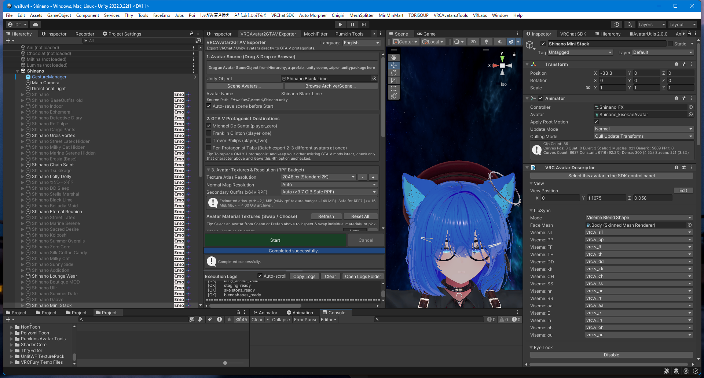
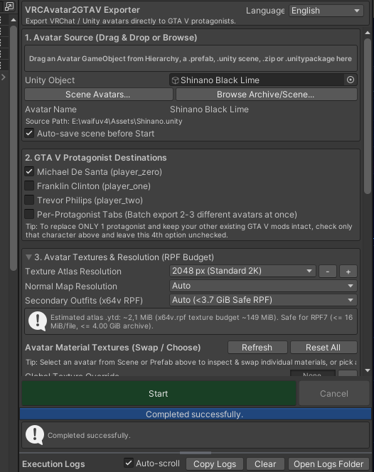
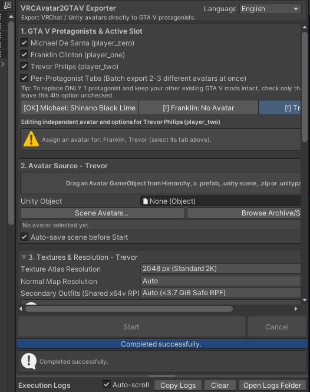
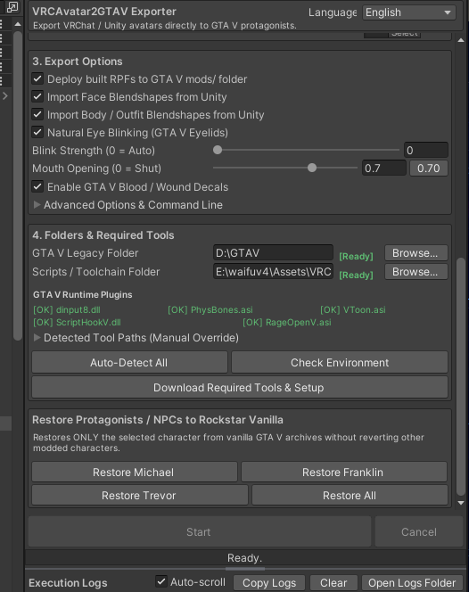

# Unity Editor UI ガイド (`VRCAvatar2GTAV Exporter`)

**言語 / Language / Idioma:** [English](UNITY_UI_GUIDE.md) | [Português (BR)](UNITY_UI_GUIDE.pt-BR.md) | **日本語** | [技術ガイド](DEPLOYMENT_GUIDE.ja.md) | [README](../README.ja.md)

**`VRCAvatar2GTAV Exporter`** ウィンドウは、BOOTH / VRChat 向けアバターを GTA V Legacy へ変換・導入する全工程を Unity Editor (`2022.3+`) 内で完結できる GUI です。特定のキャラクター名をハードコードせず、**あらゆる人型アバター**（しなの・ミルティナ・アイリ・マヌカ・ショコラなど）に対応しています。



---

## 1. プラグインのインストールと起動方法

1. `VRCAvatar2GTAV.unitypackage` をダブルクリックして Unity プロジェクトへインポートするか、CLI で非破壊インストールを実行します:
   ```bash
   python unity_plugin/install_unity_plugin.py --unity-project "/path/to/MyUnityProject"
   ```
   > **クリーンアップ付きアップデート:** `install_unity_plugin.py` は `Assets/VRCAvatar2GTAV/` 内の廃止済みファイル・古いフォルダ・孤立 `.meta` を自動整理しつつ、ローカルの `vrc2gtav.cfg` やカスタム `.json`/`.cfg` 設定は保持します。
2. Unity 上部メニューから **`Tools > VRCAvatar2GTAV > Export Avatar to GTA V`** を開きます。
3. 好みに応じて Inspector / Hierarchy の隣へタブをドッキングできます。右上の **`Language`** からいつでも **`Auto`** / **`English`** / **`Português`** / **`日本語`** を切り替えられます。

---

## 2. 共有モードと主人公別タブ切り替え

<div align="center">
<table>
  <tr>
    <td align="center" width="50%">
      <br>
      <sub><b>共有モード＆アバター選択</b></sub>
    </td>
    <td align="center" width="50%">
      <br>
      <sub><b>主人公別タブ (複数アバター一括出力)</b></sub>
    </td>
  </tr>
</table>
</div>

### アバター指定 (`Avatar Source`)
- **ドラッグ＆ドロップ領域:** Hierarchy 上の `GameObject`、`.prefab`、`.unity` シーン、`.zip`、`.unitypackage` をそのままドロップできます。
- **`Unity Object` / `Scene Avatars...`:** 現在開いている `.unity` シーン内のアバターを一覧からすぐ選択できます。
- **`Browse Archive/Scene...`:** 外部の `.unity` シーン・`.prefab`・`.zip`・`.unitypackage` をファイル選択ダイアログで指定します。
- **自動保存ガード:** **`Auto-save scene before Start`** を有効にするか、黄色い警告が出た際に **`Save Scene Now`** を押すことで、Blender / Python 側が最新の衣装オンオフ・Modular Avatar 設定・マテリアル・Scale を読み取れるようになります。

### 導入先の主人公スロット (`GTA V Protagonist Destinations`)
- **`Michael De Santa (`player_zero`)`**、**`Franklin Clinton (`player_one`)`**、**`Trevor Philips (`player_two`)`** から置換対象を選択します。
- **1 人だけの安全入れ替え:** 1 人のみにチェックを入れて 4 番目のタブオプションをオフのまま実行すると、**他の導入済み主人公 Mod を維持したまま対象 1 人だけを入れ替えられます**。
- **`Per-Protagonist Tabs (Batch export 2-3 different avatars at once)`:** Michael・Franklin・Trevor それぞれに独立した設定タブ（`[OK]` 設定済み / `[!]` 未設定）と **`Copy From...`** を表示します。実行時に `configs/active_multi_slots.json` を生成し、[`universal_gtav_builder.py`](../scripts/common_tools/universal_gtav_builder.py) `--slots-json` で連続ビルド＋1 回の RPF7 再パックを行います。

---

## 3. テクスチャ・RPF7 容量制御・エクスポート設定



### テクスチャと解像度 (`Avatar Textures & Resolution`)
- **`Texture Atlas Resolution`:** `512`、`1024`、`2048 px (Standard 2K)`（既定の `--mips 1` 単一ミップ `.ytd`）、`4096` を選択可能（`-` / `+` ボタン付き）。
- **`Normal Map Resolution`:** `Auto`、`Off (64 px)`、`256`、`512`、`1024`。
- **`Secondary Outfits (x64v RPF)`:** `Auto (<3.7 GiB Safe RPF)`、`512`、`1024`、`2048`。メイン `uppr_000` の画質を守りながら、`x64v.rpf` が **`4.00 GiB`** 上限およびリソース単体 **`16 MiB`** 上限を超えないように制御し、推定容量をリアルタイム表示します。
- **`Avatar Material Textures (Swap / Choose)`:** マテリアル単位の `_MainTex` / `_BaseMap` 確認・差し替えや **`Global Texture Override`**、**`Refresh`** / **`Reset All`** を行えます。

### エクスポート詳細設定 (`Export Options`)
- **`Deploy built RPFs to GTA V mods/ folder`:** RPF 再パックおよび `.asi` / `.ini` プロファイル配置まで自動で実施します。
- **`Import Face Blendshapes from Unity` / `Import Body / Outfit Blendshapes from Unity`:** シーンや `.prefab` の表情・目・`Shrink_*`・Modular Avatar `ShapeChanger` ウェイトをそのまま保持します。
- **`Natural Eye Blinking (GTA V Eyelids)` & `Blink Strength (0 = Auto)`:** 左右分割型 (`blink_left` + `blink_right`) を含むまばたき用ブレンドシェイプを検出し `GTAVPhysBones.asi` へ関連付けます。
- **`Mouth Opening (0 = Shut)`:** `FACIAL_jaw` リップシンク強度（`0.00`〜`1.00`）。アニメ調の顔に合う **既定値 `0.70`** と即座に戻せる **`0.70`** ボタンを備えています。
- **`Enable GTA V Blood / Wound Decals`:** `ped.sps` 向け `UVMap 1` 出血デカールを付与します（無効化時は `ped_default.sps`）。
- **`Advanced Options & Command Line` / `Execution Backend`:** 顔表情 `.anim` (`AnimationClip`) 指定、`auto | unity | cfg` ソース切替、Marshmallow PhysBones 有効化、再抽出強制、**`Auto` / `Windows Native` / `WSL`** 切替、CLI コマンドプレビューを利用できます。

---

## 4. フォルダ・ツール確認・バニラ復元・ログ

### フォルダと必須ツール (`Folders & Required Tools`)
- **`GTA V Legacy Folder`:** `GTA5.exe` のあるフォルダパス（**`[Ready]`** ステータス表示）。
- **`Scripts / Toolchain Folder`:** 同梱の `Assets/VRCAvatar2GTAV/Toolchain` を優先利用し、作業ファイルを **`<ProjectRoot>/VRCAvatar2GTAV_Work/`** へ分離して Unity の `Assets/` を汚しません。
- **`GTA V Runtime Plugins`:** **`dinput8.dll`**、**`PhysBones.asi`**、**`VToon.asi`**、**`ScriptHookV.dll`**、**`RageOpenV.asi`** (または `OpenIV.asi`) の導入状況をリアルタイム確認できます。
- **`Detected Tool Paths (Manual Override)` と各種ボタン:** `Python`・`Blender 4.0.2`・`rage-cli` の検出確認、`Auto-Detect All`、`Check Environment`（`setup_first_run.py --check-only`）、不足ツールの **`Download Required Tools & Setup`** を実行できます。

### バニラ復元 (`Restore Protagonists / NPCs to Rockstar Vanilla`)
- **`Restore Michael`**, **`Restore Franklin`**, **`Restore Trevor`**, **`Restore All`**: 他の導入済みキャラクターや NPC を壊さずに、選択した Ped のオリジナルファイルのみを Rockstar RPF から復元し、`GTAVPhysBones.ini`・`GTAVVToon.ini`・`configs/npc_registry.json` から該当項目だけを削除します。

### 実行・進行状況・実行ログ (`Execution Logs`)
- **`Start` / `Cancel`:** 変換・配置の開始および子プロセスの安全な中断。
- **比例進捗バー:** `[PROGRESS pct=...]` を解析し、複数スロット（0–82% ビルド ＋ 82–100% RPF7 梱包）の進捗を滑らかに表示します。
- **実行ログ操作:** **`Auto-scroll`**、**`Copy Logs`**、**`Clear`**、`VRCAvatar2GTAV_Work/logs/` を開く **`Open Logs Folder`**、およびログ枠の高さドラッグ調整に対応しています。

---

## 5. 生成される `.cfg` ファイル名と先頭コメント

ビルド時にブレンドシェイプや PhysBones の `.cfg` が書き出される場合:
- Unity シーン / `.prefab` 指定時は **`.unity` シーン名**（例: `Shinano_blendshapes.cfg`・`Shinano_physbones.cfg`）が使われます。
- CLI アーカイブ指定時（`--avatar-zip` 等）は **`.zip` / `.unitypackage` のファイル名語幹**が使われます。
- すべての生成 `.cfg` 先頭には、生成日時（`# Generated:`）、プロジェクト（`# Project:`）、シーン（`# Scene:`、該当時）、アーカイブ（`# Archive:`、該当時）、メイン FBX 名（`# FBX:`）を記載した `#` コメント行が付与されます。
