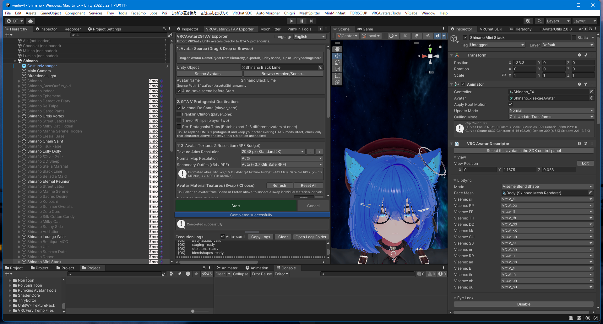
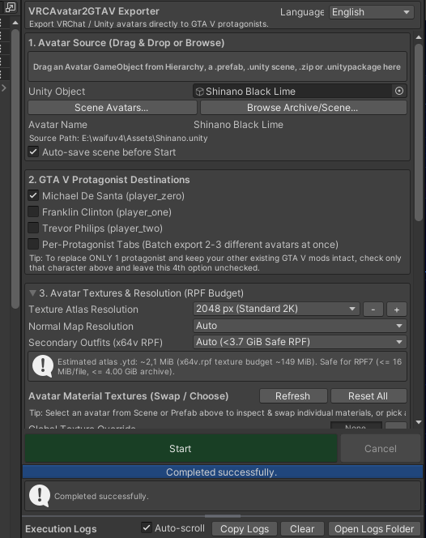
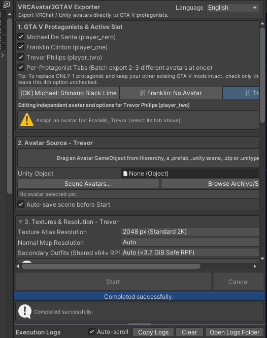
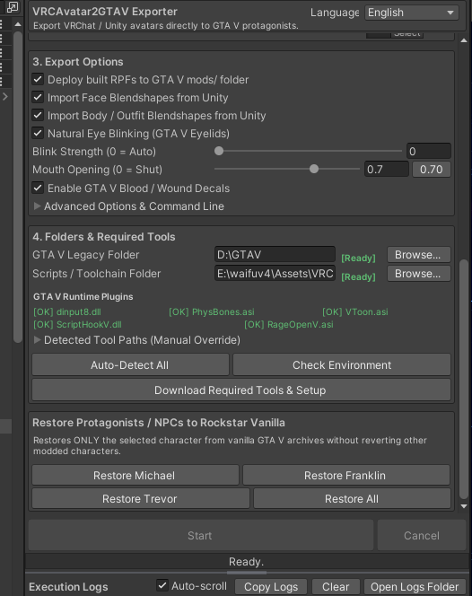

# Unity Editor UI Guide (`VRCAvatar2GTAV Exporter`)

**Language / Idioma / 言語:** **English** | [Português (BR)](UNITY_UI_GUIDE.pt-BR.md) | [日本語](UNITY_UI_GUIDE.ja.md) | [Technical Guide](DEPLOYMENT_GUIDE.md) | [README](../README.md)

The **`VRCAvatar2GTAV Exporter`** window integrates the entire Booth / VRChat avatar-to-GTA V pipeline directly inside the Unity Editor (`2022.3+`), supporting **any humanoid VRChat avatar** (Shinano, Miltina, Airi, Manuka, Chocolat, etc.) without hardcoded character names.



---

## 1. Installing & Opening the Plugin

1. Double-click `VRCAvatar2GTAV.unitypackage` in your Unity project (or install non-destructively from CLI):
   ```bash
   python unity_plugin/install_unity_plugin.py --unity-project "/path/to/MyUnityProject"
   ```
   > **Clean upgrades:** Running `install_unity_plugin.py` removes retired files, stale directories, and orphaned `.meta` files inside `Assets/VRCAvatar2GTAV/` while preserving your local `vrc2gtav.cfg` and custom `.json`/`.cfg` configurations.
2. In the Unity menu bar, open **`Tools > VRCAvatar2GTAV > Export Avatar to GTA V`**.
3. Dock the **`VRCAvatar2GTAV Exporter`** panel next to your Inspector/Hierarchy if desired. Use the **`Language`** selector in the top-right corner (`Auto`, `English`, `Português`, `日本語`) at any time.

---

## 2. Shared Mode vs. Per-Protagonist Tabs

<div align="center">
<table>
  <tr>
    <td align="center" width="50%">
      <br>
      <sub><b>Shared Mode &amp; Avatar Source</b></sub>
    </td>
    <td align="center" width="50%">
      <br>
      <sub><b>Per-Protagonist Tabs (Batch Multi-Slot)</b></sub>
    </td>
  </tr>
</table>
</div>

### Avatar Source (`Drag & Drop or Browse`)
- **Drag & Drop Zone:** Drag any active or inactive avatar `GameObject` from the Unity Hierarchy, a `.prefab` asset, a `.unity` scene, a `.zip` archive, or a `.unitypackage` directly onto the box.
- **`Unity Object` / `Scene Avatars...`:** Pick any avatar in the currently open scene without searching folders manually.
- **`Browse Archive/Scene...`:** Select an external `.unity` scene, `.prefab`, `.zip`, or `.unitypackage`.
- **Auto-Save Protection:** Keep **`Auto-save scene before Start`** checked (or click **`Save Scene Now`** when alerted) so Blender and the Python extractor always read your latest enabled outfits, Modular Avatar toggles, materials, and transforms on disk.

### GTA V Protagonist Destinations
- **`Michael De Santa (`player_zero`)`**, **`Franklin Clinton (`player_one`)`**, **`Trevor Philips (`player_two`)`**: Choose which protagonist slot(s) to replace.
- **Single-Slot Replacement:** Checking only one protagonist (while leaving the 4th option unchecked) exports into that slot **without overwriting or reverting the other two modded protagonists** in GTA V.
- **`Per-Protagonist Tabs (Batch export 2-3 different avatars at once)`:** Enables independent configuration tabs (`[OK]` assigned / `[!]` needs avatar) for Michael, Franklin, and Trevor, plus **`Copy From...`** to clone settings between slots. When started, the UI writes `configs/active_multi_slots.json` and runs [`universal_gtav_builder.py`](../scripts/common_tools/universal_gtav_builder.py) `--slots-json` in one batch with a single RPF7 repack.

---

## 3. Textures, RPF7 Budget & Export Options



### Avatar Textures & Resolution (RPF Budget)
- **`Texture Atlas Resolution`:** `512`, `1024`, `2048 px (Standard 2K)` (default single-mip `.ytd` lock via `--mips 1`), or `4096` (with quick `-` / `+` step buttons).
- **`Normal Map Resolution`:** `Auto`, `Off (64 px)`, `256`, `512`, or `1024`.
- **`Secondary Outfits (x64v RPF)`:** `Auto (<3.7 GiB Safe RPF)`, `512`, `1024`, or `2048`. Keeps primary `uppr_000` crisp while ensuring `x64v.rpf` never exceeds GTA V's **`4.00 GiB`** archive cap or **`16 MiB`** per-resource ceiling. A live estimator box updates as you change settings.
- **`Avatar Material Textures (Swap / Choose)`:** Inspect material `_MainTex` / `_BaseMap` assignments on the selected avatar, swap individual material textures, apply a **`Global Texture Override`**, or click **`Refresh`** / **`Reset All`**.

### Export Options & Advanced Settings
- **`Deploy built RPFs to GTA V mods/ folder`:** Automatically repacks and copies `.rpf` archives and runtime `.asi`/`.ini` profiles to your GTA V folder.
- **`Import Face Blendshapes from Unity` / `Import Body / Outfit Blendshapes from Unity`:** Preserves facial expressions, eye calibration, and body/outfit `Shrink_*` / Modular Avatar `ShapeChanger` weights directly from your scene or `.prefab`.
- **`Natural Eye Blinking (GTA V Eyelids)` & `Blink Strength (0 = Auto)`:** Maps upper/lower eyelid blink blendshapes automatically (including split left/right blink keys) to `GTAVPhysBones.asi`.
- **`Mouth Opening (0 = Shut)`:** Controls `FACIAL_jaw` lip-sync amplitude from `0.00` to `1.00`. Defaults to **`0.70`** (with a one-click **`0.70`** reset button) for natural anime dialogue proportions.
- **`Enable GTA V Blood / Wound Decals`:** Adds `ped.sps` damage UV zone mapping (`UVMap 1`), or uncheck for `ped_default.sps`.
- **`Advanced Options & Command Line` / `Execution Backend`:** Override facial expressions with an `AnimationClip` (`--face-anim`), select `auto | unity | cfg` blendshape/PhysBone sources, enable optional Marshmallow PhysBones, force re-extraction, switch **`Auto` / `Windows Native` / `WSL`**, and preview the generated CLI command.

---

## 4. Folders, Required Tools, Vanilla Restore & Logs

### Folders & Required Tools
- **`GTA V Legacy Folder`:** Path to your `GTA5.exe` installation. Shows live **`[Ready]`** status.
- **`Scripts / Toolchain Folder`:** Automatically prefers the embedded `Assets/VRCAvatar2GTAV/Toolchain` copy and redirects build artifacts to **`<ProjectRoot>/VRCAvatar2GTAV_Work/`** so your `Assets/` folder stays clean.
- **`GTA V Runtime Plugins`:** Live `[OK]` / missing pills for **`dinput8.dll`**, **`PhysBones.asi`**, **`VToon.asi`**, **`ScriptHookV.dll`**, and **`RageOpenV.asi`** (or `OpenIV.asi`).
- **`Detected Tool Paths (Manual Override)` + Quick Actions:** View or override `Python`, `Blender 4.0.2`, and `rage-cli`, click **`Auto-Detect All`**, run **`Check Environment`** (`setup_first_run.py --check-only`), or click **`Download Required Tools & Setup`** to fetch missing tools automatically.

### Restore Protagonists / NPCs to Rockstar Vanilla
- **`Restore Michael`**, **`Restore Franklin`**, **`Restore Trevor`**, **`Restore All`**: Selectively restores original Rockstar files from vanilla RPFs for just the chosen character(s) and cleans only their sections in `GTAVPhysBones.ini`, `GTAVVToon.ini`, and `configs/npc_registry.json`, leaving other modded peds intact.

### Running, Progress Bar & Execution Logs
- **`Start` / `Cancel`:** Starts the build or cleanly terminates child processes.
- **Proportional Progress Bar:** Tracks `[PROGRESS pct=...]` markers across `1–3` protagonist slots (`0–82%` per slot + `82–100%` RPF packaging).
- **Execution Logs:** Toggle **`Auto-scroll`**, copy output with **`Copy Logs`**, **`Clear`**, open `VRCAvatar2GTAV_Work/logs/` via **`Open Logs Folder`**, or drag the horizontal splitter bar to resize the log area.

---

## 5. Generated `.cfg` Naming & Headers

Whenever blendshape or PhysBone presets are exported during a build:
- In Unity scene / prefab mode, `.cfg` filenames use the **Unity `.unity` scene name** (for example, `Shinano_blendshapes.cfg` and `Shinano_physbones.cfg`).
- In CLI archive mode (`--avatar-zip`), `.cfg` filenames use the **archive stem** (without `.zip` / `.unitypackage`).
- Every generated `.cfg` starts with `#` header comments recording generation timestamp (`# Generated:`), project path (`# Project:`), Unity scene (`# Scene:`, when applicable), archive (`# Archive:`, when applicable), and primary FBX filename (`# FBX:`).
