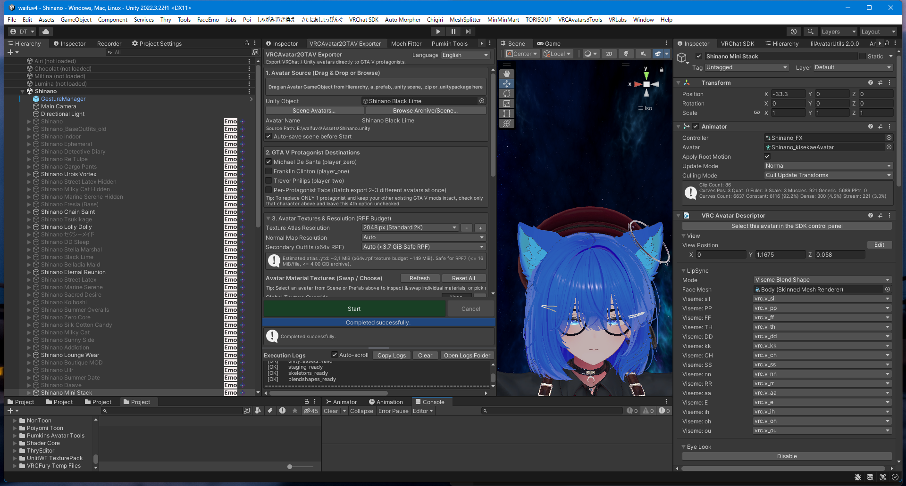
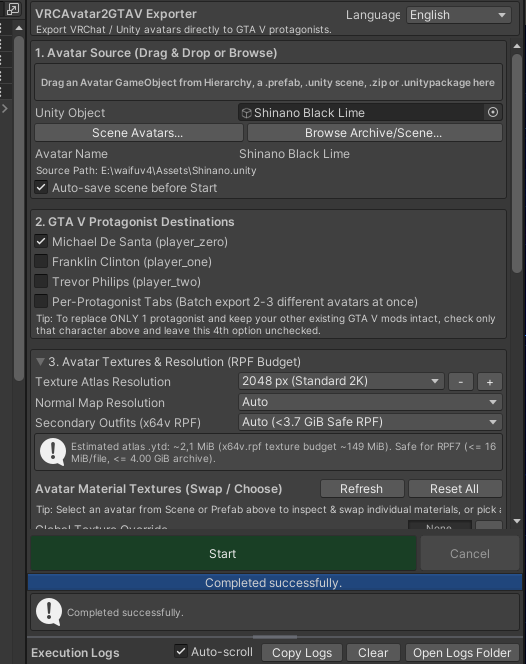
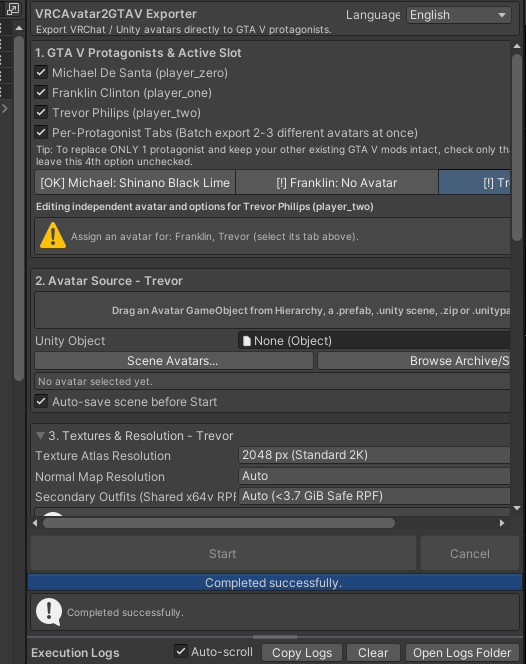
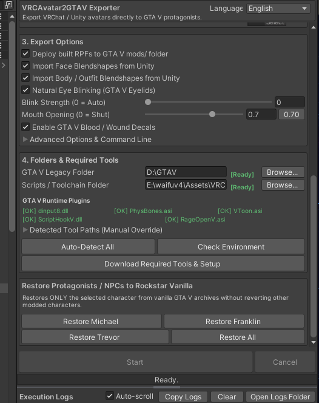

# Guia da Interface no Unity Editor (`VRCAvatar2GTAV Exporter`)

**Idioma / Language / 言語:** [English](UNITY_UI_GUIDE.md) | **Português (BR)** | [日本語](UNITY_UI_GUIDE.ja.md) | [Guia Técnico](DEPLOYMENT_GUIDE.pt-BR.md) | [README](../README.pt-BR.md)

A janela **`VRCAvatar2GTAV Exporter`** integra todo o pipeline de conversão de avatares VRChat/BOOTH para o GTA V diretamente no Unity Editor (`2022.3+`), com suporte a **qualquer avatar humanoide** (Shinano, Miltina, Airi, Manuka, Chocolat, etc.) sem nomes fixos em código.



---

## 1. Instalação e Abertura do Plugin

1. Dê um duplo clique em `VRCAvatar2GTAV.unitypackage` dentro do seu projeto Unity (ou execute o instalador não destrutivo via CLI):
   ```bash
   python unity_plugin/install_unity_plugin.py --unity-project "/caminho/MeuProjetoUnity"
   ```
   > **Atualizações limpas:** O `install_unity_plugin.py` remove automaticamente arquivos antigos descontinuados, pastas obsoletas e `.meta`s órfãos em `Assets/VRCAvatar2GTAV/` sem apagar seu `vrc2gtav.cfg` nem seus `.json`/`.cfg` locais.
2. No menu superior do Unity, abra **`Tools > VRCAvatar2GTAV > Export Avatar to GTA V`**.
3. Ancore a aba **`VRCAvatar2GTAV Exporter`** ao lado do Inspector ou Hierarchy se desejar. Use o seletor **`Language`** no canto superior direito (`Auto`, `Português`, `English`, `日本語`) para trocar o idioma da interface na hora.

---

## 2. Modo Compartilhado vs. Abas por Protagonista

<div align="center">
<table>
  <tr>
    <td align="center" width="50%">
      <br>
      <sub><b>Modo Compartilhado e Origem do Avatar</b></sub>
    </td>
    <td align="center" width="50%">
      <br>
      <sub><b>Abas por Protagonista (Lote Multi-Slot)</b></sub>
    </td>
  </tr>
</table>
</div>

### Origem do Avatar (`Avatar Source`)
- **Área de Arrastar e Soltar:** Arraste um `GameObject` da Hierarchy, um `.prefab`, uma cena `.unity`, um `.zip` ou um `.unitypackage` direto para o quadro.
- **`Unity Object` / `Scene Avatars...`:** Lista e seleciona avatares da cena aberta sem precisar procurar arquivos em pastas.
- **`Browse Archive/Scene...`:** Seleciona manualmente uma cena `.unity`, `.prefab`, `.zip` ou `.unitypackage`.
- **Proteção de Auto-Salvamento:** Mantenha **`Auto-save scene before Start`** marcado (ou clique em **`Save Scene Now`** quando o alerta amarelo aparecer) para garantir que o extrator Python e o Blender leiam exatamente as roupas, toggles do Modular Avatar, materiais e escalas atuais.

### Destinos de Protagonistas do GTA V
- **`Michael De Santa (`player_zero`)`**, **`Franklin Clinton (`player_one`)`**, **`Trevor Philips (`player_two`)`**: Marque qual(is) protagonista(s) deseja substituir.
- **Troca Individual Sem Apagar os Outros:** Ao marcar apenas 1 protagonista (deixando a 4ª opção desmarcada), somente aquele personagem é atualizado — os outros dois protagonistas já moddados permanecem intactos no GTA V.
- **`Per-Protagonist Tabs (Batch export 2-3 different avatars at once)`:** Abre abas independentes (`[OK]` configurado / `[!]` sem avatar) para Michael, Franklin e Trevor, com botão **`Copy From...`** para copiar ajustes entre abas. Ao clicar em **`Start`**, a UI grava `configs/active_multi_slots.json` e executa o [`universal_gtav_builder.py`](../scripts/common_tools/universal_gtav_builder.py) `--slots-json` em sequência com empacotamento RPF7 único.

---

## 3. Texturas, Orçamento RPF7 e Opções de Exportação



### Texturas do Avatar e Resolução (`Avatar Textures & Resolution`)
- **`Texture Atlas Resolution`:** Escolha entre `512`, `1024`, `2048 px (Standard 2K)` (padrão `.ytd` de textura única travada com `--mips 1`) ou `4096` (com botões `-` / `+`).
- **`Normal Map Resolution`:** `Auto`, `Off (64 px)`, `256`, `512` ou `1024`.
- **`Secondary Outfits (x64v RPF)`:** `Auto (<3.7 GiB Safe RPF)`, `512`, `1024` ou `2048`. Mantém o `uppr_000` principal nítido evitando ultrapassar o limite de **`4.00 GiB`** do `x64v.rpf` ou **`16 MiB`** por recurso. A estimativa ao vivo atualiza automaticamente.
- **`Avatar Material Textures (Swap / Choose)`:** Inspecione e troque texturas `_MainTex` / `_BaseMap` por material, aplique um **`Global Texture Override`** ou use **`Refresh`** / **`Reset All`**.

### Opções de Exportação e Avançado
- **`Deploy built RPFs to GTA V mods/ folder`:** Reempacota os RPFs e copia automaticamente arquivos + `.asi`/`.ini` para o GTA V.
- **`Import Face Blendshapes from Unity` / `Import Body / Outfit Blendshapes from Unity`:** Preserva expressões faciais, olhos e pesos `Shrink_*` / Modular Avatar `ShapeChanger` direto da cena ou `.prefab`.
- **`Natural Eye Blinking (GTA V Eyelids)` e `Blink Strength (0 = Auto)`:** Mapeia automaticamente os *blendshapes* de piscar (inclusive pares esquerdo/direito separados) para o `GTAVPhysBones.asi`.
- **`Mouth Opening (0 = Shut)`:** Ajusta a abertura mandibular (`FACIAL_jaw`) de `0.00` a `1.00`. O padrão é **`0.70`** (com botão rápido **`0.70`** ao lado para restaurar) para proporções faciais naturais de anime.
- **`Enable GTA V Blood / Wound Decals`:** Ativa projeção `UVMap 1` de sangue (`ped.sps`), ou desmarque para usar `ped_default.sps`.
- **`Advanced Options & Command Line` / `Execution Backend`:** Permite escolher um `AnimationClip` facial (`--face-anim`), fonte `auto | unity | cfg` de *blendshapes* e PhysBones, ativar Marshmallow PhysBones opcional, alternar **`Auto` / `Windows Native` / `WSL`** e visualizar o comando gerado.

---

## 4. Pastas, Ferramentas, Restauração Vanilla e Logs

### Pastas e Ferramentas (`Folders & Required Tools`)
- **`GTA V Legacy Folder`:** Pasta da instalação onde está o `GTA5.exe`, com badge **`[Ready]`**.
- **`Scripts / Toolchain Folder`:** Usa prioritariamente a cópia embutida `Assets/VRCAvatar2GTAV/Toolchain` e grava saídas temporárias em **`<RaizDoProjeto>/VRCAvatar2GTAV_Work/`** sem poluir seu `Assets/`.
- **`GTA V Runtime Plugins`:** Pílulas verdes `[OK]` (ou faltantes) para **`dinput8.dll`**, **`PhysBones.asi`**, **`VToon.asi`**, **`ScriptHookV.dll`** e **`RageOpenV.asi`** (ou `OpenIV.asi`).
- **`Detected Tool Paths (Manual Override)` + Botões Rápidos:** Confira ou substitua `Python`, `Blender 4.0.2` e `rage-cli`, clique em **`Auto-Detect All`**, valide tudo com **`Check Environment`** (`setup_first_run.py --check-only`) ou baixe ferramentas faltantes com **`Download Required Tools & Setup`**.

### Restaurar Protagonistas ao Original (`Restore Vanilla`)
- **`Restore Michael`**, **`Restore Franklin`**, **`Restore Trevor`**, **`Restore All`**: Extrai dos RPFs originais da Rockstar **apenas** os arquivos do ped escolhido e limpa somente as entradas dele em `GTAVPhysBones.ini`, `GTAVVToon.ini` e `configs/npc_registry.json`, mantendo intactos os outros personagens moddados.

### Execução, Barra de Progresso e Logs
- **`Start` / `Cancel`:** Inicia a compilação ou encerra os processos em andamento com segurança.
- **Barra de Progresso Proporcional:** Lê marcadores `[PROGRESS pct=...]` entre `1–3` slots (`0–82%` dos builds + `82–100%` do empacotamento RPF7).
- **Console de Logs (`Execution Logs`):** Controle **`Auto-scroll`**, **`Copy Logs`**, **`Clear`**, abra `VRCAvatar2GTAV_Work/logs/` com **`Open Logs Folder`** ou arraste a barra divisória horizontal para redimensionar os logs.

---

## 5. Nomenclatura e Cabeçalho dos Arquivos `.cfg`

Sempre que arquivos `.cfg` de *blendshapes* ou PhysBones são exportados durante o build:
- No fluxo por cena Unity / `.prefab`, os `.cfg`s recebem o **nome da cena `.unity`** (ex.: `Shinano_blendshapes.cfg` e `Shinano_physbones.cfg`).
- No fluxo via linha de comando com `.zip`/`.unitypackage`, recebem o **nome-base do arquivo `.zip`/`.unitypackage`**.
- Todos os `.cfg`s gerados começam com linhas de comentário `#` indicando data/hora (`# Generated:`), projeto (`# Project:`), cena (`# Scene:`, quando aplicável), arquivo compacto (`# Archive:`, quando aplicável) e `.fbx` principal (`# FBX:`).
